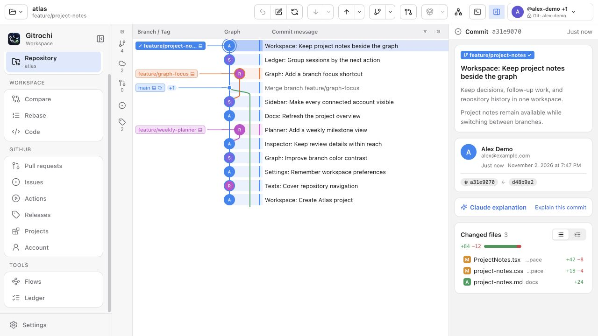
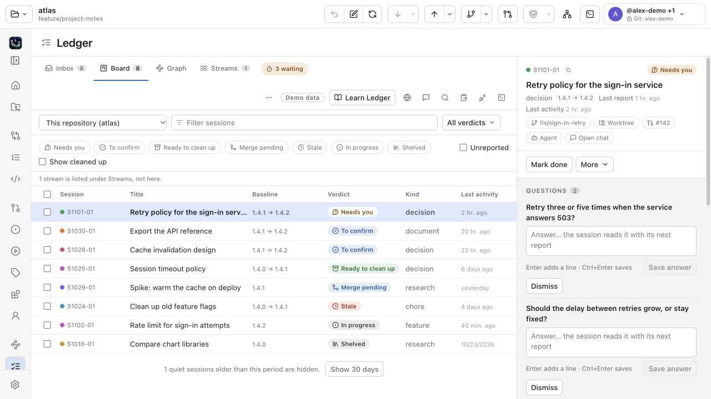

  

<h1 align="center">Gitrochi</h1>

  <b>Git の履歴、接続先の仕事、エージェントの進捗をひとつの作業画面に。</b> 
  macOS · Windows

  <a href="README.md">English</a> · <a href="README.ko.md">한국어</a> · 日本語

  
  
  
  
  

  <a href="https://github.com/Gitrochi/Gitrochi/releases/latest"><b>ダウンロード</b></a>
  &nbsp;·&nbsp; <a href="docs/features.md">使い方と機能</a>
  &nbsp;·&nbsp; <a href="docs/ledger/README.md">Ledger ガイド</a>
  &nbsp;·&nbsp; <a href="docs/flow/README.md">Flows ガイド</a>

  <picture>
    <source media="(prefers-color-scheme: dark)" srcset="docs/images/workspace-dark.jpg">
    
  </picture>

Windows 版の画面部品をブラウザーで表示したプレビューです。リポジトリとプロフィールには架空のデータを使っています。

Gitrochi は macOS と Windows 向けの Git クライアントです。コミットグラフを見ながら、変更の確認・ステージ・コミット・ブランチ操作・レビューを進められます。GitHub / GitLab の PR・Issue・プロジェクト、エージェントの報告と質問をまとめる **Ledger**、チェックと実行手順を組み立てる **Flows** も同じ画面から開けます。Git 操作にはシステムの `git` を使います。

**0.3.14 の作業画面**では、起動直後からページを選べます。リポジトリが必要なページには選択画面が表示されます。右上のアカウントメニューには複数のアカウントとサーバーをまとめて表示し、プロフィール画像も確認できます。サイドバーは内容と一緒になめらかに開閉し、OS の「動きを減らす」設定に従います。

## できること

- **履歴を読み、変更をコミット** — ブランチごとの色、作者画像、CI の状態、ワークツリーの変更をグラフで確認。ファイル・ハンク・行単位のステージ、左右の diff、コンフリクト解決、コミット整理、直前の操作の取り消しに対応します。
- **ホームから仕事を探す** — 最近のリポジトリ、接続先のリポジトリ検索、プロジェクトの予定を確認。13 の移動先（Home、Repository、Compare、Rebase、Code、PR/MR、Issues、Actions/Pipelines、Releases、Projects、Account、Flows、Ledger）は最初から選択できます。ローカルのツールにはリポジトリを選んでから進みます。
- **複数アカウントを見分ける** — 右上のメニューで接続済みプロフィールと登録済み Git アカウントを、サーバー名と画像で確認。画像の取得をオフにした場合や取得できない場合は、イニシャルなどの代替表示を使います。コミット作者・push に使う Git アカウントと、PR・Issue 用のホスティング接続は別々に確認できます。保存済み認証情報がロックされている場合は、そのアクセスを許可して再試行できます。
- **GitHub / GitLab の仕事を進める** — PR/MR の会話・行レビュー・承認、Issue のコメントや状態変更、GitHub Actions と GitLab パイプラインを操作。Account ページには **Inbox・My work・Organizations（GitLab は Groups）**、リリースとプロジェクトにはそれぞれ **Releases・Projects** ページがあります。アカウント全体と現在のリポジトリの範囲も選べます。
- **Ledger で報告と質問を整理** — **Tools › Ledger** からいつでも開き、セッションの開始時点、報告、回答待ち、完了確認と片付けを Inbox・Board・Graph・Streams で追えます。チュートリアルとガイドも内蔵しています。ページを開くだけで会話が自動取り込みされることはありません。任意のエージェント追跡・バックグラウンド通知・バッジには、起動時の `GITROCHI_LEDGER_PREVIEW=1` と各設定での有効化が必要です。追跡は初期状態ではオフです。[Ledger ガイド](docs/ledger/README.md)で接続方法を確認できます。
- **Flows でチェックと実行手順をまとめる** — **Code** で `.gitch/flow.yml` を編集し、依存関係のプレビュー、実行履歴、各ステップの結果を確認。モジュールの設定や GitLab CI・GitHub Actions・Jenkins との接続も扱えます。レビューして信頼した手順を、アプリ・`gitch flow`・push 前のチェックで使います。[Flows ガイド](docs/flow/README.md)。
- **ターミナルとエージェントを併用** — リポジトリ内のシェルをタブと分割ペインで開き、Claude Code・Codex・Gemini CLI を利用。AI にコミット文・PR 文や選択した変更について質問でき、同梱の **gitch** はリポジトリごとの Git アカウントとチェックを管理します。[CLI の使い方](docs/cli-workflows.md)。

  <picture>
    <source media="(prefers-color-scheme: dark)" srcset="docs/images/readme-ledger-dark.jpg">
    
  </picture> 
  Ledger で報告・質問・次の作業をまとめて確認できます。

## はじめる

1. **ローカルの Git を用意する。** macOS は Xcode Command Line Tools、Windows は Git for Windows を導入します。Settings › Tools で実行ファイルを確認できます。Git の作者や複数アカウントの設定は、同梱 gitch の案内から進められます。ローカルの履歴確認やコミットにホスティング接続は不要です。
2. **必要ならホスティングアカウントを接続する。** 右上のアカウントメニューから GitHub またはセルフホスト GitLab を接続します。PR・Issue などのサーバー機能で使う接続です。
3. **リポジトリを開く。** Home の **Open repository…** からローカルフォルダを選ぶか、接続先を検索してクローンします。
4. **変更を確認してコミットする。** グラフで履歴を選び、差分を読んで必要な部分をステージします。push 前にはアカウント・送信先・変更内容を確認します。
5. **仕事に合わせてページを選ぶ。** Compare・Code・PR・Issues・Projects、または Tools の Ledger・Flows を開きます。使い方は各ページとガイドから確認できます。

## ダウンロードとインストール

[最新リリース](https://github.com/Gitrochi/Gitrochi/releases/latest)から OS に合うファイルを選んでください。

| OS | ファイルと手順 | 必要なもの |
| --- | --- | --- |
| **macOS 15 以降** · Apple Silicon / Intel | `Gitrochi-<version>-macOS.dmg` を開き、`Gitrochi.app` をアプリケーションへ移動 | システムの `git`（Xcode または `xcode-select --install`） |
| **Windows 10 (1809) 以降 / 11** · x64 | `Gitrochi_<version>_x64-setup.exe` を実行。インストール不要なら `_x64_portable.zip` | [Git for Windows](https://git-scm.com/download/win)。インストーラーは必要に応じて WebView2 を導入 |

macOS のビルドはまだ公証されていません。ブロックされた場合は、**システム設定 → プライバシーとセキュリティ → このまま開く**で許可するか、`xattr -dr com.apple.quarantine /Applications/Gitrochi.app` を実行します。Windows の SmartScreen に止められた場合は、**詳細情報 → 実行**から進めます。

自動更新の確認は設定で変更できます。有効な場合は起動時と 1 日に 1 回確認し、公開リリースの更新を署名検証後に適用します。インストールするタイミングは自分で選べます。macOS ではダウンロードの SHA-256 も確認します。ソースからのビルド手順は [CONTRIBUTING.md](CONTRIBUTING.md) にあります。

## ガイドと開発

- [機能・使い方・ショートカット](docs/features.md)
- [Ledger：接続、質問への回答、報告と完了確認](docs/ledger/README.md)
- [Flows：YAML、依存関係、実行と CI 接続](docs/flow/README.md)
- [gitch と CLI の作業手順](docs/cli-workflows.md)
- [開発環境と貢献](CONTRIBUTING.md) · [アーキテクチャ](docs/architecture.md)
- [コード規則](docs/code-style.md) · [Git と PR の規則](docs/git-workflow.md) · [AGENTS.md](AGENTS.md) / [CLAUDE.md](CLAUDE.md)

主な開発者向け文書は英語です。保存先・追跡・通知などの Ledger の設定はガイドに記載しています。保存された認証情報は macOS の Keychain / Windows の Credential Manager で管理します。リポジトリ AI・MCP には Node.js 22 以降、LFS 操作には Git LFS が必要です。実サーバーへの書き込み、LFS ロック、Windows 実機へのインストールは利用環境での確認が必要です。[実装と検証範囲](docs/complete-workflows-validation.md)も参照してください。

## フィードバック

- [バグ報告](https://github.com/Gitrochi/Gitrochi/issues/new?template=bug_report.yml) · [機能要望](https://github.com/Gitrochi/Gitrochi/issues/new?template=feature_request.yml) · [質問](https://github.com/Gitrochi/Gitrochi/issues/new?template=question.yml)
- セキュリティの問題は Issue ではなく[非公開で](SECURITY.md)

## ライセンス

[Gitrochi Community Use License v1.0](LICENSE) は**提案段階で、まだ発効していません**。個人・企業の無料利用を認め、無断の再販売や独立した派生プロジェクトの配布を制限し、貢献は公式リポジトリへのプルリクエストで受け付ける内容です。発効に必要な権利者の同意と法的な詳細は[ライセンス移行の検討記録](docs/licensing-review.md)（韓国語）に記録しています。

© 2026 ChoMnSeong, [jjunhaa0211](https://github.com/jjunhaa0211)。独立した MIT ライセンスファイルと MIT の表示は削除しました。すでに MIT で提供されたコードの権利と、必要な[過去の資料に関する通知](THIRD_PARTY_NOTICES.md#prior-mit-covered-gitrochi-material)は維持されます。採択後も、配布制限のある source-available ポリシーであり、オープンソースライセンスではありません。

同梱：[SwiftTerm](https://github.com/migueldeicaza/SwiftTerm)（MIT）。Windows 版は [Tauri](https://tauri.app)、[React](https://react.dev)、[xterm.js](https://xtermjs.org)、[portable-pty](https://github.com/wezterm/wezterm)、[Lucide](https://lucide.dev) の上に作られており、それぞれのライセンスに従います。提案ライセンスはこれらサードパーティコードの権利を制限しません — [サードパーティ通知と依存関係レビュー](THIRD_PARTY_NOTICES.md)（英語）。Rust 依存関係の配布対象ごとの完全な通知レビューはまだ完了していません。
