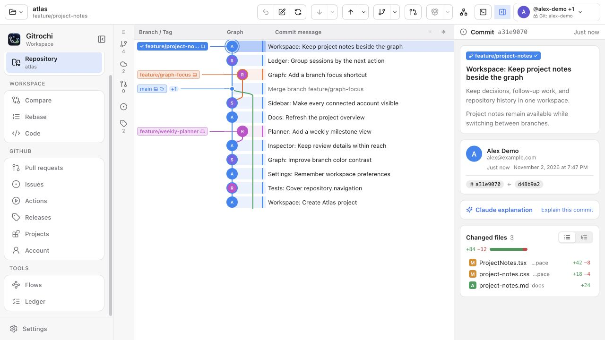
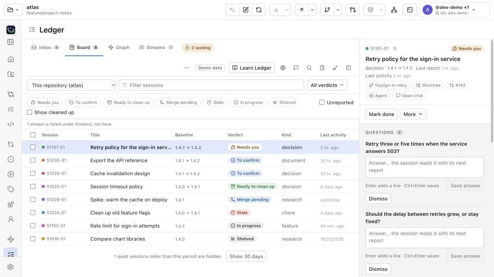

  

<h1 align="center">Gitrochi</h1>

  <b>Git 기록부터 프로젝트 작업과 AI 세션까지, 한 작업 공간에서.</b> 
  macOS · Windows

  <a href="README.md">English</a> · 한국어 · <a href="README.ja.md">日本語</a>

  
  
  
  
  

  <a href="https://github.com/Gitrochi/Gitrochi/releases/latest"><b>⬇&nbsp; 내려받기</b></a>
  &nbsp;·&nbsp; <a href="docs/features.md">사용법과 기능(영어)</a>
  &nbsp;·&nbsp; <a href="CONTRIBUTING.md">기여(영어)</a>

  <picture>
    <source media="(prefers-color-scheme: dark)" srcset="docs/images/workspace-dark.jpg">
    
  </picture>

Gitrochi 0.3.14는 macOS와 Windows에서 Git 기록, 프로젝트 작업, AI 세션을 한곳에 모읍니다. 그래프를 살펴보고 변경을 스테이지·커밋하며, 요청을 리뷰하고 검사를 실행하고 에이전트의 진행 상황을 확인할 수 있습니다. Git 작업은 시스템의 `git`이 처리합니다.

*스크린샷은 예제 데이터를 넣은 Windows 인터페이스이며, 앱의 실제 화면 구성 요소를 브라우저에서 렌더링했습니다.*

## 할 수 있는 일

- **홈에서 계획하기** — 저장소 열기·복제, 최근 작업 돌아가기, 연결한 서버의 저장소 검색, 프로젝트 할 일의 일정·계획 보기를 제공합니다.
- **Git 작업하기** — 브랜치별 그래프, 작성자 사진과 CI 상태를 확인하고 파일·덩어리·줄 단위로 스테이지합니다. diff 비교, 충돌 해결, 브랜치 끌어놓기, 커밋 정리와 되돌리기를 지원합니다. 저장소 화면에는 그래프·터미널·변경 내용이 함께 있습니다.
- **연결된 작업 리뷰하기** — GitHub PR과 사내 GitLab MR을 만들고 리뷰하며, 이슈 대화와 Actions·파이프라인을 확인합니다. **릴리스**와 **프로젝트**는 별도 페이지이고, **계정** 페이지에는 수신함·내 작업·조직 또는 그룹이 있습니다.
- **여러 계정을 한눈에 보기** — 툴바 메뉴에 연결한 프로필과 등록된 Git 계정을 서버 이름·사용 가능한 사진과 함께 표시합니다. 저장소의 호스팅 계정을 고르면서 Git 작성자도 확인할 수 있습니다. 저장된 인증 정보를 읽지 못하면 계정을 유지한 채 접근을 복원하고 다시 시도합니다. 사진은 가져오기 설정을 따르며, 사용할 수 없으면 이니셜을 표시합니다.
- **원장에서 작업 따라가기** — 세션의 기준 버전·보고·질문·인계를 수신함, 보드, 그래프, 스트림에서 확인합니다. 앱 안의 사용법 연습, 작업 기록, 문서 추적기, 노트도 제공합니다. **원장(Ledger)은 미리보기 플래그 없이 도구 메뉴에 표시됩니다.** 보고 클라이언트 연결과 기존 기록 가져오기는 직접 선택합니다. [원장 안내](docs/ledger/README.md)(영어)
- **흐름 만들고 실행하기** — Code에서 `.gitch/flow.yml`을 편집하고 의존 관계, 실행 기록과 테스트 결과를 확인하며 모듈·CI 연결을 설정합니다. 앱이나 `gitch flow`에서 로컬·Docker·지원하는 CI 서비스를 실행하고, 실패 시 설정된 되돌리기 단계를 수행합니다. [흐름 안내](docs/flow/README.md)(영어)
- **AI와 터미널 함께 쓰기** — Claude Code·Codex·Gemini CLI 또는 API 제공자로 커밋 메시지와 요청 설명을 작성하고, 워크트리 터미널에서 에이전트 세션을 실행합니다. 저장소 내용을 보내기 전에 확인할 수 있습니다. 함께 제공하는 **gitch** CLI는 Git 계정과 저장소 검사를 관리합니다. [CLI 작업 안내](docs/cli-workflows.md)(영어)

원장의 선택 기능인 앱 실행 에이전트 추적·백그라운드 알림·배지는 여전히 앱 시작 시 `GITROCHI_LEDGER_PREVIEW=1`과 해당 설정이 필요합니다. 추적은 기본으로 꺼져 있으며, 원장을 여는 것만으로 대화를 가져오거나 추적을 켜지 않습니다. 사용 전 원장 안내를 확인하세요.

  <picture>
    <source media="(prefers-color-scheme: dark)" srcset="docs/images/readme-ledger-dark.jpg">
    
  </picture> 
  원장에서 보고·질문·다음 할 일을 함께 확인합니다.

## 처음 시작하기

1. **저장소를 엽니다.** Git을 설치한 뒤 홈이나 폴더 버튼에서 저장소를 열거나 복제합니다. 로컬 Git 작업에는 호스팅 계정 로그인이 필요하지 않습니다.
2. **서버 기능이 필요하면 계정을 연결합니다.** 오른쪽 위 계정 메뉴 또는 **설정 › 계정**에서 GitHub·사내 GitLab을 연결합니다. **설정 › CLI**는 Git 작성자와 SSH 설정을 안내하며, 호스팅 API 접근과는 별개입니다.
3. **검토하고 커밋합니다.** 작업 중인 변경을 선택해 diff를 보고 파일이나 줄을 스테이지한 뒤 커밋합니다. Push는 확인 전에 계정·목적지·나갈 변경을 보여 줍니다.
4. **작업에 맞는 화면을 고릅니다.** 프로젝트에서 보드와 계획, 흐름에서 저장소 검사, 원장에서 에이전트 보고와 질문을 확인합니다. 원장의 **사용법 배우기(Learn Ledger)**로 연습할 수 있습니다.

메뉴는 처음부터 사용할 수 있습니다. 저장소가 필요한 페이지는 저장소를 열 때까지 선택 화면을 제공합니다. 사이드바 버튼 또는 **⌘B / Ctrl+B**로 부드럽게 접고 펼칠 수 있으며, 선택한 페이지를 유지하고 시스템의 동작 줄이기 설정을 따릅니다.

## 내려받기와 설치

설치 파일은 [최신 공개 릴리스](https://github.com/Gitrochi/Gitrochi/releases/latest)에서 받으세요.

| 플랫폼 | 받을 파일 | 요구 사항 |
| --- | --- | --- |
| macOS | `Gitrochi-<버전>-macOS.dmg` — `Gitrochi.app`을 응용 프로그램 폴더로 이동 | macOS 15 이상, Apple Silicon 또는 Intel, 시스템 Git |
| Windows | `Gitrochi_<버전>_x64-setup.exe`, 또는 설치 없이 쓰는 `Gitrochi_<버전>_x64_portable.zip` | Windows 10(1809) 이상 또는 11, x64, [Git for Windows](https://git-scm.com/download/win) |

macOS 빌드는 아직 공증되지 않았습니다. 실행이 차단되면 **시스템 설정 › 개인정보 보호 및 보안 › 그래도 열기**를 사용하세요. Git이 없으면 Xcode 또는 `xcode-select --install`로 설치합니다. Windows 설치 프로그램은 필요할 때 WebView2를 설치할 수 있으며, SmartScreen이 차단하면 **추가 정보 › 실행**을 선택하세요.

설정에서 자동 확인을 켜면 앱 시작 시와 하루에 한 번 업데이트를 확인합니다. 검증된 업데이트를 설치할 시점은 직접 고릅니다. 저장소 AI·MCP는 Node.js 22 이상, LFS 작업은 Git LFS가 필요합니다. 배포 앱에는 소스 빌드용 도구가 필요하지 않습니다.

## 안내와 개발

- [사용법·기능·단축키](docs/features.md)
- [원장 설정·연습·보고](docs/ledger/README.md) · [흐름과 CI 연결](docs/flow/README.md)
- [빌드와 기여](CONTRIBUTING.md) · [코드 스타일](docs/code-style.md) · [Git 작업 규칙](docs/git-workflow.md)
- [아키텍처](docs/architecture.md) · [공통 Rust 코어](crates/README.md) · [저장소 인덱스](crates/gitrochi-index/README.md)
- [에이전트 작업 지침](AGENTS.md) · [검증 범위와 한계](docs/complete-workflows-validation.md)

연결된 안내 문서는 영어입니다.

## 피드백

- 🐞 [버그 제보](https://github.com/Gitrochi/Gitrochi/issues/new?template=bug_report.yml) · ✨ [기능 요청](https://github.com/Gitrochi/Gitrochi/issues/new?template=feature_request.yml) · 💬 [질문](https://github.com/Gitrochi/Gitrochi/issues/new?template=question.yml)
- 보안 문제는 이슈 대신 [비공개로](SECURITY.md)

## 라이선스

[Gitrochi Community Use License v1.0 제안](LICENSE) — **아직 시행되지 않은 검토안**입니다. 개인·기업의 무료 사용, 무단 재판매·독립 파생 프로젝트 배포 금지, 공식 저장소 PR 기여를 제안합니다. 시행에 필요한 저작권자 권한·동의와 법적 세부사항은 [전환 검토 기록](docs/licensing-review.md)에 정리합니다.

© 2026 조문성 (ChoMnSeong), [jjunhaa0211](https://github.com/jjunhaa0211). 별도 프로젝트 MIT 라이선스 파일과 MIT 표시는 제거했습니다. 이미 MIT 로 제공된 코드의 권리와 필요한 [과거 자료 고지](THIRD_PARTY_NOTICES.md#prior-mit-covered-gitrochi-material)는 유지됩니다. 제안이 채택되더라도 사용·배포 제한이 있는 source-available 정책이므로 오픈소스 라이선스로 표시하지 않습니다.

포함: [SwiftTerm](https://github.com/migueldeicaza/SwiftTerm)(MIT). Windows 앱은 [Tauri](https://tauri.app), [React](https://react.dev), [xterm.js](https://xtermjs.org), [portable-pty](https://github.com/wezterm/wezterm), [Lucide](https://lucide.dev) 위에 있으며 각자의 라이선스를 따릅니다. 제안 라이선스는 이들 서드파티 코드의 권리를 제한하지 않습니다 — [서드파티 고지와 의존성 검토 범위](THIRD_PARTY_NOTICES.md)(영어). Rust 의존성의 배포 대상별 전체 고지 검토는 아직 끝나지 않았습니다.
