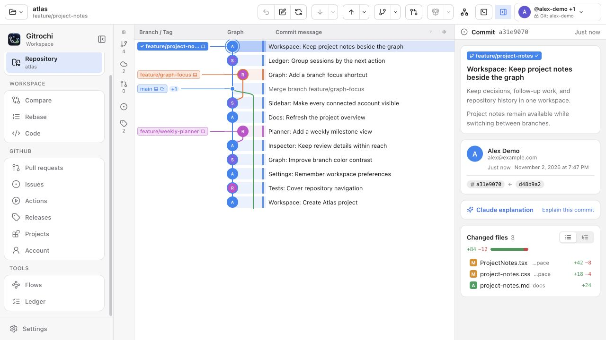

  

<h1 align="center">Gitrochi</h1>

  <b>Git history, connected work and AI sessions in one workspace.</b> 
  macOS · Windows

  English · <a href="README.ko.md">한국어</a> · <a href="README.ja.md">日本語</a>

  
  
  
  
  

  <a href="https://github.com/Gitrochi/Gitrochi/releases/latest"><b>⬇&nbsp; Download</b></a>
  &nbsp;·&nbsp; <a href="docs/features.md">Usage and features</a>
  &nbsp;·&nbsp; <a href="CONTRIBUTING.md">Contributing</a>

  <picture>
    <source media="(prefers-color-scheme: dark)" srcset="docs/images/workspace-dark.jpg">
    
  </picture>

Gitrochi 0.3.14 brings Git history, connected project work and AI sessions into one workspace for macOS and Windows. Browse the graph, stage and commit changes, review requests, run checks and keep track of what your agents are doing. Gitrochi uses your system `git`.

*The screenshots show the Windows interface with example data, rendered from the app's production components in a browser.*

## What you can do

- **Plan from Home** — open or clone repositories, return to recent work, search a connected server, and see project tasks in an agenda or planning view.
- **Work in Git** — follow branch lanes, author photos and CI status; stage by file, hunk or line; compare diffs, resolve conflicts, drag branches, and tidy or undo commits. The repository screen keeps the graph, terminal and changes together.
- **Review connected work** — review and create GitHub pull requests or self-hosted GitLab merge requests, discuss issues, and inspect Actions or pipelines. **Releases** and **Projects** have their own pages; **Account** brings together Inbox, My work and Organizations or Groups.
- **See every account** — the toolbar menu lists connected profiles and configured Git accounts with server labels and available photos. Choose the repository's hosting account while keeping its Git author identity clear. If saved credentials cannot be read, restore access and retry; the account stays listed. Photo fetching follows your preferences, with initials as a fallback.
- **Build and run Flows** — edit `.gitch/flow.yml` in Code, preview dependencies, inspect run history and test results, and configure modules or CI connections. Run through the app or `gitch flow`, locally, in Docker or through supported CI services, with configured undo steps on failure. [Flows guide](docs/flow/README.md)
- **Use AI and your terminal** — draft commit messages and request descriptions with Claude Code, Codex, Gemini CLI or an API provider; run agent sessions in worktree terminals, and preview repository context before sending it. The bundled **gitch** CLI manages Git identities and repository checks. [CLI workflows](docs/cli-workflows.md)

## Start here

1. **Open a repository.** Install Git, then use Home or the folder button to open or clone a repository. Local Git work does not require a hosting-account login.
2. **Connect when you need hosted services.** Use the account menu at the top right or **Settings › Accounts** for GitHub or self-hosted GitLab. **Settings › CLI** guides Git author and SSH setup; these are separate from hosting API access.
3. **Review and commit.** Select uncommitted changes, inspect the diff, stage files or lines, and write a commit. Push shows the account, destination and outgoing changes before confirmation.
4. **Choose a workspace.** Use Projects for boards and planning and Flows for repository checks.

The menu is available from the start. Pages that need a repository offer a chooser until one is open. Collapse or expand it with the sidebar button or **⌘B / Ctrl+B**; the transition follows your system's reduced-motion preference and preserves the selected page.

## Download and install

Get the installers from the [latest public release](https://github.com/Gitrochi/Gitrochi/releases/latest).

| Platform | Download | Requirements |
| --- | --- | --- |
| macOS | `Gitrochi-<version>-macOS.dmg` — move `Gitrochi.app` to Applications | macOS 15+, Apple Silicon or Intel; system Git |
| Windows | `Gitrochi_<version>_x64-setup.exe`, or `Gitrochi_<version>_x64_portable.zip` without installation | Windows 10 (1809)+ or 11, x64; [Git for Windows](https://git-scm.com/download/win) |

The macOS build is not notarized yet. If macOS blocks it, use **System Settings › Privacy & Security › Open Anyway**. Install Git with Xcode or `xcode-select --install` if needed. On Windows, the installer can install WebView2 when missing; if SmartScreen blocks the installer, use **More info › Run anyway**.

Built-in update checks run at launch and daily when enabled in Settings. You choose when to install a verified update. Repository AI and MCP need Node.js 22+; LFS operations need Git LFS. Packaged apps do not need the source-build toolchains.

## Guides and development

- [Usage, features and shortcuts](docs/features.md)
- [Flows and connected CI](docs/flow/README.md)
- [Building and contributing](CONTRIBUTING.md) · [Code style](docs/code-style.md) · [Git workflow](docs/git-workflow.md)
- [Architecture](docs/architecture.md) · [Shared Rust core](crates/README.md) · [Repository index](crates/gitrochi-index/README.md)
- [Agent instructions](AGENTS.md) · [Verification scope and limits](docs/complete-workflows-validation.md)

## Feedback

- 🐞 [Report a bug](https://github.com/Gitrochi/Gitrochi/issues/new?template=bug_report.yml) · ✨ [Request a feature](https://github.com/Gitrochi/Gitrochi/issues/new?template=feature_request.yml) · 💬 [Ask a question](https://github.com/Gitrochi/Gitrochi/issues/new?template=question.yml)
- Security problems go [privately](SECURITY.md), not into an issue

## License

[Gitrochi Community Use License v1.0](LICENSE) is **proposed and not yet in effect**. It would allow free personal and business use, restrict unauthorized resale and the distribution of independent derivative projects, and take contributions through pull requests to the official repository. The rights-holder consents and legal details it needs are tracked in the [licensing review](docs/licensing-review.md) (Korean).

© 2026 ChoMnSeong, [jjunhaa0211](https://github.com/jjunhaa0211). The standalone MIT license file and the MIT labels have been removed; the rights already granted for code provided under MIT, and the [notice that material requires](THIRD_PARTY_NOTICES.md#prior-mit-covered-gitrochi-material), remain. Even once adopted, the policy is source-available with distribution restrictions, not an open-source license.

Bundled: [SwiftTerm](https://github.com/migueldeicaza/SwiftTerm) (MIT). The Windows app builds on [Tauri](https://tauri.app), [React](https://react.dev), [xterm.js](https://xtermjs.org), [portable-pty](https://github.com/wezterm/wezterm) and [Lucide](https://lucide.dev), each under its own license, which the proposal does not restrict — see the [third-party notices and dependency review](THIRD_PARTY_NOTICES.md). The full notice review of the Rust dependencies per release target is not finished.
