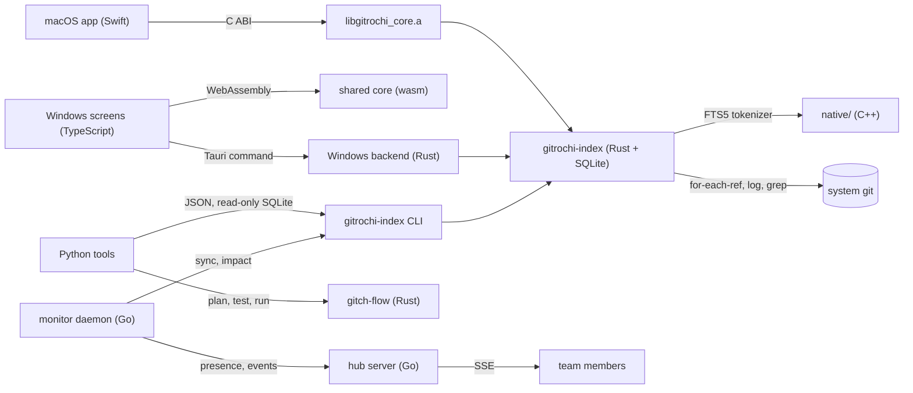

# Architecture: which language does what

Gitrochi puts each job in the language that fits it, and keeps the seams between them small, versioned and tested. The apps stay native (SwiftUI on macOS, Tauri on Windows); everything they share is Rust; the pieces around them use the language their job calls for.

| Language | Owns | Why it fits | Boundary to the rest |
| --- | --- | --- | --- |
| Swift · TypeScript | The two apps' screens and platform integration | Native UI frameworks on each platform | Call the shared Rust code; never reimplement it |
| Rust | Shared core (parsers, diff, graph), **repository index** (SQLite), flow engine (`tools/gitch-flow`) | One memory-safe implementation for both apps and the CLIs; native code and WebAssembly from the same source | C ABI in `libgitrochi_core.a` (macOS), crate dependency (Windows backend), WebAssembly (Windows screens), JSON CLIs |
| C++ | The FTS5 tokenizer in `native/` | Plugs into SQLite's C API over raw UTF-8 bytes; one source compiled into the Rust index and into a loadable SQLite extension; no C++ runtime needed | C ABI, `native/include/gitrochi_text.h` |
| Python | AI code review, repository analysis, test planning and history, runtime management (`tools/gitrochi-py`) | Orchestration around AI providers, data analysis and process supervision, where iteration speed matters more than raw speed; standard library only, so macOS's own `python3` runs it | The index's CLI and read-only SQLite, `gitch-flow --json`, `gitch graph --json` |
| Go | The team hub server and the repository monitor daemon (`services/hub`) | Long-running network services with many concurrent connections and git processes; one static binary that deploys anywhere | HTTP/JSON and Server-Sent Events; the index's CLI |
| Bash | gitch (`tools/gitch`) | Runs everywhere git runs, including Git Bash on Windows | Its existing command and JSON contracts |

## The repository index

`crates/gitrochi-index` keeps, per repository, the commits, the files each commit changed, how often files change together (change relationships) and a cache for searches only git can answer, in `<git common dir>/gitrochi/index.sqlite3`. Syncs are incremental (only commits past the indexed tips), idempotent (two processes may sync at once) and write nothing when there is nothing new, because both apps sync after every reload while watching the git dir.

- **Search.** Both apps' search bar asks the index first and falls back to git when the index is missing, off (`GITROCHI_INDEX=0`) or behind the repository. The `match` command reproduces the bar's existing semantics (`git log -i --grep`, the case-insensitive path glob), so results do not change — only the time it takes and the depth of history covered. Code searches (`git log -G`) are cached per set of ref tips and extended by searching only new commits.
- **Full-text search.** `search` ranks commits and paths with FTS5 and the C++ tokenizer: code identifiers split into their words, and Korean, Japanese and Chinese text indexed in overlapping pairs, so `로그인` finds `로그인오류`.
- **Change relationships.** `coupled`, `impact`, `hotspots` and `owners` answer "what usually changes with this file", "what is missing from this change", "where does change concentrate" and "who knows this code". The Python reviewer and test planner and the Go monitor build on them.

Contract: [crates/gitrochi-index/README.md](../crates/gitrochi-index/README.md) (schema, CLI, C ABI). Rust is the only writer of this database; other readers open it read-only and check `PRAGMA user_version`.

## Python: review, analysis, tests, runtimes

`tools/gitrochi-py` (`python3 tools/gitrochi-py/gitrochi-py <command>`) is the layer for work that is mostly orchestration. It reads the index through its CLI, or the SQLite file directly (read-only) for analysis, and owns only its own test-history database.

- `review` — AI code review of a branch, the staged changes or the work tree: the diff in size-bounded chunks reviewed in parallel, then one synthesis pass, with the index's context per file (hotspot, owners, and files that usually change with it but are missing from the change). Local checks run with `--no-ai` too. Claude (default `claude-opus-5-5`), OpenAI-compatible servers and Gemini; keys from the environment or the stores the apps already use (Keychain, Credential Manager); secrets redacted before anything is sent. Text, Markdown, JSON or SARIF for GitHub code scanning.
- `analyze` — hotspots, change-coupling clusters, ownership and bus factor per folder, knowledge-loss risk, weekly trends and outlier commits, as text, JSON, Markdown or one offline HTML file.
- `test plan` / `test run` / `test flaky` — which tests a change needs (naming conventions, co-change history from the index, `gitch graph affected`), running them through gitch-flow when the repository has a flow (its trust rules apply) or the built-in runners, and a history that flags flaky and slow tests.
- `runtime` — a supervisor for the services in `gitrochi-runtime.json` (Gitrochi's hub and monitor, or any app): runtime version checks, health checks, restart policies with backoff, rotated logs, and blue/green deploys that roll back when the new release fails its health check.

See [tools/gitrochi-py/README.md](../tools/gitrochi-py/README.md).

## Go: the hub and the monitor

`services/hub` builds one static binary, `gitrochi-hub` (standard library only, `CGO_ENABLED=0`, five targets from `build.sh --all`, a `FROM scratch` image, a hardened systemd unit).

- `serve` (default `127.0.0.1:7420`) — a self-hosted team service: who is working on which branch and files, overlap warnings when teammates touch the same files or files the index says change together, a live event feed over Server-Sent Events with resume, and shared notes. Bearer tokens stored only as SHA-256 hashes; state in memory with a crash-safe journal and snapshots.
- `monitor` (status on `127.0.0.1:7421`) — runs on a developer's machine: polls repositories with a bounded pool of git processes, detects ref changes including forced updates, keeps the index in sync (`gitrochi-index sync`), asks it for related files (`impact`), and reports presence and events to the hub with backoff.

See [services/hub/README.md](../services/hub/README.md).

## Rules across languages

- **Git is the system `git`**, in every language, with machine-readable output.
- **One writer per database.** The index belongs to Rust, the test history to Python, the hub's data directory to Go.
- **Versioned contracts.** The index's SQLite schema is versioned with `PRAGMA user_version` (its CLI reports it in `version` and `status`), the Python tools' JSON documents carry `schemaVersion`, and the C ABI, the CLI and the hub's HTTP API are documented next to their code.
- **Secrets** stay in the Keychain or the Credential Manager on desktops, and in files or environment variables on servers; never in logs, errors or committed files.
- **Dependencies are few and recorded.** The index adds SQLite (bundled, public domain) and its Rust bindings, listed in `THIRD_PARTY_NOTICES.md` by `tools/generate-core-notices.py`; the C++, Python and Go code use only their standard libraries.
- **Tests that can fail.** Each piece has tests on real temporary repositories, and `tools/test-index-integration.sh` runs the languages together: Rust indexes a history, Python's supervisor starts the Go hub, two members' monitors report overlapping work that only the index can relate, and Python's review flags the file missing from a change. [code-style.md](code-style.md#tests-and-verification) lists the commands; `.github/workflows/services.yml` runs them on Linux, macOS and Windows.
