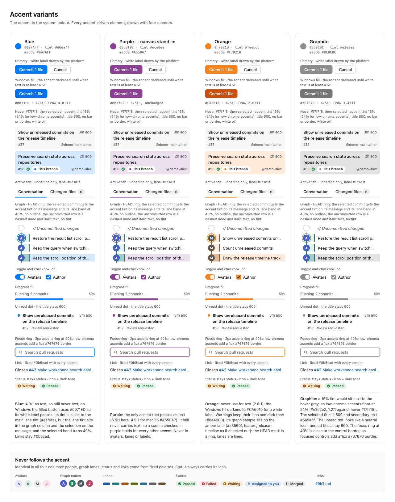
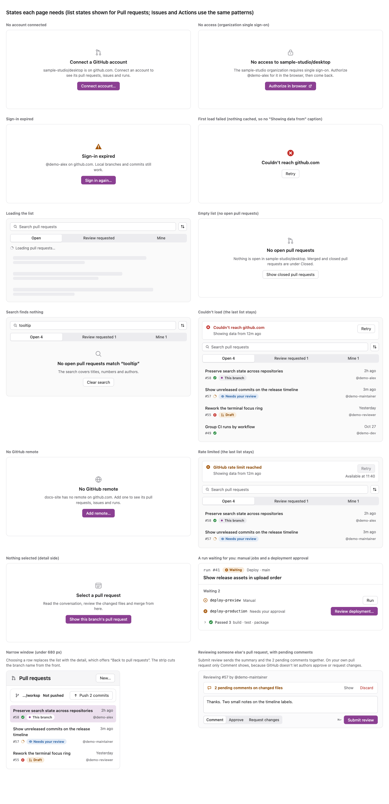
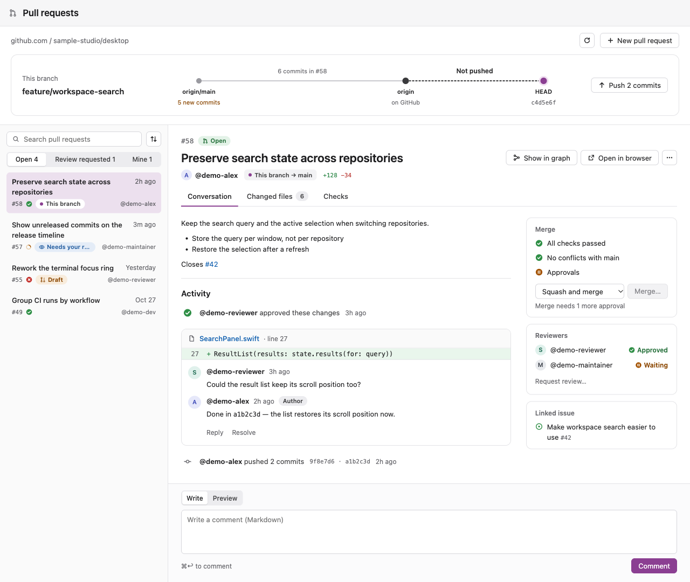
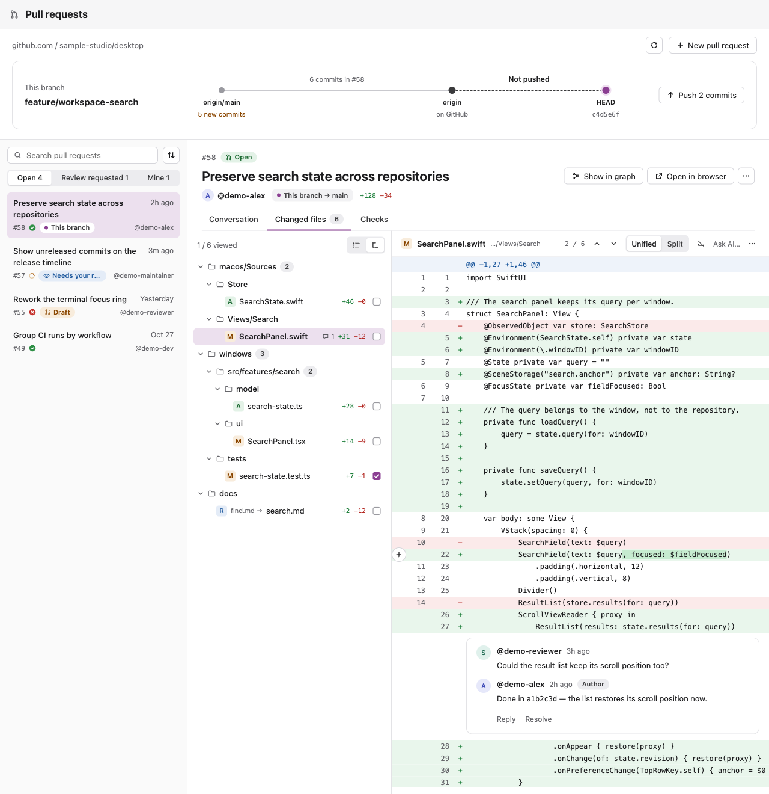
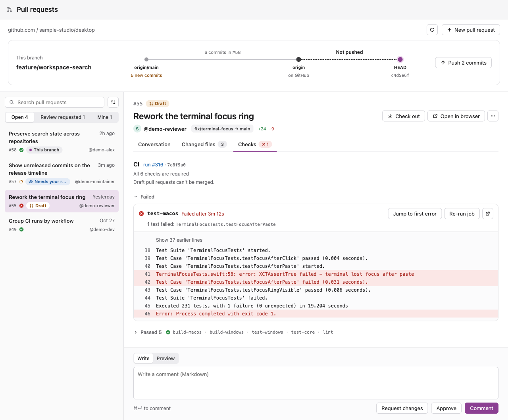
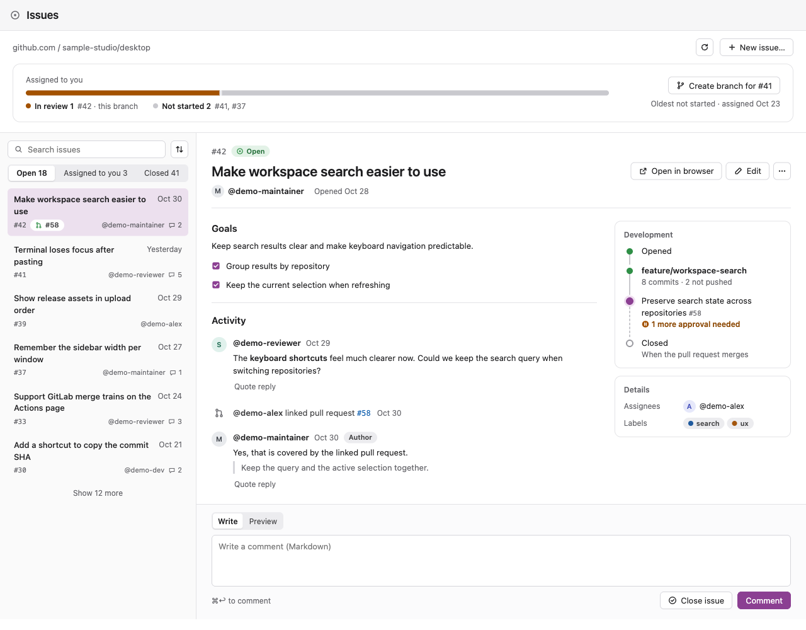
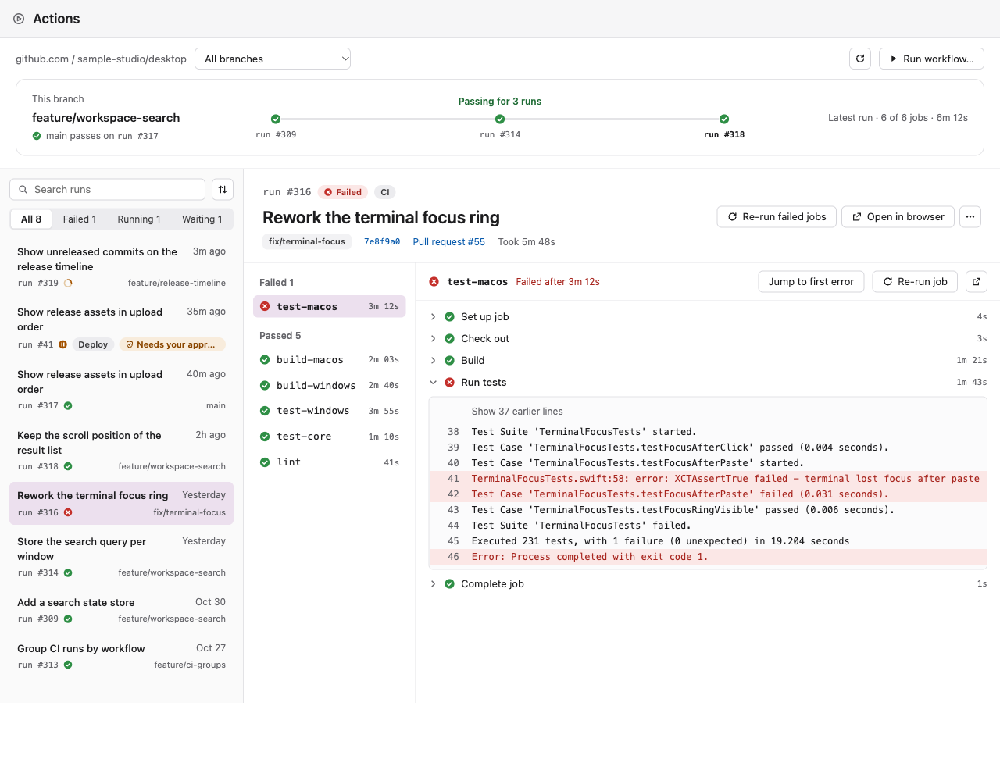
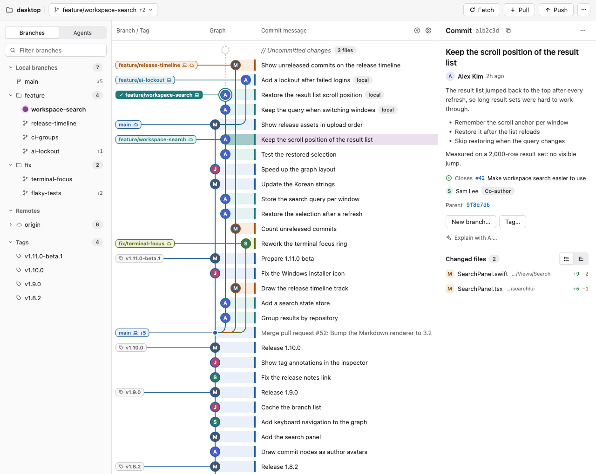

# UI design rules

The rules every screen follows, on macOS (SwiftUI) and Windows (React). They come from the redesign of the pull request, issue and Actions pages, and they apply to every page. Read this before you add or change a screen. [All reference screens](design/README.md) (every page, the states and the component sheets) show the rules in use; they are mockups drawn with the demo repository's data, not app screenshots.

If a rule here and an existing screen disagree, the rule wins; fix the screen in its own pull request.

## Accent

The accent is the **operating system's accent colour** (`Color.accentColor` / `NSColor.controlAccentColor` on macOS, the Windows accent on Windows), not a brand colour. A user with the default blue sees blue, another user sees purple or orange. The mockups use purple as a stand-in.

- Use the accent only for: the one filled (primary) button of a region, the selection tint, the active tab's 2px underline, focus rings on inputs and buttons, the "current" marker (HEAD), progress that is not a status, toggles and checkboxes when on, and unread dots.
- **Never put text in the accent.** Most system accents fail contrast as text on white (blue 4.0:1, orange 2.6:1, green 2.4:1). Links use the link colour `#0b5cad`.
- Never use the accent in fixed palettes (author avatars, graph lanes, labels) or for status. A green or red accent must not read as passed or failed.
- On Windows the app draws filled buttons itself: darken the accent until white text reaches 4.5:1 (for example orange `#CA5010`, graphite `#767676`, blue `#0071ED`). On macOS use the system button style (`.borderedProminent`) and let the system pick the label colour.

## Selection, hover and focus

- **Selection is a soft accent tint only**: the accent at 16% opacity (`Color.accentColor.opacity(0.16)`), 24% for low-chroma accents such as graphite. No coloured bar, border, outline or ring on a selected row.
- A selected row's title is semibold. Secondary text on it is `#5a5a5f`, and pills on it turn white.
- **Only one tinted row per list.** A context menu opens on the selected row. If it targets another row, that row gets the hover colour, not the tint.
- **Hover** is `#f7f7f8`, lighter than any selection tint, so the two never look alike.
- **Keyboard focus on a row moves the selection**: the focused row gets the tint. Focus rings (2px accent at 40%) are only for inputs and buttons. With a low-chroma accent, add a 1px `#767676` border so focus stays visible.
- **A tinted background means selection, nothing else.** Banners and strips are white with a 1px `#e3e3e6` border, a 14px icon and dark-toned lead text. Status lives in icons and pills.
- In the commit graph, the selected commit gets the tint on its message, and its lane band turns 40% of the lane colour. The uncommitted row has a dashed node and italic text, and no tint.

## Badges

- **Status badges always start with an 11–12px icon**: Open, Draft, Merged, Closed, Passed, Failed, Running, Waiting, Queued, Skipped, Needs your review, Review requested, Needs your approval, Needs permission, Assigned to you, Mentioned, Prerelease, Overdue.
- Status tones (text on background):

  | Status | Text | Background |
  |---|---|---|
  | Waiting, draft, running, needs action | `#8a4600` | `#f8ecdc` |
  | Failed, overdue | `#a8261f` | `#fbe7e6` |
  | Passed, open | `#1e6b34` | `#e3f2e7` |
  | Info, assigned, review | `#1f5a9e` | `#e4ecf7` |
  | Merged, closed | `#3a3a3c` | `#ececef` |

- **Markers** (This branch, Latest, Current) are neutral (`#ececef` / `#3a3a3c`) with a 6px accent dot and no icon. **Pending** (unsent review comments) is the one neutral badge without an icon.
- A pill is 18px tall, 0 8px padding, fully rounded, 11px semibold.
- A badge never repeats the current filter: no "Open" icon on every row while the list is filtered to open items.

## Text

- Type sizes: 11, 12, 13, 15, 17, 22, 28. Weights: regular, medium, semibold (no bold).
- **Branch and tag names are set in the UI font**, not monospaced: 13 in lists and pickers, 11 semibold in chips, 15 semibold in summary cards. Monospace is only for SHAs, file paths and code.
- Commits show the **git author name** (Alex Kim). `@handles` are only for GitHub objects: pull requests, issues, reviews, comments.
- **File names are never truncated.** Folder paths shorten from the start by whole segments (`…/Views/Search`, `…/tests`), never in the middle of a word. If even the last segment doesn't fit, hide the folder.
- In two-line list rows, the right slot (author, branch) never truncates; the pills on the left shrink first.
- **Dates**: within 24 hours "12m ago", "2h ago"; then "Yesterday"; older "Oct 28". A date appears once per screen: the list row owns the updated date, and the detail shows only dates the list doesn't (Opened, Tagged).
- **A count appears once per screen.** Tabs own their counts. The Checks tab shows only failures or running checks (`✗ 1`); when everything passed it shows no count. A summary track says "Not pushed" and the number lives on the button ("Push 2 commits"). Ahead/behind (`↑2`) lives on the toolbar's branch picker.
- Scope summary text when the screen could show something else: "6 commits in #58", not "6 commits in the pull request".
- Runs are written "run #318", never a bare "#318".

## Controls

- Buttons are 28px tall with 13px medium text. Text buttons are 12px medium `#66666b`, at least 24px tall; a destructive text button is `#b42a24` and comes last. A label that opens a dialog ends with "…".
- **One filled button per region.**
- **Disabled buttons are neutral**: background `#f2f2f4`, border `#e3e3e6`, text `#86868b` (an icon-only glyph `#c7c7cc`), never a faded opacity. The reason sits directly below or beside the button.
- **Empty and blocked states**: a 24px gray icon, one 15px semibold line, one 12px caption and one action. The action is filled when the state blocks the user (no account, no access, sign-in expired, nothing selected), plain for recovering or exploring (Retry, Clear search, Show closed).
- **Connection failure has one form everywhere**: a failed icon, "Couldn't reach github.com", the caption "Showing data from 12m ago" when cached data is shown, and a plain "Retry" button.
- **Sign-in expired has one form**: a warning icon, "Sign-in expired", and "Sign in again…".
- Segmented controls are for filters and modes only (labels 12px medium, the selected segment is a white thumb). Switching content uses underline tabs: medium `#3a3a3c`, the active tab `#1d1d1f` with a 2px accent underline, so labels never shift.
- Click targets are at least 24×24 (icon buttons, checkboxes, the diff's "+" comment button).
- Context menus: 240 wide, 28px items, hover `#f7f7f8`, a 13px icon column, shortcuts right-aligned in macOS order (`⇧⌘C`), destructive items last after a divider. Items that do nothing in context are disabled with a reason ("Already checked out").

## Shared components

Each of these has one form. Build it once per platform and reuse it; don't draw a page-specific copy.

- **File list (ChangeList)**: the same rows everywhere (status badge, file name, folder, stats), with the same list/tree toggle. Its title is "Changed files N" (no N when a tab already shows it). Context such as "Not pushed · 1 commit" or "Staged" is a subheading above it.
- **Diff header (DiffView)**: 44px. Left: status badge, file name (13 semibold), folder (11). Right: "2 / 6" with previous/next file buttons, Unified | Split, the Hide whitespace toggle, Ask AI…, and ⋯ (Wrap long lines lives in ⋯). Keyboard shortcuts (J/K) appear in tooltips.
- **Failed check**: icon, job name (monospaced 13 semibold), "Failed after 3m 12s" in the failed tone, then Jump to first error, Re-run job and an open-in-browser button. The failed row opens with its log; passed checks collapse into one "Passed N" group. No "Required" pill on every row; one line "All 6 checks are required" instead.
- **Merge card**: checklist rows in neutral text with their icons. When merging is blocked, the reason sits only directly below the disabled "Merge…", and there is no generic note.
- **Current marker**: a 12px dot inside an 18px halo. Commit graph nodes keep their own look.
- **Todo row**: checkbox, title, one line of meta, status pill, avatar. A done item shows a check and a gray title.

## App shell

On macOS the window, toolbar and sidebar are native: `NavigationSplitView`, a unified toolbar (`.windowToolbarStyle(.unified)`) and a `.listStyle(.sidebar)` source list. The OS owns their height, the capsules it groups toolbar items into, the sidebar selection highlight, `.badge` counts, menus and the overflow (») menu for items that do not fit. Don't redraw those; decide only what goes in them.

- **Repository and branch** are the window title: `navigationTitle` (repository) and `navigationSubtitle` (branch, with `↑2 ↓5`) with `.toolbarTitleMenu`. Ahead/behind counts live only there.
- **Always titled**: Changes N, Fetch, Pull, Push (`.labelStyle(.titleAndIcon)`). Everything else is icon-only and follows the user's toolbar setting, with branch, worktree and stash actions under Branch ▾ and the rest under ⋯.
- **One prominent item** (`.borderedProminent`) only for the recommended action: Push when there are only commits to push, Pull when a fast-forward is possible, none when the branch has diverged.
- **Keep visible in a narrow window**: the title, the four titled actions and the account, through `NSToolbarItem.visibilityPriority` (SwiftUI has no API for it).
- **Sidebar**: sections Repository · GitHub · Tools · Settings, icons in `.foregroundStyle(.secondary)` so the accent stays on the selection. The OS selection highlight is the one exception to "selection is a tint"; lists inside pages keep the tint.
- **Blocked pages** say why in one line under their section; macOS shows no `.help()` on disabled rows. The collapsed icon rail is custom: its blocked icons are drawn dimmed but stay enabled, so their `.help()` reason still shows.
- **Windows** has no native shell, so it draws the same structure with the frame values below.

## Frames and spacing

- Repository screens: a 44px page toolbar (the macOS window toolbar is the OS's, see App shell), a 240px sidebar, a 340px inspector (header 44px). List/detail pages: a 312px list column. Blame: a 280px gutter with a 56px age column.
- Spacing steps: 4, 6, 8, 10, 12, 16, 20, 24, 28, 32. Card padding 12 16.
- Avatars: 24 in conversations, 20 in meta and side cards, 22 as graph nodes, 16 in dense rows.
