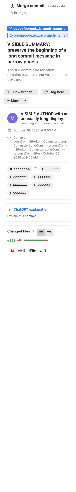
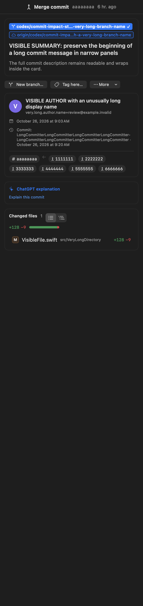

# Pending work integration and verification

This change brings the pending Gitrochi work onto `main` in one pull request. It preserves the 0.3.12 version and the already merged license changes. The original development worktrees remain available; only the integration branch is published by this task.

## Request coverage

| Request | Integrated result |
|---|---|
| Improve `gitch g` for everyday reviews | Changed-file reviews, explained impact paths, test candidates, dependency evidence, keyboard navigation, offline Markdown/HTML reports and graph performance coverage. |
| Review commit impact and replay structural changes | Immutable commit selections and dependency-change playback, with native and shell CLI paths. |
| Fix Gitrochi and gitch regressions | Literal paths and unusual filenames, first-commit operations, patches, conflict handling and stale-result protection are retained in the integrated implementation and regression suites. |
| Introduce Rust where appropriate | Shared native and WebAssembly parsing, diff, conflict and graph calculations, cancellable frontend work and packaged CLI resources. This includes the Unicode-path and replay follow-up from the former Rust PR #55. |
| Improve the macOS UI/UX | Changes/history flows, persistent repository navigation, command palette, branch context, independent PR/commit/worktree document state, contextual tools, readable graph labels and adaptive inspectors. |
| Ignore whitespace in commit search | Space-insensitive commit subject/body matching on both platforms. |
| Fix macOS window overlap | Titlebar safe areas, loading overlays, window resizing and sidebar visibility. |
| Add review, AI and Git workflows | Reviewed pushes, anchored PR/MR drafts and replies, scoped change questions, revision comparison, batch commit plans, line history, recovery, LFS, submodules, bisect and a read-only repository MCP server. |
| Add repository and hosting workspaces | Code browsing, account work and inboxes, repository/project/release views, CI access and guarded server operations. |
| Compact sidebar and shared heights, formerly PR #61 | The newer navigation keeps compact previews, keyboard access and fair list sizing. Fractional layout measurements are stabilized, while lazy file-row rendering is preserved. |
| English documentation and contribution rules, formerly PR #62 | Concise English README, Korean/Japanese READMEs, agent/contribution/security/release guidance and required commit areas. |

The shared-core PR #55 originally targeted another feature branch. Its code is now included in this `main`-based integration, together with the graph work it depended on. License PRs #63/#64 and release PR #42 are already in the base and are preserved.

## Integration choices

- The newer repository/hosting workspace supplies the common shell. Independent refinements from the older macOS UI branch are adapted to it rather than replacing the current navigation and feature wiring.
- Existing terminal panes, terminal file/image pasting, Markdown rendering, linked-worktree WIP rows, branch visibility and graph-column toggles stay connected.
- PR files, commit files and linked-worktree files keep separate selection/diff/inspection contexts. Synthetic WIP rows are excluded from batch commit plans.
- Compact sidebars retain hover, focus, keyboard and accessible preview entry points. Shared list heights do not repeatedly update state for subpixel rounding differences.
- A narrow file row gives the filename priority over directory and line-count metadata; the inspector still displays aggregate counts. The final inspector fixture verifies filenames at 250, 320 and 380 points in both themes.
- Rust dependency origins, manifest licenses and bundled upstream texts are recorded in `THIRD_PARTY_NOTICES.md`. The existing proposal and historical-rights notices remain intact.

## Verification performed

All checks below were performed on the integrated code on an Apple Silicon Mac. The Windows frontend also ran in Chrome with mocked filesystem/process/network entry points.

| Check | Result |
|---|---|
| macOS development build and ad-hoc signing | Passed on arm64. The build emits existing deprecated Security API warnings; the initial uncached SwiftTerm build also emits vendor warnings. |
| macOS feature scripts | All 26 `macos/Tools/test-*.sh` checks passed. |
| Navigation regression fixture | Independent document contexts, branch identity at shared SHAs, background reconciliation, back/forward state, routes/tools/pins, WIP selection/batch exclusion and shared heights passed. |
| Actual macOS window layout | Loading, resize, native zoom, sidebar transitions and titlebar containment passed; see `screenshots/integration/window-layout.json`. |
| Actual macOS inspector | 250/320/380-point panels, light/dark themes, long refs/messages/identity fields, six parents and filenames passed. |
| Large macOS change lists | 400 and 1,000 files each evaluated 38 visible rows; adaptive layout kept the same child state identity. |
| Windows TypeScript and production build | Passed with a freshly generated WebAssembly core. |
| Windows Vitest | 45 files / 421 tests passed; the final shared-height and workspace-operation changes were also rerun individually. |
| Tauri Rust check | `cargo check --locked --manifest-path windows/src-tauri/Cargo.toml` passed on the macOS host. |
| Windows browser interaction fixtures | Compact navigation, hover/focus/ArrowRight/Escape, keyboard collapse, final-file selection, folder collapsing and shared-height allocation passed. 1,000 changes rendered 26 rows; two long sections received equal 163-pixel allocations. |
| Shared Rust | Formatting, Clippy with warnings denied, 12 tests and release native/WASM builds passed. |
| Complete gitch suite | 229 passed / 0 failed. |
| CLI graph paths | 64 checks passed in each of the native and shell-fallback configurations, including UTF-8 paths and replay handling. |
| SCIP and watcher helpers | 27 SCIP tests and 25 watcher tests passed. |
| Repository MCP | 9 tests passed, including strict read-only schemas, secret/path boundaries and repository-state preservation. |
| Git rules | Hook regression tests and the staged-file secret/privacy/whitespace checks passed. |

The standalone macOS Git/history fixtures include the merged Markdown dependencies. Navigation expectations follow the actual linked-worktree WIP rows and independent document contexts. Private-key redaction fixtures cover every supported key kind through parameterized test data; no private key material is present.

## Screenshots

These are final integration fixtures with synthetic repository data.

| Narrow light inspector | Dark inspector |
|---|---|
|  |  |

Additional feature fixtures and earlier captures remain in [workspace validation](navigation-workspace-validation.md), [workflow validation](complete-workflows-validation.md) and [review validation](review-workflows-validation.md).

## Remaining environment checks

- Native Windows installation, Credential Manager, PowerShell/WSL integration and real-app automation require the Windows runner or a Windows device. Chrome fixtures and a macOS-hosted Cargo check do not substitute for these.
- Real GitHub/GitLab account, issue, review, CI, project and AI writes were simulated. Required server permissions and live provider behavior still need verification in the intended account.
- The optional real fullscreen transition was not requested or exercised; normal resizing, native zoom and titlebar containment were tested.
- The Community Use License and CLA remain proposals that are not in effect. This integration does not post assent for any rights holder or resolve the remaining dependency-audit items outside the shared Rust core.
