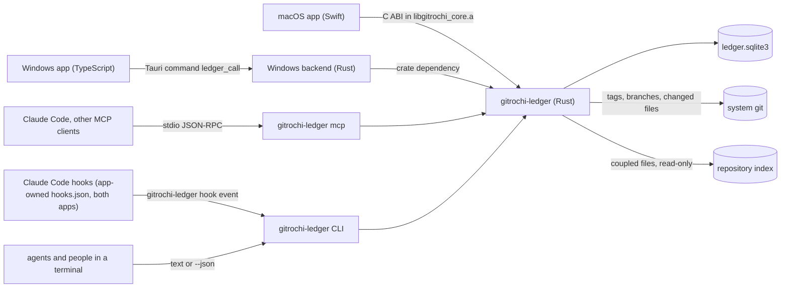

# Ledger design (draft)

> **Status: P0 draft, waiting for the maintainer.** Nothing here is built yet. The decisions in [§14](#14-decisions) are proposals with a recommended option: D1–D10 are put to the maintainer, D11–D13 are working defaults that stand unless changed. P1 starts only after they are confirmed. To change a decision, change this document first.

Agents report which baseline their work started from and where it stands. Gitrochi draws the sessions as branches off a baseline trunk, and a person only answers, confirms and cleans up. Information flows one way — **agent → ledger → screen**. The screens never drive an agent: what a person writes (an answer, a note, a status) waits in the ledger until that session's next report or read picks it up. The one exception is opt-in: when a person turns on auto-continue, Gitrochi answers an agent that has waited too long for them, within fixed limits, and records it for review ([§9](#9-auto-continue)).

This document is the contract for phases P1–P5: the feature map, the data model, the rules (verdicts, resuming, hand-offs), the permission boundary, auto-continue, the screens and the open decisions.

## 1. Where it comes from

Ledger reimplements the ideas of an existing standalone tool, *claude-ledger* (a Python standard-library server, a single-page HTML dashboard and an Electron shell). That project has no license file, so Gitrochi takes **concepts and observable behaviour only**: no code, wording, styles or schema text is copied, and its tests are read as a behaviour specification and rewritten as Rust tests in our own words (decision D7). Its organisation-specific parts — parsers for one team's document formats, its file-naming conventions, a merge-request tab for one server, an IP allow list for a second PC — are left out or generalised (D2–D4).

What Gitrochi adds on top:

- **Tracking without reports.** Sessions Gitrochi launches already carry Claude Code hooks. The ledger records their activity, so "stale" is accurate even when an agent forgets to report, and a session used again after it was archived resurfaces.
- **Git links.** A session knows its branch, worktree, commits, pull request and running agent. "Touches" are what the agent declared plus the files its branch actually changed, and overlap warnings also use the repository index's change coupling.
- **Fast triage.** The Inbox works from the keyboard alone, and confirming or archiving shows an undo toast.
- **Auto-continue (opt-in).** An agent that asks about its implementation and gets no answer within 30 s (adjustable) receives a safe "go ahead" from Gitrochi through documented Claude Code hooks; the person reviews it later ([§9](#9-auto-continue)).
- **One look, both platforms.** Native screens built from Gitrochi's existing parts, on macOS and Windows, with the rules in one Rust crate.
- **Existing data carries over.** A read-only import of a claude-ledger database (D5).

## 2. Feature map

| Original | In Gitrochi | Phase | Notes |
|---|---|---|---|
| Sessions, events, questions, verdicts, resume rules, overlaps | **Core**: new crate `crates/gitrochi-ledger` | P1 | Rules in [§7](#7-rules); the original's scenarios become Rust tests |
| Baseline trunk from version folders | **Baselines** with a choosable source: git tags (default), folder or file name pattern, manual registration and `release` events | P1 | D6 |
| Graph: trunk + session branches, 7 days · 30 days · all | **Graph** view, drawn with the commit graph's lanes, colours and line widths | P2 | [§10.5](#105-graph) |
| "My turn": questions, clean-up, decisions | **Inbox** (the first screen) + sidebar badge + Home card | P2 (badge P3) | Same count as the original |
| Clean-up board | **Board**: verdict filter chips, multi-select, bulk actions | P2 | |
| Implementation channel and its cycles | **Streams**; which kinds are the decision side and which the implementation side is a setting | P4 | No kind names hard-coded in the rules |
| Ctrl+K search | macOS: a Ledger group in `WorkspaceCommandPalette`; Windows: D11 | P3 | No Ledger-only search window |
| Paste import of ```` ```ledger ```` blocks | **Import** sheet; the duplicate hash is kept | P1 parser, P4 sheet | |
| MCP tools and CLI | `gitrochi-ledger`: a CLI (short text, or JSON with `--json`) with an `mcp` stdio subcommand, bundled with both apps | P1 binary, P3 sheet | The "Connect Claude…" sheet copies a `claude mcp add …` command and a config snippet; it never edits a client's files |
| Tray notifications | Native notifications + Dock/taskbar badge, switchable in Settings | P3 | Neither app has system notifications yet |
| Electron terminal and quick launch | Gitrochi's terminal panel + "Ledger overview" and "Claude Code" quick launches | P4 | |
| GitLab merge-request tab and merging | Nothing new: a **session chip** on the existing pull/merge request pages, and the inspector links to the request | P3 | Merging stays in Gitrochi's own confirmed flow |
| AI "current state" summary | Gitrochi's AI service and its stored key | P5 | Off without a key or offline |
| Daily backup, 14 kept | The same, with `VACUUM INTO` | P1 | |
| Sharing with another PC (IP allow list) | Not in the first release; later on the hub's token authentication | — | D4 |
| Parsers for one team's documents (open-question lists, directives, registries, notices, ID dictionary) | A general **document tracker** configured in settings, or nothing | P5 | D2 |
| Work ledger (bundles, items, reports) | A general **Work log** | P5 | D3 |
| Personal notes | Later | P5 | Person-only; never in agent output |
| Chat link per session | Kept ("Open chat" in the inspector) | P2 | |
| — (new) | **Auto-continue** when nobody answers an agent's question in time | P3b | [§9](#9-auto-continue); D8–D10 |

Not carried over: the Python code itself ([§4](#4-architecture)), the HTTP server and its request guards (the app reads the database directly, so nothing listens on a port), the tray launcher, the Electron shell, the remote client bundle, and a reminder that one team attached to questions from certain kinds.

## 3. Vocabulary

| Term | Meaning |
|---|---|
| **Session** | One unit of agent work — usually one conversation, often one branch or worktree. Shown as a branch in the graph. |
| **Baseline** | A version of the source of truth a project's work starts from: a release tag, a spec folder, a registered version. The newest is **HEAD**. |
| **Base** | The baseline a session started from (`base_version`) and the one it is on now (`base_current`, moved by `sync` and `release`). **Behind** = how many baselines are newer than `base_current`. |
| **Report** | An event an agent sends (`start`, `artifact`, `question` …). |
| **Question** | Something an agent needs a person for. Open questions put the session in **Needs you**. |
| **Verdict** | What a person should do with a session — computed, never stored ([§7.3](#73-verdicts)). |
| **Confirm** | A person's acknowledgement that a finished session's outcome is right (`ack`). |
| **Archive** | A person's statement that the conversation is cleaned up and may be closed. Not the same as **shelve** (paused research a person wants to keep). |
| **Stream** | A long-running implementation session that reports in cycles instead of finishing ([§7.8](#78-streams)). |
| **Hand-off** | The only path by which an agent's report changes another session ([§7.7](#77-hand-offs-sync-and-applied)). |
| **Touches** | What a session works on: IDs, modules or files the agent declared, plus files its branch changed. |

Event, kind, status and verdict values are stored as lower-case English identifiers. The input side also accepts the original's Korean aliases for event and kind names, so existing instructions and pasted blocks keep working; those alias strings are input data in one table, like translations, and never appear in output.

## 4. Architecture

**Languages** (the maintainer's rule: change the language wherever that serves the feature better). The original is Python; none of it is ported. The shared logic, the CLI, the MCP server and the hook handler are **Rust**: one binary with no runtime, so it runs on Windows machines that have no Python, and it starts in about a millisecond where hooks may run on every tool call (starting a Python interpreter alone takes tens of milliseconds). The screens are Swift and TypeScript, as everywhere in Gitrochi. Ledger adds no Python code. Where another language serves a part better, this document says so with the reason — sharing between PCs, if D4 ever asks for it, belongs on the existing Go hub (long-running network service, token authentication already there).



The crate mirrors `crates/gitrochi-index` in every pattern that already works there:

```
crates/gitrochi-ledger/
  src/schema.sql, db.rs     open, configure, migrate (PRAGMA user_version, additive steps only)
  src/store.rs              the single write path: every write is one IMMEDIATE transaction that bumps rev
  src/report.rs, human.rs   agent reports and a person's operations
  src/verdict.rs            verdicts, live/stream classification (computed, never stored)
  src/streams.rs            cycles of implementation streams
  src/baseline.rs           tag, folder and manual sources; numeric version order; inferred versions
  src/overlap.rs            shared touches + coupled files from the repository index
  src/hook.rs               Claude Code hook observations (fast path, never fails the agent)
  src/auto.rs               auto-continue: waits, question detection, the deny list, answer templates (P3b)
  src/import.rs             ```ledger blocks + duplicate hashes; read-only import of a claude-ledger database
  src/text.rs               short English text for agents (overview, report reply, session)
  src/api.rs                one dispatcher behind the C ABI, Tauri, the CLI and MCP; caller-aware (§8)
  src/ffi.rs                gitrochi_ledger_call / gitrochi_ledger_free
  src/mcp.rs, main.rs       the gitrochi-ledger binary: CLI subcommands and `mcp`
  tests/                    real temporary databases and repositories, two-process writers, CLI and MCP round trips
```

- **Contracts.** The C ABI is `gitrochi_ledger_call(input, length)` / `gitrochi_ledger_free(buffer, length)`, re-exported from `libgitrochi_core.a` and declared in `gitrochi_core.h`, with the index's buffer format (u64 little-endian length + JSON). Requests are `{db?, command, args}`, answers `{"result": …}` or `{"error": {code, message}}`. Windows calls the crate through one Tauri command, `ledger_call`, on a blocking thread. The CLI prints short text by default and the same JSON with `--json`; errors use the index's codes and exit codes (0, 1, 2).
- **Database.** One file for all repositories: `Gitrochi/ledger/ledger.sqlite3` in the app data folder (macOS `~/Library/Application Support`, Windows `%APPDATA%`), next to the existing `agents/` folder. `GITROCHI_LEDGER_DB` overrides the path and `GITROCHI_LEDGER=0` turns the feature off in the apps, the hooks and the binary — the same pattern as `GITROCHI_INDEX_DB` and `GITROCHI_INDEX=0`.
- **One writer.** Only this crate writes the database. The app, the CLI, MCP and the hooks write at the same time, so: WAL, `BEGIN IMMEDIATE`, a 10 s busy timeout (1.5 s on the hook path), and the index's connection settings. A binary that finds a newer `user_version` than it knows refuses to write (`SCHEMA_MISMATCH`); an older file is migrated forward. `docs/architecture.md` gets this database and its contract in P1.
- **Change signal.** Every write increments `meta.rev`. The apps read `rev` cheaply (every 2 s, or on a change to the database folder) and fetch views only when it moved. The app runs no HTTP server.
- **Text.** Times are epoch milliseconds; every input string is NFC-normalised (long text line by line, which is much faster on multi-megabyte input and gives the same result).
- **WebAssembly.** The Windows screens build every workspace member for `wasm32`; like the index, the crate compiles to nothing there.
- **Dependencies.** The index's (`rusqlite` bundled, `serde_json`) plus one new crate, `unicode-normalization` (MIT or Apache-2.0, with `tinyvec`), because the standard library has no NFC. The duplicate hash needs SHA-1 for compatibility with the original's hashes; it is written in the crate (checked against the standard test vectors) rather than pulled in. Local dates for session IDs and backup names come from SQLite's `strftime(…, 'localtime')`, so no time-zone crate is needed.

## 5. Where it plugs in

| Existing piece | How Ledger uses it |
|---|---|
| Agent center: `Services/Agents.swift` ↔ `entities/agent`, `src-tauri/src/agents.rs` | "Start agent" creates the ledger session ([§7.11](#711-tracking-launched-agents)) and passes `GITROCHI_LEDGER_SESSION` next to `GITROCHI_AGENT_ID`. The inspector shows the agent's live state and opens its terminal tab. |
| Claude Code hooks: the app-owned `hooks.json` passed with `--settings` (`hook.sh` on macOS, `Gitrochi.exe --agent-hook` on Windows, `hooks-wsl.json` for WSL) | Both apps add `gitrochi-ledger hook <event>` entries next to the existing ones (WSL: the Windows executable, as `hooks-wsl.json` already does): activity on `SessionStart`, `UserPromptSubmit`, `Stop` and `SessionEnd`; auto-continue on `Stop`, `PreToolUse` (question tools only) and `PermissionRequest` ([§9](#9-auto-continue)). The agent center's entries stay as they are. Nothing is written to a project's or the user's Claude settings. |
| `ExternalAgents` (process scan, both platforms) | Agents Gitrochi did not start appear in the Inbox as "Running, not in the Ledger" — a suggestion with **Track** and **Hide**, never an automatic session. The scan runs while the Inbox is visible, as it does for the Agents tab. |
| Repository index (`gitrochi-index`) | Read-only `coupled` queries for overlap warnings; the ledger never writes the index. |
| Commit graph layout (`gitrochi-core` `graph::layout`) | The Graph view's lanes ([§10.5](#105-graph)); lane colours and metrics from `Palette.lanes`/`GraphMetrics` ↔ `laneColors`/`metrics.ts`. |
| Pull/merge request pages (`PullRequestSection`, `PullRequestDetailView` on both platforms) | A session chip on rows and in the request header (head branch, or a session ID in the title, branch or description); the inspector opens the request. |
| `WorkspaceCommandPalette` (macOS) | Adding `.ledger` to `WorkspaceDestination` gives "Go to Ledger"; a Ledger group appended to the palette's command list adds sessions, questions and baselines. |
| `MCPConnectionSheet` (both platforms) | The Connect Claude Code sheet follows its layout (Copy configuration, Test connection) and adds the `claude mcp add` command. |
| AI service (`Services/AI.swift` ↔ `entities/ai`) | P5 summaries through `complete`, with the key Gitrochi already stores. |
| `MarkdownView` ↔ `shared/ui/Markdown.tsx` | Report bodies and questions. |
| Terminal panel | P4 quick launches. |
| `tools/gitrochi-mcp` (read-only) | Untouched. Ledger's writing tools live in their own server so the read-only server stays read-only. |
| `services/hub` | Only if D4 asks for sharing later. |

## 6. Data model

Schema 1 (P1). Later phases add tables and columns only.

| Table | Columns | Meaning |
|---|---|---|
| `meta` | `k`, `v` | `rev` (+1 per write transaction), `created` |
| `config` | `k`, `v` (JSON) | Rules every writer must agree on: `stale_hours` (72), kind roles ([§7.8](#78-streams)), stream lines. Written only from the app. |
| `projects` | `id`, `name` (unique), `repo_root`, `repo_remote`, `baseline_source` (`tags` · `folder` · `manual`), `baseline_pattern`, `baseline_dir`, `scan_files`, `scan_subdirs`, `created_ts` | A trunk of baselines, usually bound to one repository |
| `versions` | `project_id`, `version` (PK pair), `ts`, `source` (`tag` · `folder` · `manual` · `release` · `inferred`), `note`, `by_session`, `commit` | The baseline trunk |
| `sessions` | `id`, `project_id`, `kind`, `title`, `title_auto`, `agent` (`claude-code`, `codex` …), `base_version`, `base_current`, `base_was_latest`, `base_auto`, `status`, `merged_into`, `touches`, `related`, `chat_url`, `origin` (`report` · `launch` · `track` · `import` · `demo`), `color`, `created_ts`, `last_ts`, `active_ts`, `ack_ts`, `snooze_ts`, `archived_ts` | A session = a branch in the graph. `last_ts` = last agent report, `active_ts` = last hook activity. |
| `events` | `id`, `session_id`, `project_id`, `ts`, `type`, `actor` (`agent` · `human` · `system`), `summary`, `ssot`, `artifacts`, `data`, `channel` (`mcp` · `cli` · `import` · `hook` · `app` · `demo`), `delivered_ts` | Reports, a person's operations and system records |
| `items` | `id`, `session_id`, `ts`, `text`, `state` (`open` · `answered` · `dismissed`), `answer`, `answered_by`, `answered_ts`, `delivered_ts` | Questions |
| `links` | `session_id`, `kind` (`claude_session` · `agent_run` · `branch` · `worktree` · `pull_request`), `value`, `repo`, `ts` | Lookups both ways; `(kind, value)` is indexed for the hook path |
| `session_files` | `session_id`, `path`, `source` (`reported` · `branch` · `worktree`), `tip` | Changed files cached per branch tip, so git runs only when a tip moves |
| `imports` | `hash`, `ts` | Duplicate guard for pasted blocks and imported databases |

P3b adds the auto-continue table `waits` and two session columns ([§9.5](#95-data)) as migration 2.

- `status` stores only `active`, `done`, `merged`, `closed`, `dropped`, `shelved`. "Needs you", "stale" and "archived" are computed from open questions, times and `archived_ts`.
- JSON columns (`touches`, `related`, `artifacts`, `data`) hold arrays and objects only; the crate validates them on write.
- Session IDs keep the original's shape so imported and pasted IDs stay valid: issued as `S<MMDD>-<nn>`, or given by the agent as 3–48 letters (any script), digits, `.`, `_` and `-`.
- `color` = creation order within the project modulo 8, mapped to the commit graph's lane palette; a row always shows the session ID next to its colour.

## 7. Rules

These are the behaviour every client sees. P1 fixes each rule with a Rust test; the scenarios come from the original's test suite, rewritten.

### 7.1 Events

| Event | An agent sends it when | Needs | Effect |
|---|---|---|---|
| `start` | the work's nature is clear | `project` for a new session; `title`, `kind`, `base`, `touches` expected | Creates the session; on an existing session it is recorded as `progress` |
| `progress` | (default) | | None |
| `artifact` | it produced something | `artifacts[{name, ssot?, ver?, path?}]` | `ssot` defaults to `base_current` and is marked inferred |
| `question` | it needs a person | `question` | Opens an item → **Needs you** |
| `decision` | it reached a conclusion | | None |
| `sync` | it moved to a newer baseline | `version` | `base_current` = version; a hand-off for implementation kinds ([§7.7](#77-hand-offs-sync-and-applied)) |
| `done` | the work is finished, merge undecided | | `status = done` |
| `merged` | the result went into a baseline | `into` | `status = merged` |
| `closed` · `dropped` | finished without a merge · result discarded | | `status = closed` · `dropped` |
| `shelved` | (shelvable kinds only) paused without a merge | reason in `summary` | `status = shelved` |
| `release` | this session made a new baseline | `version`, `absorbs[]` | Adds the baseline (`source = release`, `by_session`); absorbed sessions become `merged` |
| `applied` | (implementation kinds) applied baseline vX **because a person told it to** | `version`, `targets[]?` | Hand-off ([§7.7](#77-hand-offs-sync-and-applied)) |
| `note` | for reference | | None; never reopens or un-confirms |
| `heartbeat` | alive | | Updates `last_ts` only; no row |

Any event may carry `body` (Markdown, up to 60,000 characters, cut with a notice), `questions[]` (one item each), `resolves[]` (item numbers the session settled itself), `touches[]` and `related[]` (merged as sets), `ssot`, `chat_url`, and `work[]` (kept in `data` until D3). Loose types are accepted where the original accepted them: a single string for a list, a number for an item list, an object for one artifact.

### 7.2 Processing a report

All in one transaction:

1. Normalise the event name (aliases → English), validate; reject unknown events, `release`/`sync`/`applied` without a version, a `question` without text, a new session without a project, a malformed session ID.
2. Resolve the project: the explicit `project`, else the session's, else `GITROCHI_LEDGER_SESSION`'s, else the repository of the caller's working folder. Scan its baselines (throttled to once per 15 s per project).
3. Find or create the session. `base: "latest"` (or `head`) is stored as the HEAD number at that moment, with `base_was_latest`. A version the trunk lacks is added as `inferred`. A non-`start` event creates the session with an automatic `start` before it. A `start` with a different title on an existing ID is a conflict — unless the title is automatic (`title_auto`), in which case the agent's title wins; the same goes for an automatic base (`base_auto`).
4. Merge fields: title, kind, chat link; `touches` and `related` as sets.
5. Apply the resume rules ([§7.4](#74-resuming)), then the event's effect ([§7.1](#71-events)).
6. Any event but `note`/`heartbeat` clears the session's own `ack_ts`.
7. Store questions, resolved items, the body; insert the event (not for `heartbeat`); update the session.
8. Build the reply in the same transaction: the session view, HEAD, short notices (behind on `start`/`sync`/`artifact`/`release`/`applied`; overlaps whenever the session has touches; other open sessions on `start` only; shelved material on `start`; one line per hand-off target), then deliver waiting messages ([§7.6](#76-delivery)). Commit (`rev + 1`).

### 7.3 Verdicts

Computed on read, first match wins:

| # | Condition | Verdict | Label | What a person does |
|---|---|---|---|---|
| 1 | `archived_ts` set | `archived` | Archived | Nothing (hidden by default) |
| 2 | an open question | `needs_human` | Needs you | Answer or dismiss — the session receives it on its next report |
| 3 | status `merged` · `closed` · `dropped` | `expirable` if confirmed, else `confirm` | Ready to archive · To confirm | Confirm, then archive |
| 4 | status `shelved` | `shelved` | Shelved | Keep; it never turns stale |
| 5 | status `done` | `pending_merge` | To decide | Mark merged (version), close or drop |
| 6 | `now − max(last_ts, active_ts, snooze_ts) > stale_hours` | `stale` | Stale | Check the conversation: close it, or **Still active** |
| 7 | otherwise | `active` | Active | — |

Derived flags shown next to the verdict: `stream`, `behind`, `overlap`, and `unreported` (no agent report yet; [§7.11](#711-tracking-launched-agents)). "Live" = not `merged`/`closed`/`dropped`/`shelved` and not archived.

### 7.4 Resuming

The rule that keeps a cleaned-up conversation from being silently reused:

- `start`, `progress`, `artifact`, `question`, `decision`, `sync` or `applied` on a session that is not `active` makes it `active` again and clears `ack_ts`, `archived_ts` and `merged_into`; the event keeps `reopened_from`.
- Any agent event except `note` and `heartbeat` clears `archived_ts`, including a `release` that absorbs an archived session.
- **New:** a prompt observed by a hook on a confirmed or archived session clears `ack_ts` and `archived_ts` (not the status) and records a system event `reused` — so a conversation used again after a person confirmed it goes back to **To confirm** even if the agent never reports.

### 7.5 A person's operations

Answer · dismiss · confirm / unconfirm · set status (`active`, `done`, `merged` with a version, `closed`, `dropped`, `shelved`) · archive / unarchive · **Still active** (snooze: sets `snooze_ts`, leaves `last_ts` as the agent left it) · note to the session · edit title, kind, chat link, touches · link or unlink a branch, worktree or request · add a baseline, note a baseline · delete a session · **undo**.

- Every operation is an event with `actor = human`.
- **A status a person chooses counts as confirmed**: `merged`, `closed` and `dropped` also set `ack_ts`. `active` clears `ack_ts` and `archived_ts`. Shelving does not confirm.
- **Undo.** Each state-changing operation stores the columns it changed (`data.before`, `data.after`). Undo restores `before` when the session still matches `after`, as a new `undo` event; otherwise it reports a conflict and changes nothing. Bulk operations undo as one.
- Dropping and deleting ask once (deleting removes the session's events and cannot be undone). The rest are undone from the toast.

### 7.6 Delivery

Answers, dismissals, a person's notes and status changes are delivered **exactly once**, in the same transaction that marks them delivered: with the session's next report reply, `ledger_session`, or `ledger_overview` with that session. The CLI delivers only with `--deliver`. Reading for maintenance (the app, `session` without `--deliver`, `overview` without a session) never consumes messages. Undoing a status change that was already delivered queues a new message.

### 7.7 Hand-offs (sync and applied)

The only paths by which an agent's report changes another session. They keep the original's scope and do not widen without a decision recorded here:

- **sync.** When a session with an implementation kind on a *confirming* line ([§7.8](#78-streams)) syncs to vX, the session that released vX (`versions.by_session`) — if its kind has the decision role and it is neither finished nor archived — becomes `merged` into vX **without** confirmation (→ To confirm), with a `merged` event (`by`, `via: "sync"`, `from_status`). Repeating the sync does nothing more. Open questions stay.
- **applied.** When such a session reports `applied` for vX, the targets (`targets`, else the releasing session) that have the decision role become `merged` into vX **and confirmed**, archived is cleared, and each gets an `applied` event with `by`. Others are skipped with a notice; a target already merged and confirmed at vX is left alone. Open questions stay, so the target can still be **Needs you**. The reporting session's own `base_current` only moves forward.
- On a non-confirming line, `sync` and `applied` only mark the cycle (`data.line`); no other session changes.
- The ledger cannot check that a person really asked for the application; the agent's instructions say so, and the inspector labels such sessions "Confirmed by S… (applied)" with **Unconfirm** and **Reopen**.

### 7.8 Streams

- **Roles** (Settings › Ledger, stored in `config`): *decision kinds* (default `decision`), *implementation kinds* (default `implementation`), *shelvable kinds* (default `research`, `document`). Default kinds are `research`, `decision`, `implementation`, `review`, `document`, `baseline`, `other`; an unknown kind is kept as typed and can be given a role.
- **Lines**: named groups of implementation kinds, each *confirming* (hand-offs on) or not. Default: one confirming line, "Implementation".
- A session is a **stream** while its kind is an implementation kind and its status is not `merged`, `closed` or `dropped`. Streams keep their verdict (questions and staleness still show) but stay out of the Board, open-session lists, overlaps and project open counts; the graph still draws them. When a person closes a stream it behaves like any session; a new report makes it a stream again.
- **Cycles** (computed): walking the agent's events in time order, `sync` to vX starts the vX cycle; the session's own `applied` vX attaches to the vX cycle and moves the current version forward only; anything else joins the current cycle. Newest version first. A cycle with an `applied` is *applied*, the newest otherwise is *active*, older ones are *skipped*. Each cycle names the session that released its version.

### 7.9 Baselines

- **Sources** per project: `tags` — tags of the bound repository matching `baseline_pattern` (default `^v?(\d+(?:\.\d+)+)$`; the first group, or the whole match without one), timestamp from the tag (or its commit), commit recorded; `folder` — folder (and, with `scan_files`, file) names under `baseline_dir` and the listed sub-folders, not recursive, timestamp = the earlier of created and modified; `manual` — only registered and released versions. Every source also takes `release` events and manual registration.
- Versions compare as numeric tuples; HEAD is the largest. A tag the pattern does not match (pre-releases, say) is ignored.
- A version first seen in a report is `inferred`; a later scan or registration upgrades it and its time. For drawing, an inferred version's time is moved before the next higher version's.
- A scan failure (bad pattern, unreadable folder, git error) is logged and never blocks a report.

### 7.10 Overlaps

Two live, non-stream sessions in the same project overlap when their touches share an entry. When both have changed files in the same repository, the repository index's `coupled` relation adds a weaker **likely overlap** ("files that usually change together"). Shelved sessions are not warned about but are mentioned once, as material, to a session that starts on the same touches.

### 7.11 Tracking launched agents

- **Start.** When a person starts an agent from Gitrochi and tracking is on, the app creates the session before launch (`origin = launch`, title and base automatic: the branch name, and the newest baseline tag reachable from the worktree), links the agent run, branch and worktree, and passes `GITROCHI_LEDGER_SESSION`. The MCP server uses it as the default `session`, so the agent's reports land on the right session without being told the ID.
- **Hooks.** `UserPromptSubmit` sets `active_ts` and links the Claude session ID from the payload; `Stop` and `SessionStart` set `active_ts`; `SessionEnd` records a system event `ended`. Activity hooks store IDs and times only — never prompt text or tool input — and they never change a status. (Auto-continue, when a person turns it on, also keeps the question it answered; [§9](#9-auto-continue).)
- **Never block the agent.** The activity path opens the database with a short busy timeout, runs one transaction, prints nothing and exits 0 on every failure. The only hooks that wait are auto-continue's, and only for sessions where a person turned it on.
- **Unreported sessions** (no agent report yet) count in the Inbox only when their branch has commits beyond its base; until then they wait under the Board's **Unreported** filter (D13).
- **Git refresh.** After the repository reloads, the app asks the crate to refresh live sessions whose branch tip moved: changed files (`session_files`), commit count, merged state.

### 7.12 Imports

- **Pasted text**: every fenced ```` ```ledger ```` block; without fences, the whole text as JSON, or each line that starts with `{` and has an `"event"` key. Each block is reported with channel `import`, timestamps 1 ms apart to keep the order. One bad block does not stop the rest; each gets `ok`, `duplicate` or `error`. The duplicate check and the report share one transaction (the original checked first and wrote afterwards). The hash is computed on canonical JSON the same way as the original, so blocks imported there are recognised here after D5.
- **A claude-ledger database** (D5): opened read-only, never written; projects, baselines, sessions, events, questions and import hashes are copied, kinds mapped through the alias table, unknown kinds kept. A session whose ID already exists is skipped and listed. Work-ledger and note tables are not read before D3.

### 7.13 Text for agents

Replies to agents are short English text, because every report reply costs each session context: the overview (HEAD, recent baselines, open sessions, streams in one line each, overlaps, waiting messages), the report reply (recorded event, notices, messages) and the session (state, questions, recent events). `--json` and the MCP `structuredContent` carry the full data for tools.

### 7.14 Backups

While the app runs, once a day, `VACUUM INTO` writes `ledger/backups/ledger-YYYYMMDD-HHMM.sqlite3`; the newest 14 are kept and only files with that name shape are ever removed. `gitrochi-ledger backup [--list]` does the same on demand. Restoring is manual and documented.

## 8. Permission boundary

The product rule from the original: confirming, archiving, changing a status, answering and deleting are a person's judgement. If an agent could press those buttons, the ledger would lose its reason to exist.

| Operation | App (a person) | MCP | CLI | Hook |
|---|---|---|---|---|
| Report events, incl. the `sync` and `applied` hand-offs | — | ✓ | ✓ | — |
| Read overview, session, projects | ✓ | ✓ | ✓ | — |
| Receive messages (delivery) | — | own session | `--deliver` | — |
| Import pasted blocks | ✓ | — | ✓ | — |
| Register a baseline | ✓ | — | ✓ | — |
| Answer, dismiss, confirm, set status, archive, snooze, note, edit, delete, undo | ✓ | — | — | — |
| Roles, stream lines, stale hours, projects' baseline sources | ✓ | — | — | — |
| Activity, Claude session link | — | — | — | ✓ |
| Answer an agent's wait: answer, allow, deny, hand back to the terminal, skip auto-continue ([§9](#9-auto-continue)) | ✓ | — | — | only automatically, after the wait, within [§9.4](#94-safety) |
| Import a claude-ledger database, backups, demo data | ✓ | — | ✓ | — |

- `api.rs` takes the caller (`app` or `agent`) from the entry point, not from the request: the C ABI and the Tauri command are `app`; the CLI, MCP and hook are `agent`. There is no flag that turns the CLI into an app caller, and a person's operations answer `NOT_ALLOWED` there.
- The database file is not a security boundary — anything running as the user can open it. The boundary is about the tools Gitrochi hands to agents. P3 proposes adding the ledger folder to the paths gitch guard keeps AI agents from editing, as it already does for flow trust records.
- MCP's stdout carries JSON-RPC only; logs go to stderr.
- Merging pull requests stays in Gitrochi's existing confirmed flow; the ledger has no path to it.
- Auto-continue answers only an agent's own wait in its conversation. It never performs a person-only ledger operation, never answers or closes a ledger question, and never presses a gitch or system confirmation dialog.

## 9. Auto-continue

> Added at the maintainer's request; built in P3b. Off by default.

When a Claude Code session that Gitrochi launched stops to ask the person something about the implementation, and nobody answers within a set time (30 s by default), Gitrochi answers for the person with a "go ahead" that fits the question. The person reviews or corrects it afterwards in the Ledger. It works only through documented Claude Code hooks, never by imitating key presses.

### 9.1 Where an agent waits

The hook behaviour below was read in the Claude Code hooks documentation (`code.claude.com/docs/en/hooks`) on 2026-10-31. P3b checks every row again against the documentation of that day and a real Claude Code before building on it.

| The agent waits because | Hook | After the wait | If the person answers first |
|---|---|---|---|
| It ended its turn with a question | `Stop` with `"async": true` and `"asyncRewake": true`, so it runs in the background and the person can still type in the terminal. `last_assistant_message` tells whether the turn ended with a question; `stop_hook_active` stops chains | Exit 2 with the answer on stderr, which wakes the session even when it is idle (P3b confirms that stderr is what reaches the agent) | The `UserPromptSubmit` hook marks the wait answered; the `Stop` handler exits 0 quietly |
| A choice question (`AskUserQuestion`), and plan approval (`ExitPlanMode`) if D8 includes it | `PreToolUse` matching only those tools, synchronous; it answers with `permissionDecision: "allow"` plus `updatedInput` carrying `questions` and `answers` (`allow` alone does not answer) | The option marked "(Recommended)", else the first | The option the person picked in Gitrochi |
| A permission request | `PermissionRequest`, synchronous; it answers with `hookSpecificOutput.decision.behavior: "allow"` | Allow **this once** unless the request is never auto-allowed ([§9.4](#94-safety)); no permanent rule is added | The person's Allow or Deny in Gitrochi |

- **Gitrochi's screens answer during the wait.** While a synchronous hook waits, the terminal's own dialog may not show (the documentation does not say; P3b checks). So for those seconds the Agents panel row, the Ledger Inbox and a notification show the question and a countdown, with **Answer…**, **Allow**, **Deny**, **Answer in terminal** and **Not this time**. The last two end the hook without a decision, and the terminal's own dialog appears.
- **Gitrochi not running.** Synchronous hooks do not wait: they return at once without a decision and the terminal's dialog appears (D10). The turn-question path needs no Gitrochi screen and works either way. The app shows it is running by touching `ledger/app.alive` every 5 s; a hook counts it as running while the file is under 15 s old.
- **One handler for both platforms.** `gitrochi-ledger hook <event>` writes the wait to the ledger database and checks it for an answer every 250 ms; both apps read the same database, so neither needs waiting code of its own. With auto-continue off for the session it exits within milliseconds. Only these entries get a longer `timeout` (the wait plus a 10 s margin); the existing entries keep `timeout: 5`. The timeout applies to the asynchronous `Stop` entry too.
- **Other agents.** Codex and Gemini have no such hooks and are left out at first. If they are needed later, the candidate is typing the answer and Enter into the Gitrochi terminal tab that runs the agent, cancelled whenever the person is typing there.

### 9.2 What it sends

- **Structured questions first.** For a session with auto-continue on, the start-of-session context (`SessionStart`, `additionalContext`) asks the agent to use `AskUserQuestion` when it needs the person's decision and to put its recommendation first, marked "(Recommended)". The automatic answer is then the agent's own recommendation; free-text questions on the `Stop` path are the fallback.
- **The free-text answer** is a template in the question's language (detected from its script, otherwise the app's language):

  > *{the question in one line}* No answer for *{seconds}* seconds, so this continues automatically. Go ahead with the option you recommended; if you recommended none, choose the one that is easiest to undo. Do not do anything hard to undo (deleting data, force-pushing, pushing to the main or a protected branch, deploying, changing credentials or account settings); stop and ask again instead. List the assumptions you made in your final summary.

- **Instant by default (D9).** The template needs no network. When the person turns refinement on, the app — not the hook, so keys never leave the Keychain or the Credential Manager — asks the connected AI provider's fast model to fit the answer to `last_assistant_message` a few seconds before the deadline; if nothing is ready by the deadline, the template goes out. The template is editable in Settings; it is a translated app string that the app copies into `config` so the hook can read it.

### 9.3 Turning it on

Off by default. A checkbox in the Start agent sheet ("Continue automatically after [30] s without an answer") or a per-repository setting turns it on for a session (`sessions.auto_wait_s`). It is independent of Claude Code's permission modes: it never switches to bypass mode or accepts that mode's warning.

### 9.4 Safety

Product rules. Widening any of them needs the maintainer's approval, recorded here.

- **Never auto-allowed** (defaults; the list can grow, not shrink): writing outside the repository; `rm -rf` and the like, `git clean -fdx`; `git push --force`, `-f`, `--force-with-lease`; pushing to the default or a protected branch; `git reset --hard`; `--no-verify`; `sudo`; deploy and release commands; `curl … | sh`; anything touching `~/.ssh`, `~/.gitconfig`, `~/.config/gitsw` or credentials; `gitch use`, `unlock`, `undo`, `amend`, `remove`, `abort` and `gitch rescue --restore`. A command the handler cannot read with certainty (`eval`, command substitution, sub-shells) is not auto-allowed either. Proposed here in addition: tools of other MCP servers, which can act on outside services, unless a person lists them in Settings. Such requests wait for the person with no countdown.
- **Not for decisions.** Sessions with a decision kind never auto-continue; questions in the Ledger are never answered or closed automatically; the person-only ledger operations (confirm, archive, status changes) are out of reach; gitch's and the system's confirmation dialogs (pushing to main, creating a pull request) are never touched.
- **At most three in a row** per session (apart from Claude Code's own limits). The next wait has no countdown and a notification says why; a person's answer or prompt resets the count (`sessions.auto_streak`).
- **Everything is on record.** Each automatic answer is a system event `auto_reply` (what waited, the question, the options, the answer sent, the rule that applied, the time) and an Inbox item **Auto-continued — review** with **Confirm** and **Send correction…**, which writes a note to the session (delivered as in [§7.6](#76-delivery)) and offers **Open terminal** to say it now.

### 9.5 Data

Migration 2 (P3b) adds `waits` — `id`, `session_id`, `claude_session`, `kind` (`turn_question` · `choice` · `plan` · `permission`), `question`, `options`, `tool`, `command`, `created_ts`, `deadline_ts`, `state` (`waiting` · `answered` · `released` · `auto` · `blocked` · `expired`), `answer`, `rule`, `resolved_ts`, `reviewed_ts` — and the session columns `auto_wait_s` and `auto_streak`. Unlike the activity hooks, auto-continue keeps the question it waited on (and, for a permission request, the tool and command) so the person can review it; what the person types is still never stored.

## 10. Screens

### 10.1 Placement

- A new workspace destination **Ledger** (D1) in the sidebar's **Tools** group under Flows (symbol `checklist` · lucide `ListChecks`), with a badge = the Inbox count; `⌘7` / `Ctrl+7`, both free today. It opens without a repository (`needsRepository = false`) and filters to the current repository's project when there is one.
- A Home card ("Ledger — 3 need you") and, in P3, a ledger chip on Agents panel rows and on pull/merge request rows.

### 10.2 Layout

Gitrochi's three columns — filters | view | inspector — built from the same parts as the repository screen (`PageHeader`, `WorkspaceColumns` on macOS, the workspace page grid on Windows). Below 1,080 pt the inspector becomes a sheet, as in the project workspace (`ProjectWorkspace.swift`; a `Modal` on Windows); below 640 pt the filter column stacks above the view, as `AdaptiveWorkbenchSplit` does.

```
┌────────────┬──────────────────────┬──────────────────────────────────────────┬──────────────────────────────┐
│ WORKSPACE  │ ⌕ Filter sessions    │ Inbox  Board  Graph  Streams      Import │ S1031-02          ● Needs you │
│ Home       │                      │──────────────────────────────────────────│ Fix login retry              │
│ Repository │ PROJECT              │ QUESTIONS                             2  │ implementation · Claude Code │
│ …          │ ● This repository    │ ▸ S1031-02  Fix login retry       2h     │ v1.4.0 → v1.4.2 · 1 behind   │
│ TOOLS      │   All projects       │   Retry 3 or 5 times on a 503?           │ ⎇ fix/login-retry · worktree │
│ Flows      │                      │   ┌──────────────────────────────────┐   │ ⇄ #142 open · agent idle 4m  │
│ Ledger  5  │ VIEWS                │   │ Answer… (⌘↩ saves)               │   │──────────────────────────────│
│            │ Inbox            5   │   └──────────────────────────────────┘   │ [Mark merged…] [Close] [⋯]   │
│            │ Board                │ TO CLEAN UP                           1  │ QUESTIONS                    │
│            │ Graph                │ ▸ S1030-04  Export docs  merged v1.4.2   │ #12 Retry 3 or 5 times?      │
│            │ Streams          1   │             [Confirm C]                  │ TIMELINE                     │
│            │                      │ TO DECIDE                             2  │ ◇ question     2h            │
│            │ VERDICTS             │ ▸ S1029-01  Cache spike  done · 3d       │ ● artifact     5h  report.md │
│            │ ● Needs you      2   │   [Merged… M] [Close] [Still active S]   │ ○ start        1d  from 1.4.0│
│            │ ● To decide      2   │ RUNNING, NOT IN THE LEDGER            1  │ TOUCHES                      │
│            │ ● To confirm     1   │ ◌ claude · app · feature/x · 12m [Track] │ src/auth/retry.ts ⚠ S1031-05 │
└────────────┴──────────────────────┴──────────────────────────────────────────┴──────────────────────────────┘
```

### 10.3 Inbox

Only what needs a person. The count is the original's (questions + to clean up + to decide) plus the two auto-continue groups; suggestions are not counted:

- **Waiting now** (auto-continue, [§9](#9-auto-continue)) — agents waiting for an answer, with the question, a countdown and the buttons of §9.1. Always on top.
- **Questions** — open questions of non-archived sessions, grouped by session, newest first, answerable in place.
- **To clean up** — `confirm` and `expirable`.
- **To decide** — non-stream `pending_merge` and `stale` (unreported sessions per D13).
- **Auto-continued — review** — automatic answers not yet confirmed, with **Confirm** and **Send correction…**.
- **Running, not in the Ledger** — agents found by `ExternalAgents`, with **Track** and **Hide**.

Keyboard (never while typing in a field): `↑`/`↓` move, `Return` opens the inspector, `A` answers, `C` confirms, `E` archives, `S` still active, `M` mark merged…, `⌘Z`/`Ctrl+Z` undo. In answer fields `Return` is a new line and `⌘↩`/`Ctrl+Enter` saves. Every confirm, archive and status change shows a toast with **Undo**.

### 10.4 Board

Every session of the project as a dense list (ID, title, kind, base → current, verdict, last activity, links), filter chips per verdict with counts plus **Unreported** and **Show archived**, and multi-select (`⇧`/`⌘` click, `Space`) with a bulk bar: Confirm, Archive, Still active, Close. A line above the list says how many streams are kept out of it.

### 10.5 Graph

Rows are baselines and events, newest on top; lane 0 is the trunk; each session is a lane that forks from its base and joins the version it merged into; open sessions continue upward as a dashed tail. Period 7 days (default, remembered) · 30 days · all, with "n older rows hidden — show more" at the bottom. "Key events only" hides progress and notes. Node shapes follow the original's legend (question = diamond, finished = square, merge/release/applied = ringed dot …), drawn with the commit graph's lane colours, line widths and row height, and the legend is a popover. Baselines released by a decision session carry the hand-off state: *awaiting* → *synced by S…* → *applied by S…*.

Lanes come from the commit graph's own layout (`gitrochi-core` `graph::layout`, which takes any `{id, parents}` list ordered child before parent): baselines form the first-parent chain, so the trunk stays in lane 0; each session is a chain of its events whose oldest node's parent is its base. Joins into a merged version and sync links are drawn on top as connectors, because they can point back in time (a person may mark a session merged into a version tagged days earlier), which a parent edge cannot express. Lane colours are remapped to each session's colour. Only the visible period is laid out, off the main thread (macOS `GraphLayout.compute`, Windows `layoutGraphAsync`).

```
 v1.4.2 ◉ ◀──────╮    applied by S1029-07
        │   ┆    │    S1031-02 is still open: its lane continues upward, dashed
        │   ◇    │    S1031-02  question  "Retry 3 or 5…"
        │   ●    │    S1031-02  artifact  report.md
        │   │    ■    S1030-04  merged → v1.4.2 (the join is drawn on top of the layout)
        │   │    ○    S1030-04  start
 v1.4.1 ◉───┼────╯    S1030-04 forks from its base
        │   ○         S1031-02  start
 v1.4.0 ◉───╯         S1031-02 forks from its base
```

### 10.6 Streams

One card per stream (label, line, verdict, current version, last report) with its cycles below: version, state chip (*applied* · *active* · *skipped*), sync → applied times, the releasing session and its verdict, the latest report body (Markdown), the cycle's reports collapsed. The newest cycle is open.

### 10.7 Inspector

- **Header**: ID, title, kind, agent, base → current (behind), verdict chip, chips for branch, worktree, pull request, the running agent (live state from the agent center, **Open terminal**) and the chat link.
- **Actions** by verdict: Confirm · Archive · Mark merged… (version picker defaulting to HEAD) · Close · Drop · Shelve (shelvable kinds) · Still active · Reopen · Unconfirm · Unarchive · Note… · Edit… · Delete…
- **Questions** with answer fields (`⌘↩`/`Ctrl+Enter`) and Dismiss.
- **Timeline**: events newest first; bodies through `MarkdownView` ↔ `Markdown.tsx`, collapsed except the newest; a person's operations in a quieter style; the hand-off source ("Confirmed by S… (applied)").
- **Touches**: declared and changed files, overlap and likely-overlap badges that select the other session; **Commits (n)** opens the branch in the repository graph.

### 10.8 Empty state = onboarding

`WorkspaceEmptyState` ↔ `Empty`, with three buttons below it as the pull-request page already composes them: **Connect Claude Code** (the sheet below), **Paste reports** (Import), **Import from claude-ledger…** (D5). Once there are sessions, the same actions stay in the view menu.

### 10.9 Sheets

- **Connect Claude Code**: laid out like the existing `MCPConnectionSheet` — the `claude mcp add --scope user gitrochi-ledger -- "<bundled binary>" mcp` command and the `mcpServers` JSON for other clients, each with Copy; a short English instruction block for a project's `CLAUDE.md` (when to report, which events); **Test connection** starts the bundled binary, runs the MCP handshake and lists the tools. It never edits a client's configuration files. Sessions Gitrochi launches need none of this when tracking is on.
- **Import**: a text area for pasted conversations, results per block, and **Import from claude-ledger…** (choose a database file; a preview of counts, then import).

### 10.10 Search

macOS appends a Ledger group to `WorkspaceCommandPalette`'s command list (`⌘K`): session IDs and titles, open questions, report summaries and bodies, baselines; choosing a result opens the Ledger with the session selected and scrolls to the event. The crate answers the search (`search` command) so bodies never have to be loaded into the palette. Windows has no palette and `Ctrl+K` is free: D11. Each Ledger list also keeps the plain filter row (`ListSearchRow`), which filters and does not search; on Windows it lives inside `widgets/sidebar` and is not exported, so P2 first moves it to `shared/ui`, where its macOS twin already is.

### 10.11 Notifications and badge

New questions, new sessions to clean up and new `applied` reports raise one native notification (several are grouped); nothing is announced for what existed at launch. An auto-continue wait notifies at once, with the question and the time left, and so does every automatic answer and every wait that has no countdown (a request that is never auto-allowed, or the fourth in a row). Clicking opens the Ledger at that item. The Dock badge (macOS) and the taskbar overlay (Windows) show the Inbox count. Both are switches in Settings › Ledger. Neither app posts system notifications or sets a badge today, so this is new groundwork: macOS uses UserNotifications (a system framework, no dependency); Windows adds the Tauri notification plugin (today's plugins are dialog, opener, single-instance and updater), recorded in `THIRD_PARTY_NOTICES.md`.

### 10.12 Settings › Ledger

Use the Ledger · Track agents I start (+ give them the Ledger tools) · Auto-continue (per repository; wait in seconds; answer template; AI refinement; extra never-auto-allowed rules and allowed MCP tools) · Notifications · Badge · Stale after (hours) · Roles and stream lines · Projects (repository, baseline source and pattern) · Backups (keep, Back up now, Show in Finder/Explorer) · Connect Claude Code… · Import…

### 10.13 Visual rules

- No new colours or styles. Neither app has a shared status chip; the verdict chip is a thin view over the existing pill styles (macOS: the tinted capsule of the request state and `GitchResultPill`; Windows: `.pill`). Verdicts map to existing semantic colours and always carry a symbol and a label:

| Verdict | Colour (macOS · Windows) | Symbol (SF Symbols · lucide) |
|---|---|---|
| Needs you | orange · `--orange` | `questionmark.bubble` · `MessageCircleQuestion` |
| To decide | orange · `--orange` | `arrow.triangle.merge` · `GitMerge` |
| To confirm | orange · `--orange` | `checkmark.circle` · `CircleCheck` |
| Ready to archive | green · `--green` | `archivebox` · `Archive` |
| Stale | red · `--red` | `clock.badge.exclamationmark` · `ClockAlert` |
| Active | accent · `--accent` | `circle.dotted` · `CircleDot` |
| Shelved | secondary · `--text-3` | `books.vertical` · `Library` |
| Archived | secondary · `--text-3` | `archivebox.fill` · `PackageCheck` |

- Icon buttons explain themselves on hover (`.help` · `data-tip`); every action has a VoiceOver label and an accessibility action; everything works from the keyboard.
- Light and dark are both checked with demo data (`gitrochi-ledger demo <db>`: a neutral project, baselines v1.0.0–v1.4.2, a session in every verdict, a stream with three cycles, an overlap, `example.com` links).

### 10.14 Scale

Target: 1,000 sessions and 50,000 events without stutter. The crate answers views, not dumps — `inbox`, `sessions(filter)`, `graph(project, period)`, `streams`, `session(id)`, `search` — so nothing ships every event to the screen (the original sent the newest 5,000). Lists are lazy on macOS (`LazyVStack`, as the commit graph) and windowed on Windows with the hand-written windowing the commit graph and the file list use (P2 moves `visibleFileRange` to `shared/lib` so a second widget can import it). Activity hook writes stay under 20 ms at the 95th percentile, and auto-continue's hooks end within a few milliseconds when it is off; reading `rev` costs one statement. P1 includes a timing test on generated data.

## 11. File map

| | macOS (`macos/Sources`) | Windows (`windows/src`, `src-tauri/src`) |
|---|---|---|
| Models | `Core/LedgerModels.swift` | `entities/ledger/model/types.ts` |
| Calls | `Services/Ledger.swift` (C ABI, off the main thread) | `entities/ledger/api/ledger.ts` → `shared/api/ipc.ts` → `src-tauri/src/ledger.rs` (`ledger_call`) |
| State | `Store/LedgerStore.swift` (one per app, `@MainActor @Observable`) | `entities/ledger/model/store.ts` (`LedgerStore extends Observable`) |
| Pure logic | (mirrors) | `entities/ledger/lib/` — verdict presentation, Inbox grouping, triage keys, undo stack |
| Page | `Views/Ledger/LedgerWorkspace.swift`, `LedgerInbox`, `LedgerBoard`, `LedgerGraph`, `LedgerStreams`, `LedgerInspector` | `widgets/ledger-workspace/ui/` with the same names |
| Actions | `Views/Ledger/LedgerSessionActions.swift`, `LedgerAnswerField.swift` | `features/review-ledger-session`, `features/answer-ledger-question` |
| Sheets | `Views/Sheets/LedgerImportSheet.swift`, `LedgerConnectSheet.swift` | `features/import-ledger-reports`, `features/connect-ledger-mcp` |
| Settings | `Views/Settings/LedgerSettings.swift` | `widgets/settings/ui/LedgerSettings.tsx` |
| Hooks | `Services/Agents.swift` (adds the ledger entries to `hooks.json`) | `entities/agent/model/agents.ts` (the same entries, and in `hooks-wsl.json`) |
| Auto-continue (P3b) | `Views/Ledger/LedgerWaits.swift`; countdown on `Views/Sidebar/AgentsPanel.swift` rows; checkbox in its `StartAgentSheet`; presence file in `Store/LedgerStore.swift` | `widgets/ledger-workspace/ui/LedgerWaits.tsx`; countdown on `widgets/sidebar/ui/AgentsPanel.tsx` rows; checkbox in `features/start-agent/ui/StartAgentSheet.tsx`; presence file in `entities/ledger/model/store.ts` |
| Navigation | `Core/WorkspaceNavigation.swift` (`.ledger`) | `entities/git/model/workspace-navigation.ts` (`"ledger"`) |
| Checks | `macos/Tools/test-ledger.sh` | `windows/tests/ledger*.test.ts`, `src/app/lib/ledger-selftest.tsx` registered in `src/app/selftest.ts` |
| Moved, not new | — | `ListSearchRow` → `shared/ui`, `visibleFileRange` → `shared/lib` (P2, own commits) |

Each file names its twin in a comment, as the rest of the code does.

## 12. Phases

Each phase is one issue and one pull request, stacked on the previous branch.

| Phase | Scope | Done when |
|---|---|---|
| **P0** design | This document, the decisions | The maintainer has confirmed D1–D10; D11–D13 stand unless changed |
| **P1** core | Crate, schema 1, report / human / import / overview / session, verdicts, streams, baselines (tags, folder, manual), overlaps (touches), backups, CLI, MCP, demo; build and bundle wiring (WASM gate, macOS universal binary and C ABI, Windows resource); `docs/architecture.md`, `crates/README.md` | Rust tests cover §7 (verdict order, resuming, release/absorbs, sync and applied hand-offs, inferred versions, import duplicates, delivery once, migrations, two-process writers, backup while writing, timings); CLI and MCP round trips; `test-ledger.sh` checks the C ABI contract |
| **P2** screens | Ledger destination on both platforms: Inbox, Board, Graph, inspector, a person's operations with undo, empty state, 19 locales | Self-test step; light and dark screenshots with demo data |
| **P3** connections | Launch tracking and hooks, branch/worktree/request links, index-based likely overlaps, palette (D11), notifications and badge, Connect sheet, gitch guard path | Hook latency and never-block tests; agents launched in the app appear and go stale/resurface correctly |
| **P3b** auto-continue | [§9](#9-auto-continue), its own pull request on top of P3's hook wiring | The checks in [§13](#13-verification), including one real Claude Code run per path |
| **P4** rest of the core | Streams view, Import sheet, claude-ledger import, terminal quick launches | Import of a generated claude-ledger-shaped database round-trips |
| **P5** optional | Per D2/D3/D4: document tracker, Work log, notes, AI summary, sharing | Per item |

## 13. Verification

Per phase, and reported as run or not run:

- Shared Rust: `cargo fmt --all --manifest-path crates/Cargo.toml -- --check`, `cargo test --locked --manifest-path crates/Cargo.toml`, `cargo clippy --locked --manifest-path crates/Cargo.toml --all-targets -- -D warnings`; `python3 tools/generate-core-notices.py` in P1, which adds `unicode-normalization` and `tinyvec` to `THIRD_PARTY_NOTICES.md`. The Windows notification plugin (P3) is recorded there by hand, like the other Windows packages.
- macOS: `macos/build.sh` without errors or warnings; `bash macos/Tools/test-ledger.sh` (C ABI contract, pure logic).
- Windows (in `windows/`): `npm run build`, `npm test`, `cargo check --manifest-path src-tauri/Cargo.toml`; `windows/tests/ledger*.test.ts`; the Ledger self-test step.
- Screens: demo data, light and dark, wide and narrow, opened and looked at for overlap, overflow and truncation.
- Auto-continue (P3b): Rust unit tests for question detection, reading commands against the never-auto-allowed rules, the count in a row, picking the recommended option and the template's language. The handler is tested with fake hook input (JSON on stdin): no answer → the automatic answer; a person answers during the wait → that answer; a never-auto-allowed command → no decision; app not running → no decision at once; auto-continue off → done within a few milliseconds (timed). Then each of the three paths runs once end to end with a real Claude Code and a short wait, and the pull request records what happened.

## 14. Decisions

| # | Topic | Recommended | Alternatives | Status |
|---|---|---|---|---|
| D1 | Name and place | Workspace destination **Ledger** in the Tools group | A tab in the Agents panel | Awaiting |
| D2 | Parsers for one team's documents | Leave them out of the first release; later a general **document tracker** in settings (path glob, ID pattern, table-column mapping) in this repository | A private add-on pack outside this repository · leave out for good | Awaiting |
| D3 | Work ledger | A general **Work log** in P5 | In the first release · leave out | Awaiting |
| D4 | Sharing with another PC | Not in the first release; later on the hub's token authentication | The original's IP allow-list HTTP server | Awaiting |
| D5 | Importing a claude-ledger database | Offer a read-only import | No import | Awaiting |
| D6 | Default baseline source | Git tags | Folder scan | Awaiting |
| D7 | Rights to the original | Treat it as unlicensed: concepts and behaviour only, nothing copied. Keep the compatibility surface (MCP tool names `ledger_overview` · `ledger_report` · `ledger_session`, report field names, the ```` ```ledger ```` block, the session ID shape) only if its author agrees; otherwise rename (`gitrochi_ledger_*`) and drop pasted-block compatibility | — | Needs the author's answer |
| D8 | What auto-continue answers | Questions that end a turn, choice questions, and permission requests (never-auto-allowed ones excluded). Questions in the Ledger are never closed automatically, whichever option is chosen | Also plan approval (`ExitPlanMode`) · leave permission requests to Claude Code's own `auto` permission mode | Awaiting |
| D9 | How the automatic answer is written | The instant template by default; AI refinement only when a person turns it on | AI refinement by default | Awaiting |
| D10 | When Gitrochi is not running | Synchronous hooks do not wait: no decision, so the terminal's own dialog appears (the turn-question path works either way) | Wait and auto-continue anyway | Awaiting |
| D11 | Windows search (no palette there yet) | Build the workspace command palette on Windows, mirroring macOS's name and shape (`features/workspace-command-palette`), with the Ledger group — its own small pull request in P3 | Search inside the Ledger page only | Working default |
| D12 | Commit area | Add **Ledger** to the areas in `docs/git-workflow.md` (in P1's first commit); P0 uses `Agents` | Keep using `Agents` | Working default |
| D13 | Sessions created by "Start agent" that never report | Create them (tracking on by default), but count them in the Inbox only once their branch has commits; until then they wait under **Unreported** | Create them only after the agent's first report · never create them automatically | Working default |

## 15. Risks and open questions

- **Hook behaviour.** Auto-continue rests on hook details read in the documentation on 2026-10-31: `asyncRewake` waking an idle session with the stderr text, `updatedInput` answering `AskUserQuestion`, `PermissionRequest` decisions, `SessionStart` context, timeouts on asynchronous hooks, and whether the terminal's dialog stays hidden while a synchronous hook waits. P3b re-checks each against the documentation of the day and a real Claude Code; if one does not hold, that path is dropped rather than worked around with key presses. Tracking itself needs none of them: `GITROCHI_LEDGER_SESSION` already ties reports to the session.
- **Question detection.** Telling whether a turn ended with a question is a heuristic and will sometimes be wrong. The answer it sends is written to be safe either way, three in a row is the limit, and every automatic answer waits for review.
- **Inherited environment.** The default session for MCP assumes the MCP server inherits the launched agent's environment. P3 checks this; if it does not hold, launches pass the session through the per-launch MCP configuration instead.
- **WSL.** Agents in WSL already call the Windows executable through `/mnt/c` (`hooks-wsl.json`); the ledger write runs as a Windows process, so the database is never opened from both sides. `WSLENV` must carry `GITROCHI_LEDGER_SESSION` as it carries `GITROCHI_AGENT_ID`.
- **Unknown kinds.** Imported sessions may carry kinds no role knows. They are listed in Settings › Ledger › Roles so a person can assign them.
- **Clock skew.** Times come from each writer's clock; all writers run on one machine until D4.
- **Scope.** Each phase stays within its row in [§12](#12-phases); anything else becomes its own issue.
