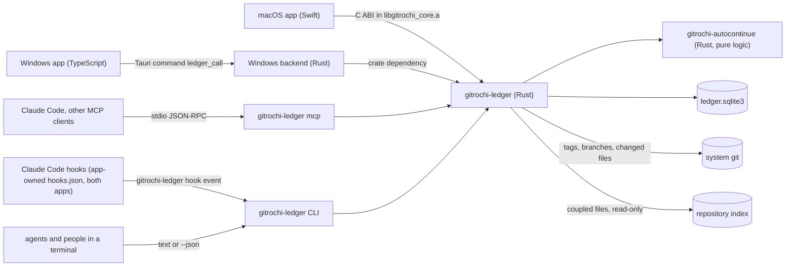

# Ledger design

> **Status: P0 design; the maintainer confirmed decisions D1–D10 on 2026-10-31.** The code is being built in parallel ([§12](#12-phases-and-waves)) against **contract v0** ([§6](#6-contract-v0)): the shared types and methods, owned by the core crate `crates/gitrochi-ledger`, whose JSON Schema is their authoritative form. This document follows contract v0; where it describes more than v0 covers, the text says *proposed*. Decisions ([§14](#14-decisions)): D1–D10 confirmed as recommended, and D7's compatibility surface is kept; D11–D13 are working defaults, and the additive-only rule below changed D11 and D13. To change a decision or the contract, change the schema and this document together.

Agents report which baseline their work started from and where it stands. Gitrochi draws the sessions as branches off a baseline trunk, and a person only answers, confirms and cleans up. Information flows one way — **agent → ledger → screen**. The screens never drive an agent: what a person writes (an answer, a message, a status) waits in the ledger until that session's next report or read picks it up. The one exception is opt-in: when a person turns on auto-continue, Gitrochi answers an agent that has waited too long for them, within fixed limits, and records it for review ([§9](#9-auto-continue)).

This document is the contract for phases P1–P5: the feature map, the shared types, the rules (verdicts, resuming, hand-offs), the permission boundary, auto-continue, the screens and the open decisions.

**Additive only** (the maintainer's rule, 2026-10-31). Ledger is one feature among others, and it only adds. It never removes, renames, replaces or changes the behaviour of an existing menu, page, shortcut, panel, setting, command or CI check. With the Ledger off, every existing feature behaves exactly as on `main`, and tests prove it wherever an existing file is touched. Its entry points are its own row in Tools under Flows (`⌘7` / `Ctrl+7`), its own Settings › Ledger tab, and the Ledger group appended to the macOS palette.

## 1. Where it comes from

Ledger reimplements the ideas of an existing standalone tool, *claude-ledger* (a Python standard-library server, a single-page HTML dashboard and an Electron shell). That project has no license file, so Gitrochi takes **concepts and observable behaviour only**: no code, wording, styles or schema text is copied, and its tests are read as a behaviour specification and rewritten as Rust tests in our own words (decision D7). Its organisation-specific parts — parsers for one team's document formats, its file-naming conventions, a merge-request tab for one server, an IP allow list for a second PC — are left out or generalised (D2–D4).

What Gitrochi adds on top:

- **Tracking without reports** (opt-in). Sessions Gitrochi launches already carry Claude Code hooks. With **Track agents I start** on, the ledger records their activity too, so "stale" is accurate even when an agent forgets to report, and a session used again after it was archived resurfaces.
- **Git links.** A session knows its branch, worktree, commits, pull request and running agent. "Touches" are what the agent declared plus the files its branch actually changed, and overlap warnings also use the repository index's change coupling.
- **Fast triage.** The Inbox works from the keyboard alone, and confirming or archiving shows an undo toast.
- **Auto-continue (opt-in).** An agent that asks about its implementation and gets no answer within 30 s (adjustable) receives a safe "go ahead" from Gitrochi through documented Claude Code hooks; the person reviews it later ([§9](#9-auto-continue)).
- **One look, both platforms.** Native screens built from Gitrochi's existing parts, on macOS and Windows, with the rules in Rust.
- **Existing data carries over.** A read-only import of a claude-ledger database (D5).

## 2. Feature map

| Original | In Gitrochi | Phase | Notes |
|---|---|---|---|
| Sessions, events, questions, verdicts, resume rules, overlaps | **Core**: new crate `crates/gitrochi-ledger` | P1 | Rules in [§7](#7-rules); the original's scenarios become Rust tests |
| Baseline trunk from version folders | **Baselines** with a choosable source: git tags (default), folder or file name pattern, registration and `release` events | P1 | D6 |
| Graph: trunk + session branches, 7 days · 30 days · all | **Graph** view; lanes computed in Rust, drawn with the commit graph's colours and line widths | P2 | [§10.5](#105-graph) |
| "My turn": questions, clean-up, decisions | **Inbox** (the first screen) + a badge on the Ledger's own sidebar row | P2 (badge P3) | The original's count, plus auto-continue reviews |
| Clean-up board | **Board**: verdict filter chips, multi-select, bulk actions | P2 | |
| Implementation channel and its cycles | **Streams**; which kinds have the decision role and which the implementation role is a setting | P4 | No kind names in the rules |
| Ctrl+K search | macOS: a Ledger group appended to `WorkspaceCommandPalette`; Windows: search inside the Ledger page (D11) | P3 | No Ledger-only search window |
| Paste import of ```` ```ledger ```` blocks | **Import** sheet; the duplicate hash is kept | P1 parser, P4 sheet | |
| MCP tools and CLI | `gitrochi-ledger`: a CLI (short text, or JSON with `--json`) with an `mcp` stdio subcommand, bundled with both apps | P1 binary, P3 sheet | The "Connect Claude…" sheet copies a `claude mcp add …` command and a config snippet; it never edits a client's files |
| Tray notifications | Native notifications + Dock/taskbar badge, switchable in Settings | P3 | Neither app has system notifications yet |
| Electron terminal and quick launch | "Ledger overview" and "Claude Code" quick launches in the Ledger page, opening tabs through the terminal's existing API | P4 | |
| GitLab merge-request tab and merging | Nothing new, and the existing pull/merge request pages stay untouched: the Ledger inspector links to the request | P3 | Merging stays in Gitrochi's own confirmed flow |
| AI "current state" summary | Gitrochi's AI service and its stored key | P5 | Off without a key or offline |
| Daily backup, 14 kept | The same, with `VACUUM INTO` | P1 | |
| Sharing with another PC (IP allow list) | Not in the first release; later on the hub's token authentication | — | D4 |
| Parsers for one team's documents (open-question lists, directives, registries, notices, ID dictionary) | A general **document tracker** configured in settings, or nothing | P5 | D2 |
| Work ledger (bundles, items, reports) | A general **Work log** | P5 | D3 |
| Personal notes | Later | P5 | Person-only; never in agent output |
| Chat link per session | Kept ("Open chat" in the inspector) | P2 | |
| — (new) | **Auto-continue** when nobody answers an agent's question in time | P3b | [§9](#9-auto-continue); D8–D10 |

Not carried over: the Python code itself ([§4](#4-architecture)), the HTTP server and its request guards (the app reads the database directly, so nothing listens on a port), the tray launcher, the Electron shell, the remote client bundle, and a reminder that one team attached to questions from certain kinds.

## 3. Vocabulary

| Term | Meaning |
|---|---|
| **Session** | One unit of agent work — usually one conversation, often one branch or worktree. Shown as a branch in the graph. |
| **Baseline** | A version of the source of truth a project's work starts from: a release tag, a spec folder, a registered version. The newest is **HEAD**. |
| **Base** | The baseline a session started from (`baseVersion`) and the one it is on now (`baseCurrent`, moved by `sync` and `release`). **Behind** = how many baselines are newer than `baseCurrent`. |
| **Report** | An event an agent sends (`start`, `artifact`, `question` …). |
| **Question** | Something an agent needs a person for. Open questions put the session in **Needs you**. |
| **Verdict** | What a person should do with a session — computed, never stored ([§7.3](#73-verdicts)). |
| **Role** | Derived from a session's free-text `kind`: `decision`, `implementation`, `research`, `document` or `other`. The rules use roles, never kind names. |
| **Confirm** | A person's acknowledgement that a finished session's outcome is right (`ack`). |
| **Archive** | A person's statement that the conversation is cleaned up and may be closed. Not the same as **shelve** (paused research a person wants to keep). |
| **Stream** | A long-running implementation session that reports in cycles instead of finishing; each belongs to a **line** (default `core`) ([§7.8](#78-streams)). |
| **Hand-off** | The only path by which an agent's report changes another session ([§7.7](#77-hand-offs-sync-and-applied)). |
| **Touches** | What a session works on: IDs, modules or files the agent declared, plus files its branch changed. |
| **Pending prompt** | An agent waiting for the person inside its own conversation — the thing auto-continue answers ([§9](#9-auto-continue)). |
| **Actor** | Who wrote an event: `agent`, `human`, `auto` (auto-continue) or `hook`. |

Values, all stored as lower-case English identifiers:

- **Statuses** (stored): `active`, `done`, `merged`, `closed`, `dropped`, `shelved`.
- **Verdicts** (computed, in priority order): `archived`, `needs_human`, `expirable` or `confirm`, `shelved`, `pending_merge`, `stale`, `active`.
- **Agent events**: `start`, `progress`, `artifact`, `question`, `decision`, `sync`, `done`, `merged`, `closed`, `dropped`, `shelved`, `release`, `applied`, `note`, `heartbeat`. The input side also accepts the original's Korean aliases for event and kind names, so existing instructions and pasted blocks keep working; those alias strings are input data in one table, like translations, and never appear in output.
- **Gitrochi events**: `auto_reply` (actor `auto`) and `hook` (actor `hook`).
- **A person's actions** (each recorded as an event with actor `human`): `ack`, `unack`, `archive`, `unarchive`, `set_status`, `answer`, `dismiss`, `snooze`, `shelve`, `link`, `message`.
- **Attention groups**: `questions`, `tidy` (to clean up), `decide`, `autoReview`.

## 4. Architecture

**Languages** (the maintainer's rule: change the language wherever that serves the feature better). The original is Python; none of it is ported. The shared logic, the CLI, the MCP server and the hook handler are **Rust**: one binary with no runtime, so it runs on Windows machines that have no Python, and it starts in about a millisecond where hooks may run on every tool call (starting a Python interpreter alone takes tens of milliseconds). The screens are Swift and TypeScript, as everywhere in Gitrochi. Ledger adds no Python code. Where another language serves a part better, this document says so with the reason — sharing between PCs, if D4 ever asks for it, belongs on the existing Go hub (long-running network service, token authentication already there).



Two crates, each following `crates/gitrochi-index` wherever a pattern already works there:

```
crates/gitrochi-ledger/        the store, the rules, graph layout, CLI, MCP, C ABI, demo data, JSON Schema
  schema/                      JSON Schema of contract v0 (schemaVersion 1)
  src/schema.sql, db.rs        open, configure, migrate (PRAGMA user_version, additive steps only)
  src/store.rs                 the one transaction function every write goes through; bumps meta.rev
  src/report.rs, human.rs      agent reports and a person's actions
  src/verdict.rs, streams.rs   verdicts, roles, stream cycles (computed, never stored)
  src/baseline.rs              tag, folder and registered sources; numeric order; inferred versions
  src/graph.rs                 lanes, nodes and edges for the Graph view; the apps only draw
  src/overlap.rs               shared touches + coupled files from the repository index
  src/import.rs                ```ledger blocks and duplicate hashes (the legacy database import: wave 2)
  src/text.rs                  short English text for agents
  src/api.rs                   one dispatcher (method + JSON) behind the C ABI, Tauri, `call` and MCP; caller-aware (§8)
  src/ffi.rs, mcp.rs, main.rs  the C ABI, the MCP stdio server, the gitrochi-ledger binary
  src/hook.rs                  `gitrochi-ledger hook` (wave 2)
crates/gitrochi-autocontinue/  auto-continue's pure logic, no I/O: question detection, the never-auto-allowed rules,
                               the recommended option, the answer text, Claude Code hook output formats
```

- **Methods.** JSON in, JSON out, errors as `{"error": {"code", "message"}}` ([§6.2](#62-methods)). The C ABI is `gitrochi_ledger_call(method, json)` / `gitrochi_ledger_free`, re-exported from `libgitrochi_core.a` and declared in `gitrochi_core.h`; Windows uses one Tauri command, `ledger_call(method, args)`, on a blocking thread. Both apps reach it through a backend interface with a single `call(method, args)` — a demo backend until the native one is wired in wave 2 — so the screens never know which backend they talk to.
- **CLI.** `gitrochi-ledger report`, `overview`, `session`, `import`, `scan`, `backup`, `demo`, `call` and `mcp`, plus `hook` in wave 2. Short text by default, JSON with `--json`; the index's exit codes (0, 1, 2).
- **Database.** One SQLite file per user at `default_db_path()`: macOS `~/Library/Application Support/Gitrochi/ledger/ledger.sqlite3`, Windows `%APPDATA%\Gitrochi\ledger\ledger.sqlite3`, elsewhere `$XDG_DATA_HOME/gitrochi/ledger/ledger.sqlite3` — next to the apps' existing `agents/` folder. `GITROCHI_LEDGER_DB` overrides it and `GITROCHI_LEDGER=0` turns the feature off, like `GITROCHI_INDEX_DB` and `GITROCHI_INDEX=0`.
- **One writer.** Only `gitrochi-ledger` code writes, from whichever process runs it (an app, the CLI, the MCP server, a hook), always through the one transaction function that bumps `meta.rev`: WAL, `BEGIN IMMEDIATE`, a 15 s busy timeout (*proposed*: about 1.5 s on the hook path, so a hook never nears Claude Code's 5 s limit), additive migrations under `PRAGMA user_version`. A binary that finds a newer schema than it knows refuses to write. `docs/architecture.md` gets this database and its contract in P1.
- **Change signal.** The apps read `rev` cheaply (every 2 s, or on a change to the database folder) and fetch `state` only when it moved. The app runs no HTTP server.
- **Text.** Times are epoch milliseconds; every input string is NFC-normalised (long text line by line, which is much faster on multi-megabyte input and gives the same result).
- **WebAssembly.** The Windows screens build every workspace member for `wasm32`; like the index, the ledger crate compiles to nothing there.
- **Dependencies.** The ledger crate uses the index's (`rusqlite` bundled, `serde_json`) plus `unicode-normalization` (MIT or Apache-2.0, with `tinyvec`), because the standard library has no NFC. The duplicate hash needs SHA-1 for compatibility with the original's hashes; it is written in the crate (checked against the standard test vectors) rather than pulled in. Local dates for session IDs and backup names come from SQLite's `strftime(…, 'localtime')`, so no time-zone crate is needed. The auto-continue crate needs nothing beyond the standard library.

## 5. Where it plugs in

| Existing piece | How Ledger uses it |
|---|---|
| Agent center: `Services/Agents.swift` ↔ `entities/agent`, `src-tauri/src/agents.rs` | Only while **Track agents I start** (Settings › Ledger, off by default) is on, "Start agent" creates the ledger session ([§7.11](#711-tracking-launched-agents)) and passes `GITROCHI_LEDGER_SESSION` next to `GITROCHI_AGENT_ID`. With it off, the launch command and the environment are byte-for-byte what they are today, and a test checks that. The Ledger inspector shows the agent's live state and opens its terminal tab through the existing APIs. |
| Claude Code hooks: the app-owned `hooks.json` passed with `--settings` (`hook.sh` on macOS, `Gitrochi.exe --agent-hook` on Windows, `hooks-wsl.json` for WSL) | Only while **Track agents I start** is on, both apps add `gitrochi-ledger hook <event>` entries next to the existing ones (WSL: the Windows executable, as `hooks-wsl.json` already does): activity on `SessionStart`, `UserPromptSubmit`, `Stop` and `SessionEnd`; auto-continue on `Stop`, `PreToolUse` (question tools only) and `PermissionRequest` ([§9](#9-auto-continue)). The existing entries keep their exact content and `timeout: 5`; with tracking off, the hooks file is byte-for-byte what it is today, and a test checks that. Nothing is written to a project's or the user's Claude settings. |
| `ExternalAgents` (process scan, both platforms) | Agents Gitrochi did not start appear in the Inbox as "Running, not in the Ledger" — a suggestion with **Track** and **Hide**, never an automatic session. The scan runs while the Inbox is visible, as it does for the Agents tab. |
| Repository index (`gitrochi-index`) | Read-only `coupled` queries for overlap warnings; the ledger never writes the index. |
| Commit graph (`gitrochi-core` `graph::layout`, `Palette.lanes`/`GraphMetrics` ↔ `laneColors`/`metrics.ts`) | The core may reuse the layout to compute the Graph view's lanes; the apps draw with the commit graph's colours and metrics ([§10.5](#105-graph)). |
| Pull/merge request pages (`PullRequestSection`, `PullRequestDetailView` on both platforms) | Untouched — no chip. The Ledger inspector links to a session's request instead (head branch, or a session ID in the request's title, branch or description) and opens it on the existing page. |
| `WorkspaceCommandPalette` (macOS) | Adding `.ledger` to `WorkspaceDestination` gives "Go to Ledger"; a Ledger group appended to the palette's command list adds sessions, questions and baselines from `search`. |
| `MCPConnectionSheet` (both platforms) | The Connect Claude Code sheet follows its layout (Copy configuration, Test connection) and adds the `claude mcp add` command. |
| AI service (`Services/AI.swift` ↔ `entities/ai`) | Auto-continue's optional refinement and P5 summaries, through `complete`, with the key Gitrochi already stores. |
| `MarkdownView` ↔ `shared/ui/Markdown.tsx` | Report bodies and questions. |
| Terminal panel | P4 quick launches from the Ledger page, through the terminal's existing API only. |
| `tools/gitrochi-mcp` (read-only) | Untouched. Ledger's writing tools live in their own server so the read-only server stays read-only. |
| `services/hub` | Only if D4 asks for sharing later. |

## 6. Contract v0

The shapes every part builds against. The core crate's JSON Schema (`crates/gitrochi-ledger/schema/`) is authoritative and this section mirrors it. JSON field names are camelCase; times are epoch milliseconds; `?` marks an optional field.

### 6.1 Types

```text
Session       { id, project, title, kind, role, status, verdict,
                baseVersion?, baseCurrent?, mergedInto?, touches[], related[], chatUrl?,
                links { repoPath?, branch?, worktree?, pr? { host, number, url }, agentId?, agentSessionId?, cwd? },
                color (0–7), createdAt, lastAt, lastAgentAt?, ackAt?, snoozeUntil?, archivedAt?,
                openQuestions, stream? { line }, autoContinue? { enabled, delaySec } }
LedgerEvent   { id, sessionId, ts, type, actor, summary?, body? (Markdown, at most 60,000 characters), version?,
                artifacts?[{ name, ssot?, ver? }], data?, deliveredAt? }
Question      { id, sessionId, text, state (open · answered · dismissed), answer?, answeredBy? (human · auto),
                createdAt, answeredAt?, deliveredAt? }
Baseline      { project, version, ts, source (tag · folder · registered · release · inferred), note?, bySession? }
StreamCycle   { sessionId, line, version, state (applied · active · skipped), syncedAt?, appliedAt?, releasedBy?,
                eventIds[] }
Overlap       { a, b, paths[], kind (same · coupled) }
PendingPrompt { id, sessionId?, agentId?, kind (stop_question · ask_user_question · exit_plan_mode · permission),
                payload, createdAt, deadline, state (waiting · answered · auto · released · expired), answer?,
                answeredBy? }
Attention     { questions, tidy, decide, autoReview, total }
State         { schemaVersion: 1, rev, now, projects[{ key, name, open }], baselines, sessions, questions (open only),
                streams, overlaps, pendingPrompts (waiting only), attention, hiddenBefore }
Graph         { lanes, nodes[{ id, lane, ts, color, kind (baseline · start · event · merge · release · end),
                sessionId?, version?, label? }], edges[{ from, to, kind (trunk · branch · merge · handoff), color }],
                from, to }
```

- `lastAt` is the last activity of any kind (an agent report or a hook); `lastAgentAt` the last agent report. A session without `lastAgentAt` is *unreported* (D13).
- **Still active** sets `snoozeUntil` to now plus the stale hours; a session is stale when now is past both `lastAt` plus the stale hours and `snoozeUntil` — the original's rule in another form.
- `State` carries sessions, open questions, baselines, streams, overlaps and waiting prompts, never every event; `hiddenBefore` says where the chosen period starts. A session's events come from `session`.
- `Graph` is laid out in Rust; the apps only draw it.

### 6.2 Methods

| Method | Input | Answer | Callers |
|---|---|---|---|
| `info` | — | versions, database path, schema version | apps, CLI |
| `rev` | — | `rev` | apps |
| `state` | `project?`, `range?` (`7d` · `30d` · `all`) | `State` | apps, CLI |
| `session` | `id` | the session with its events and questions; read only | apps, CLI |
| `graph` | `project`, `range?` | `Graph` | apps |
| `search` | `query`, `project?`, `limit?` | matching sessions, questions, events, baselines | apps, CLI |
| `report` | the original's report fields ([§7.1](#71-events)) | the session, notices, and the person's waiting messages, delivered exactly once | agents (MCP, CLI) |
| `overview` | `project?`, `session?`, `deliver?` | the short overview for agents | agents (MCP, CLI) |
| `import` | `text`, `project?` | a result per block | apps, CLI |
| `human` | `action`, `sessionId`, … | `ok` | apps only — never MCP or CLI |
| `prompt_answer` | `id`, `answer` | `ok` | apps only |
| `backup` | — | the new file | apps, CLI |

MCP exposes three tools — `ledger_overview`, `ledger_report`, `ledger_session` — and no person's action.

### 6.3 Storage

The core crate owns the tables; in outline: `meta` (`rev`), `settings` (key/value: stale hours, the kind-to-role mapping, stream lines, auto-continue defaults), projects, baselines, sessions, events, questions, `pending_prompts`, and `imports` (duplicate hashes), plus whatever caches the core keeps (changed files per branch tip). Statuses are stored; verdicts, roles, cycles and overlaps are computed.

- Session IDs keep the original's shape so imported and pasted IDs stay valid: issued as `S<MMDD>-<nn>`, or given by the agent as 3–48 letters (any script), digits, `.`, `_` and `-`.
- `color` is the creation order within the project modulo 8, mapped to the commit graph's lane palette; a row always shows the session ID next to its colour.

## 7. Rules

These are the behaviour every client sees. P1 fixes each rule with a Rust test; the scenarios come from the original's test suite, rewritten.

### 7.1 Events

| Event | An agent sends it when | Needs | Effect |
|---|---|---|---|
| `start` | the work's nature is clear | `project` for a new session; `title`, `kind`, `base`, `touches` expected | Creates the session; on an existing session it is recorded as `progress` |
| `progress` | (default) | | None |
| `artifact` | it produced something | `artifacts[{name, ssot?, ver?, path?}]` | `ssot` defaults to `baseCurrent` and is marked inferred |
| `question` | it needs a person | `question` | Opens a question → **Needs you** |
| `decision` | it reached a conclusion | | None |
| `sync` | it moved to a newer baseline | `version` | `baseCurrent` = version; a hand-off for the implementation role ([§7.7](#77-hand-offs-sync-and-applied)) |
| `done` | the work is finished, merge undecided | | `status = done` |
| `merged` | the result went into a baseline | `into` | `status = merged` |
| `closed` · `dropped` | finished without a merge · result discarded | | `status = closed` · `dropped` |
| `shelved` | (research and document roles only) paused without a merge | reason in `summary` | `status = shelved` |
| `release` | this session made a new baseline | `version`, `absorbs[]` | Adds the baseline (`source = release`, `bySession`); absorbed sessions become `merged` |
| `applied` | (implementation role) applied baseline vX **because a person told it to** | `version`, `targets[]?` | Hand-off ([§7.7](#77-hand-offs-sync-and-applied)) |
| `note` | for reference | | None; never reopens or un-confirms |
| `heartbeat` | alive | | Updates the activity time only; no event |

Any event may carry `body` (Markdown, up to 60,000 characters, cut with a notice), `questions[]` (one question each), `resolves[]` (question numbers the session settled itself), `touches[]` and `related[]` (merged as sets), `ssot`, `chat_url`, and `work[]` (kept in `data` until D3). Loose types are accepted where the original accepted them: a single string for a list, a number for a question list, an object for one artifact.

### 7.2 Processing a report

All in one transaction:

1. Normalise the event name (aliases → English), validate; reject unknown events, `release`/`sync`/`applied` without a version, a `question` without text, a new session without a project, a malformed session ID.
2. Resolve the session and the project. The session is the explicit `session`, else `GITROCHI_LEDGER_SESSION`, else (*proposed*) the session linked to `CLAUDE_CODE_SESSION_ID`, which Claude Code sets for the MCP servers and commands it starts — so an agent never has to remember its ledger ID. The project is the explicit `project`, else the session's, else the repository of `CLAUDE_PROJECT_DIR` or of the working folder. Scan its baselines (throttled to once per 15 s per project).
3. Find or create the session. `base: "latest"` (or `head`) is stored as the HEAD number at that moment, and the session remembers that it came from `latest`. A version the trunk lacks is added as `inferred`. A non-`start` event creates the session with an automatic `start` before it. A `start` with a different title on an existing ID is a conflict — except on a session no agent has reported to yet, which the app registered at launch ([§7.11](#711-tracking-launched-agents)): there the agent's title, kind and base win.
4. Merge fields: title, kind, chat link; `touches` and `related` as sets.
5. Apply the resume rules ([§7.4](#74-resuming)), then the event's effect ([§7.1](#71-events)).
6. Any event but `note`/`heartbeat` clears the session's own `ackAt`.
7. Store questions, resolved questions, the body; insert the event (not for `heartbeat`); update the session.
8. Build the reply in the same transaction: the session, HEAD, short notices (behind on `start`/`sync`/`artifact`/`release`/`applied`; overlaps whenever the session has touches; other open sessions on `start` only; shelved material on `start`; one line per hand-off target), then deliver waiting messages ([§7.6](#76-delivery)). Commit (`rev + 1`).

### 7.3 Verdicts

Computed on read, first match wins:

| # | Condition | Verdict | Label | What a person does |
|---|---|---|---|---|
| 1 | `archivedAt` set | `archived` | Archived | Nothing (hidden by default) |
| 2 | an open question | `needs_human` | Needs you | Answer or dismiss — the session receives it on its next report |
| 3 | status `merged` · `closed` · `dropped` | `expirable` if confirmed, else `confirm` | Ready to archive · To confirm | Confirm, then archive |
| 4 | status `shelved` | `shelved` | Shelved | Keep; it never turns stale |
| 5 | status `done` | `pending_merge` | To decide | Mark merged (version), close or drop |
| 6 | now is past `lastAt` + 72 h (the stale hours) and past `snoozeUntil` | `stale` | Stale | Check the conversation: close it, or **Still active** |
| 7 | otherwise | `active` | Active | — |

Shown next to the verdict: `stream`, behind, overlap, and *unreported* (no agent report yet). "Live" means not `merged`/`closed`/`dropped`/`shelved` and not archived.

### 7.4 Resuming

The rule that keeps a cleaned-up conversation from being silently reused:

- `start`, `progress`, `artifact`, `question`, `decision`, `sync` or `applied` on a session that is not `active` makes it `active` again and clears `ackAt`, `archivedAt` and `mergedInto`; the event keeps where it came from (`reopenedFrom`).
- Any agent event except `note` and `heartbeat` clears `archivedAt`, including a `release` that absorbs an archived session.
- *Proposed:* a prompt observed by a hook on a confirmed or archived session clears `ackAt` and `archivedAt` (not the status) and records a `hook` event — so a conversation used again after a person confirmed it goes back to **To confirm** even if the agent never reports.

### 7.5 A person's actions

Through `human {action, sessionId, …}`, apps only:

| Action | Effect |
|---|---|
| `answer` · `dismiss` | Settle a question; delivered to the session once ([§7.6](#76-delivery)) |
| `ack` · `unack` | Confirm or unconfirm |
| `set_status` | `active`, `done`, `merged` (with a version), `closed` or `dropped`. A status a person chooses counts as confirmed: `merged`, `closed` and `dropped` also set `ackAt`; `active` clears `ackAt` and `archivedAt`. Delivered to the session. |
| `shelve` | Status `shelved` (research and document roles); does not confirm |
| `archive` · `unarchive` | Clean up, or bring back |
| `snooze` | **Still active**: sets `snoozeUntil`, leaves the agent's times as they were |
| `link` | Set or clear a branch, worktree, request or agent link |
| `message` | A note to the session, delivered once |

*Proposed* additions, all in the original or needed by the screens: `edit` (title, kind, chat link, touches), `delete` (removes the session and its events), `add_baseline` (register or annotate a baseline), and `undo` (restores what the previous action changed if nothing changed since; it is what the undo toast calls). Dropping and deleting ask once; the rest are undone from the toast.

### 7.6 Delivery

A person's answers, dismissals, messages and status changes are delivered **exactly once**, in the same transaction that marks them delivered: with the session's next `report` reply, or with `overview` for that session and `deliver`. The MCP tool `ledger_session`, which an agent calls for its own session, delivers as in the original; the CLI delivers only with `--deliver`. Reading for maintenance — the apps, the `session` method, `overview` without a session — never consumes messages. Undoing a status change that was already delivered queues a new message.

### 7.7 Hand-offs (sync and applied)

The only paths by which an agent's report changes another session. They keep the original's scope and do not widen without a decision recorded here:

- **sync.** When a session with the implementation role on a *confirming* line ([§7.8](#78-streams)) syncs to vX, the session that released vX (`bySession`) — if it has the decision role and is neither finished nor archived — becomes `merged` into vX **without** confirmation (→ To confirm), with a `merged` event (`by`, `via: "sync"`, `fromStatus`). Repeating the sync does nothing more. Open questions stay.
- **applied.** When such a session reports `applied` for vX, the targets (`targets`, else the releasing session) that have the decision role become `merged` into vX **and confirmed**, archived is cleared, and each gets an `applied` event with `by`. Others are skipped with a notice; a target already merged and confirmed at vX is left alone. Open questions stay, so the target can still be **Needs you**. The reporting session's own `baseCurrent` only moves forward.
- On a line that does not confirm, `sync` and `applied` only mark the cycle; no other session changes.
- No other agent path sets `ackAt`. The ledger cannot check that a person really asked for the application; the agent's instructions say so, and the inspector labels such sessions "Confirmed by S… (applied)" with **Unconfirm** and **Reopen**.

### 7.8 Streams

- **Roles.** Each kind maps to a role in `settings` (defaults from the alias table: research, decision, implementation, document; anything else is `other`). Shelving is for the research and document roles; hand-offs target the decision role.
- **Lines.** Each implementation kind belongs to a stream line, by default `core`; a line either confirms hand-offs (`core` does) or only marks cycles, which is how the original kept a second implementation channel from confirming decisions.
- A session is a **stream** while it has the implementation role and its status is not `merged`, `closed` or `dropped`. Streams keep their verdict (questions and staleness still show) but stay out of the Board, open-session lists, overlaps and project open counts; the graph still draws them. When a person closes a stream it behaves like any session; a new report makes it a stream again.
- **Cycles** (`StreamCycle`, computed): walking the agent's events in time order, `sync` to vX starts the vX cycle; the session's own `applied` vX attaches to the vX cycle and moves the current version forward only; anything else joins the current cycle. Newest version first. A cycle with an `applied` is *applied*, the newest otherwise is *active*, older ones are *skipped*. Each cycle names the session that released its version.

### 7.9 Baselines

- **Sources** per project: `tag` — tags of the bound repository matching the pattern (default `^v?(\d+(?:\.\d+)+)$`; the first group, or the whole match without one), timestamp from the tag (or its commit); `folder` — folder (and, optionally, file) names under a chosen folder and listed sub-folders, not recursive, timestamp = the earlier of created and modified; `registered` — added by a person or by `gitrochi-ledger`'s CLI. Every project also takes `release` events.
- Versions compare as numeric tuples; HEAD is the largest. A tag the pattern does not match (pre-releases, say) is ignored.
- A version first seen in a report is `inferred`; a later scan or registration upgrades it and its time. For drawing, an inferred version's time is moved before the next higher version's.
- A scan failure (bad pattern, unreadable folder, git error) is logged and never blocks a report.

### 7.10 Overlaps

Two live, non-stream sessions in the same project overlap (`kind: same`) when their touches share an entry. When both have changed files in the same repository, the repository index's `coupled` relation adds a weaker overlap (`kind: coupled`, "files that usually change together"). Shelved sessions are not warned about but are mentioned once, as material, to a session that starts on the same touches.

### 7.11 Tracking launched agents

Wave 2.

- **Start.** When a person starts an agent from Gitrochi and **Track agents I start** is on (it stays off until a person turns it on; D13), the app creates the session before launch with the core's `track` method (title and base set automatically: the branch name, and the newest baseline tag reachable from the worktree), fills its `links` (agent, branch, worktree, folder) and passes `GITROCHI_LEDGER_SESSION`. The session has no agent report yet, so the agent's own first `start` fills in its title, kind and base. The MCP server uses it as the default `session`, so the agent's reports land on the right session without being told the ID. Wave 2 also checks whether launching with `--session-id` lets the app link the Claude session ID before the first prompt (the documentation does not say that it matches the hooks' `session_id`).
- **Hooks.** `UserPromptSubmit` updates `lastAt` and fills `links.agentSessionId` from the payload; `Stop` and `SessionStart` update `lastAt`; `SessionEnd` records a `hook` event. Claude Code holds the prompt until `UserPromptSubmit` hooks finish, so that handler must stay in milliseconds. `/clear` gives the conversation a new Claude session ID (`SessionEnd` with reason `clear`, then `SessionStart` with source `clear`); the ledger session follows the launch, keeps its own ID and records the new one, while still finding itself by the old one, which the MCP server keeps. `SessionEnd` is not documented to fire when the agent crashes or its terminal is closed, so the agent center's liveness check records those ends. Activity hooks store IDs and times only — never prompt text or tool input — and they never change a status. (Auto-continue, when a person turns it on, also keeps the question it answered; [§9](#9-auto-continue).)
- **Never block the agent.** The activity path opens the database, runs one transaction, prints nothing and exits 0 on every failure. The only hooks that wait are auto-continue's, and only for sessions where a person turned it on.
- **Unreported sessions** (no `lastAgentAt`) count in the Inbox only when their branch has commits beyond its base; until then they wait under the Board's **Unreported** filter (D13).
- **Git refresh.** After the repository reloads, the app asks the core to refresh live sessions whose branch tip moved: changed files, commit count, merged state.

### 7.12 Imports

- **Pasted text** (`import`): every fenced ```` ```ledger ```` block; without fences, the whole text as JSON, or each line that starts with `{` and has an `"event"` key. Each block is reported with timestamps 1 ms apart to keep the order. One bad block does not stop the rest; each gets `ok`, `duplicate` or `error`. The duplicate check and the report share one transaction (the original checked first and wrote afterwards). The hash is computed on canonical JSON the same way as the original, so blocks imported there are recognised here after D5.
- **A claude-ledger database** (D5, wave 2): opened read-only, never written; projects, baselines, sessions, events, questions and import hashes are copied, kinds mapped through the alias table, unknown kinds kept. A session whose ID already exists is skipped and listed. Work-ledger and note tables are not read before D3.

### 7.13 Text for agents

Replies to agents are short English text, because every report reply costs each session context: the overview (HEAD, recent baselines, open sessions, streams in one line each, overlaps, waiting messages), the report reply (recorded event, notices, messages) and the session (state, questions, recent events). `--json` and the MCP `structuredContent` carry the full data for tools.

### 7.14 Backups

While the app runs, once a day, `VACUUM INTO` writes `ledger/backups/ledger-YYYYMMDD-HHMM.sqlite3`; the newest 14 are kept and only files with that name shape are ever removed. `backup` does the same on demand. Restoring is manual and documented.

## 8. Permission boundary

The product rule from the original: confirming, archiving, changing a status, answering and deleting are a person's judgement. If an agent could press those buttons, the ledger would lose its reason to exist.

| Operation | Apps (a person) | MCP | CLI | Hook |
|---|---|---|---|---|
| `report`, including the `sync` and `applied` hand-offs | — | ✓ `ledger_report` | ✓ | — |
| `overview` | — | ✓ `ledger_overview` | ✓ | — |
| `state`, `session`, `graph`, `search`, `info`, `rev` | ✓ | — | ✓ through `call` | — |
| Delivery of a person's messages | — | own session (`ledger_session`, `ledger_overview` with it) | `--deliver` | — |
| `import`, `backup`, `scan`, `demo` | ✓ | — | ✓ | — |
| `human` — every person's action | ✓ | — | — | — |
| Answering a pending prompt | ✓ `prompt_answer` | — | — | automatically, after the wait, within [§9.4](#94-safety) |
| Settings: roles, lines, stale hours, baseline sources, auto-continue defaults | ✓ | — | — | — |
| Activity and the Claude session link | — | — | — | ✓ |

- `api.rs` takes the caller (`app` or `agent`) from the entry point, not from the request: the C ABI and the Tauri command are `app`; the CLI (including `call`), MCP and the hook are `agent`. `human` and `prompt_answer` answer `NOT_ALLOWED` to an agent caller, and no flag turns the CLI into an app caller.
- The database file is not a security boundary — anything running as the user can open it. The boundary is about the tools Gitrochi hands to agents. gitch is not changed.
- MCP's stdout carries JSON-RPC only; logs go to stderr.
- Merging pull requests stays in Gitrochi's existing confirmed flow; the ledger has no path to it.
- Auto-continue answers only an agent's own wait in its conversation. It never performs a person's ledger action, never answers or closes a question in the Ledger, and never presses a gitch or system confirmation dialog.

## 9. Auto-continue

> Added at the maintainer's request; built in P3b (wave 2 for the hook handler; the pure logic is in `crates/gitrochi-autocontinue` from wave 1). Off by default.

When a Claude Code session that Gitrochi launched stops to ask the person something about the implementation, and nobody answers within a set time (30 s by default), Gitrochi answers for the person with a "go ahead" that fits the question. The person reviews or corrects it afterwards in the Ledger. It works only through documented Claude Code hooks, never by imitating key presses.

### 9.1 Where an agent waits

The hook behaviour below was read in the Claude Code hooks documentation (`code.claude.com/docs/en/hooks`) on 2026-10-31. It was then checked with a real Claude Code 2.1.309; [#171](https://github.com/Gitrochi/Gitrochi/issues/171) has the full table and its evidence.

The documentation confirms:
- the `SessionStart` context: plain stdout or `additionalContext`, at most 10,000 characters, and Claude's first answer waits for it;
- the `PermissionRequest` input (`tool_name`, `tool_input`, `mcp_server`, `permission_suggestions`, but no `tool_use_id`) and its JSON decision, where exit 2 is not honoured;
- the `Stop` input (`stop_hook_active`, `last_assistant_message`), and that Claude Code stops honouring `Stop` continuations after 8 in a row;
- that `PostToolUse` and `PostToolUseFailure` fire once a call ran, with `duration_ms`;
- that `PermissionDenied` fires only for auto mode's own denials, never for a person choosing No.

Confirmed live in #171:
- An `asyncRewake` `Stop` hook that exits 2 wakes an idle session. Only its stderr reaches the agent, as a system reminder inside a notification marked as not user input.
- The wake-up fires `UserPromptSubmit` with a prompt that starts with `<task-notification>`, and the `Stop` after the woken turn has `stop_hook_active: true`.
- `allow` plus `updatedInput` answers `AskUserQuestion`; `allow` alone does not. The terminal's question dialog stays hidden while the hook waits and appears when the hook returns no decision. Esc during the wait interrupts the turn and ends the hook.
- **The terminal's permission dialog is not hidden while a `PermissionRequest` hook waits.** The person can answer there, and that answer applies at once. The hook keeps waiting, unaware, and its later decision is ignored.
- A timeout is enforced for `asyncRewake` hooks, but not for plain `async` ones. A hook that times out gives no decision.
- A `PermissionRequest` `allow` allows a command once and writes no rule.

Not checked live: `ExitPlanMode`. It uses the same mechanism as `AskUserQuestion`, and it stays behind its off-by-default setting until P3b checks it.

| The agent waits because | Pending prompt kind | Hook | After the wait | If the person answers first |
|---|---|---|---|---|
| It ended its turn with a question | `stop_question` | `Stop` with `"async": true` and `"asyncRewake": true`, so it runs in the background and the person can still type in the terminal. `last_assistant_message` tells whether the turn ended with a question; `stop_hook_active` stops chains | Exit 2 with the answer on stderr, which wakes the session even when it is idle | Their prompt in the terminal marks it answered (the wake-up's own `<task-notification>` prompt is not theirs); the `Stop` handler exits 0 quietly |
| A choice question | `ask_user_question` | `PreToolUse` matching `AskUserQuestion`, synchronous; it answers with `permissionDecision: "allow"` plus `updatedInput` carrying `questions` and `answers` (`allow` alone does not answer) | The option marked "(Recommended)", else the first | The option the person picked in Gitrochi |
| Plan approval — a setting, off by default (D8); not checked live | `exit_plan_mode` | `PreToolUse` matching `ExitPlanMode`, synchronous, as above | Approve | The person's choice |
| A permission request | `permission` | `PermissionRequest`, synchronous; it answers with `hookSpecificOutput.decision.behavior: "allow"`. The terminal shows its own dialog during the wait | Allow **this once** unless the request is never auto-allowed ([§9.4](#94-safety)); no permanent rule is added. It counts as an automatic answer only once the call is seen to start after it (`PostToolUse` or `PostToolUseFailure`, by `duration_ms`); when nothing tells, the outcome is recorded as unknown | The person's Allow or Deny in Gitrochi, or their answer in the terminal: the call running during the wait, or the agent moving on to something else, shows it, and nothing automatic is recorded |

- **Gitrochi's screens answer during the wait.** The Ledger's prompt strip and a notification show the question and a countdown, with **Answer…**, **Allow**, **Deny**, **Answer in terminal** and **Not this time** (`prompt_answer`). The last two end the hook without a decision (`released`).
  - For `AskUserQuestion` the terminal's own dialog stays hidden during the wait, so these buttons are the only way to answer before it appears.
  - For a permission request the terminal shows its own dialog during the countdown as well, and the person may answer in either place.
  - An answer typed in Gitrochi for a stop question reaches the agent as the same system reminder marked not user input. Where the person's consent matters, answering in the terminal is clearer.
- **Gitrochi not running.** Synchronous hooks do not wait: they return at once without a decision, and the terminal's dialog appears (D10). For a permission request that dialog shows during a wait anyway, so D10 could be revisited there; that is the maintainer's decision. The `stop_question` path needs no Gitrochi screen and works either way. The app shows it is running by setting the modification time of `ledger/app.alive` every 5 s; a hook counts it as running while the file is under 15 s old.
- **One handler for both platforms** (wave 2). `gitrochi-ledger hook <event>` writes a `PendingPrompt` and checks it for an answer every 250 ms. Both apps read the same database, so neither needs waiting code of its own. With auto-continue off for the session it exits within milliseconds.
  - Only these entries get a longer `timeout`: the wait plus a 10 s margin, enforced for the `asyncRewake` `Stop` entry too. The handler keeps its own deadline at the wait. The existing entries keep `timeout: 5`.
  - Short `PostToolUse` and `PostToolUseFailure` entries tell the handler that a call ran. Because `PermissionRequest` input has no `tool_use_id`, the call is matched on its tool and what it acts on (the command, the file, the URL or the query), for the same agent.
- **Permission modes.** Claude Code 2.1.309 starts sessions in auto mode by default, and `PermissionRequest` hooks fire only in a prompting mode. So the permission path applies only to sessions launched in one; launch tracking decides the mode.
- **Other agents.** Codex and Gemini have no such hooks and are left out at first. If they are needed later, the candidate is typing the answer and Enter into the Gitrochi terminal tab that runs the agent, cancelled whenever the person is typing there.

### 9.2 What it sends

`gitrochi-autocontinue` decides and formats; the handler only waits and writes.

- **Structured questions first.** For a session with auto-continue on, the start-of-session context (`SessionStart`, `additionalContext`) asks the agent to use `AskUserQuestion` when it needs the person's decision and to put its recommendation first, marked "(Recommended)". The automatic answer is then the agent's own recommendation; free-text questions on the `Stop` path are the fallback.
- **The free-text answer** is a template in the question's language (detected from its script, otherwise the app's language):

  > *{the question in one line}* No answer for *{seconds}* seconds, so this continues automatically. Go ahead with the option you recommended; if you recommended none, choose the one that is easiest to undo. Do not do anything hard to undo (deleting data, force-pushing, pushing to the main or a protected branch, deploying, changing credentials or account settings); stop and ask again instead. List the assumptions you made in your final summary.

- **Instant by default (D9).** The template needs no network. When the person turns refinement on, the app — not the hook, so keys never leave the Keychain or the Credential Manager — asks the connected AI provider's fast model to fit the answer to `last_assistant_message` a few seconds before the deadline; if nothing is ready by the deadline, the template goes out. The template is editable in Settings; it is a translated app string that the app copies into `settings` so the hook can read it.

### 9.3 Turning it on

Off by default. It is turned on per repository in Settings › Ledger, or per session in the Ledger inspector ("Continue automatically after [30] s without an answer"; `Session.autoContinue {enabled, delaySec}`); defaults live in `settings`. The Start agent sheet and the Agents panel stay as they are. It is independent of Claude Code's permission modes: it never switches to bypass mode or accepts that mode's warning.

### 9.4 Safety

Product rules. Widening any of them needs the maintainer's approval, recorded here.

- **Never auto-allowed** (defaults; the list can grow, not shrink): writing outside the repository; `rm -rf` and the like, `git clean -fdx`; `git push --force`, `-f`, `--force-with-lease`; pushing to the default or a protected branch; `git reset --hard`; `--no-verify`; `sudo`; deploy and release commands; `curl … | sh`; anything touching `~/.ssh`, `~/.gitconfig`, `~/.config/gitsw` or credentials; `gitch use`, `unlock`, `undo`, `amend`, `remove`, `abort` and `gitch rescue --restore`. A command the handler cannot read with certainty (`eval`, command substitution, sub-shells) is not auto-allowed either. *Proposed* in addition: tools of other MCP servers (the request names the server in `mcp_server`), which can act on outside services, unless a person lists them in Settings. Such requests wait for the person with no countdown.
- **Not for decisions.** Sessions with the decision role never auto-continue; questions in the Ledger are never answered or closed automatically; a person's ledger actions (confirm, archive, status changes) are out of reach; gitch's and the system's confirmation dialogs (pushing to main, creating a pull request) are never touched.
- **At most three in a row** per session (Claude Code itself stops honouring `Stop` continuations after 8), counted from the session's `auto_reply` events since the person last answered or typed. The next wait has no countdown, and a notification says why.
- **Everything is on record.** Each automatic answer is an `auto_reply` event (actor `auto`: what waited, the question, the options, the answer sent, the rule that applied, the time) and counts in `attention.autoReview` until a person looks at it: **Confirm**, or **Send correction…**, which sends a `message` to the session (delivered as in [§7.6](#76-delivery)) and offers **Open terminal** to say it now.

### 9.5 Data

`pending_prompts` holds the `PendingPrompt`s ([§6.1](#61-types)); their `payload` is the question, its options and, for a permission request, the tool and command. *Proposed* additions: `reviewedAt` with a `review` action (so **Confirm** on an automatic answer is stored), `rule` (the rule that blocked or allowed it), and no `deadline` for a wait that is never auto-allowed. Unlike the activity hooks, auto-continue keeps the question it waited on so the person can review it; what the person types is still never stored.

## 10. Screens

### 10.1 Placement

- A new workspace destination `ledger`, titled **Ledger** (D1), in the sidebar's **Tools** group under Flows (symbol `checklist` · lucide `ListChecks`), with a badge = `attention.total`; `⌘7` / `Ctrl+7`, both free today. It opens without a repository (`needsRepository = false`) and filters to the current repository's project when there is one.
- Until the native backend is wired (wave 2) the destination stays hidden; `GITROCHI_LEDGER_PREVIEW=1` shows it with the demo backend.

### 10.2 Layout

Gitrochi's three columns — filters | view | inspector — built from the same parts as the repository screen (`PageHeader`, `WorkspaceColumns` on macOS, the workspace page grid on Windows). Below 1,080 pt the inspector becomes a sheet, as in the project workspace (`ProjectWorkspace.swift`; a `Modal` on Windows); below 640 pt the filter column stacks above the view, as `AdaptiveWorkbenchSplit` does. Waiting prompts sit in a strip above every view (`LedgerPromptStrip`).

```
┌────────────┬──────────────────────┬──────────────────────────────────────────┬──────────────────────────────┐
│ WORKSPACE  │ ⌕ Filter sessions    │ Inbox  Board  Graph  Streams      Import │ S1031-02         ● Needs you │
│ Home       │                      │──────────────────────────────────────────│ Fix login retry              │
│ Repository │ PROJECT              │ QUESTIONS                             2  │ implementation · Claude Code │
│ …          │ ● This repository    │ ▸ S1031-02  Fix login retry       2h     │ v1.4.0 → v1.4.2 · 1 behind   │
│ TOOLS      │   All projects       │   Retry 3 or 5 times on a 503?           │ ⎇ fix/login-retry · worktree │
│ Flows      │                      │   ┌──────────────────────────────────┐   │ ⇄ #142 open · agent idle 4m  │
│ Ledger  5  │ VIEWS                │   │ Answer… (⌘↩ saves)               │   │──────────────────────────────│
│            │ Inbox            5   │   └──────────────────────────────────┘   │ [Mark merged…] [Close] [⋯]   │
│            │ Board                │ TO CLEAN UP                           1  │ QUESTIONS                    │
│            │ Graph                │ ▸ S1030-04  Export docs  merged v1.4.2   │ #12 Retry 3 or 5 times?      │
│            │ Streams          1   │             [Confirm C]                  │ TIMELINE                     │
│            │                      │ TO DECIDE                             2  │ ◇ question     2h            │
│            │ VERDICTS             │ ▸ S1029-01  Cache spike  done · 3d       │ ● artifact     5h  report.md │
│            │ ● Needs you      2   │   [Merged… M] [Close] [Still active S]   │ ○ start        1d  from 1.4.0│
│            │ ● To decide      2   │ RUNNING, NOT IN THE LEDGER            1  │ TOUCHES                      │
│            │ ● To confirm     1   │ ◌ claude · app · feature/x · 12m [Track] │ src/auth/retry.ts ⚠ S1031-05 │
└────────────┴──────────────────────┴──────────────────────────────────────────┴──────────────────────────────┘
```

The prompt strip, when an agent is waiting:

```
┌ WAITING NOW ─────────────────────────────────────────────────────────────────────────────────┐
│ ▸  S1031-07  Permission: npm install --save-dev vitest              continues in 24 s        │
│    [Allow] [Deny] [Answer in terminal] [Not this time]                                       │
└──────────────────────────────────────────────────────────────────────────────────────────────┘
```

Its buttons are reached with Tab; no single-letter key answers an agent, so a stray key press never does.

### 10.3 Inbox

Only what needs a person; the count is `attention.total`:

- **Questions** (`attention.questions`) — open questions of non-archived sessions, grouped by session, newest first, answerable in place.
- **To clean up** (`attention.tidy`) — `confirm` and `expirable`.
- **To decide** (`attention.decide`) — non-stream `pending_merge` and `stale` (unreported sessions per D13).
- **Auto-continued — review** (`attention.autoReview`) — automatic answers not yet looked at, with **Confirm** and **Send correction…**.
- **Running, not in the Ledger** — agents found by `ExternalAgents`, with **Track** and **Hide**; not counted.

Keyboard (never while typing in a field): `↑`/`↓` move, `Return` opens the inspector, `A` answers, `C` confirms, `E` archives, `S` still active, `M` mark merged…, `⌘Z`/`Ctrl+Z` undo. In answer fields `Return` is a new line and `⌘↩`/`Ctrl+Enter` saves. Every confirm, archive and status change shows a toast with **Undo**.

### 10.4 Board

Every session of the project as a dense list (ID, title, kind, base → current, verdict, last activity, links), filter chips per verdict with counts plus **Unreported** and **Show archived**, and multi-select (`⇧`/`⌘` click, `Space`) with a bulk bar: Confirm, Archive, Still active, Close. A line above the list says how many streams are kept out of it.

### 10.5 Graph

The `graph` method returns lanes, nodes and edges, computed in Rust for the chosen period; the apps only draw them, with the commit graph's lane colours, line widths and row height. Rows are baselines and events, newest on top; lane 0 is the trunk; each session is a lane that forks from its base (`branch` edge) and joins the version it merged into (`merge` edge); hand-offs are drawn as `handoff` edges; open sessions continue upward as a dashed tail. Period 7 days (default, remembered) · 30 days · all, with "older rows hidden — show more" from `hiddenBefore`. "Key events only" hides progress and notes. Node shapes follow the original's legend (question = diamond, finished = square, merge/release/applied = ringed dot …), and the legend is a popover. Baselines released by a decision session carry the hand-off state: *awaiting* → *synced by S…* → *applied by S…*.

The core may compute the lanes with the commit graph's own layout (`gitrochi-core` `graph::layout`, which takes any `{id, parents}` list ordered child before parent): baselines form the first-parent chain, so the trunk stays in lane 0, and each session is a chain of its events whose oldest node's parent is its base. Joins into a merged version can point back in time (a person may mark a session merged into a version tagged days earlier), which a parent edge cannot express, so they are separate edges.

```
 v1.4.2 ◉ ◀──────╮    applied by S1029-07
        │   ┆    │    S1031-02 is still open: its lane continues upward, dashed
        │   ◇    │    S1031-02  question  "Retry 3 or 5…"
        │   ●    │    S1031-02  artifact  report.md
        │   │    ■    S1030-04  merged → v1.4.2 (a merge edge)
        │   │    ○    S1030-04  start
 v1.4.1 ◉───┼────╯    S1030-04 forks from its base
        │   ○         S1031-02  start
 v1.4.0 ◉───╯         S1031-02 forks from its base
```

### 10.6 Streams

One card per stream (label, line, verdict, current version, last report) with its `StreamCycle`s below: version, state chip (*applied* · *active* · *skipped*), sync → applied times, the releasing session and its verdict, the latest report body (Markdown), the cycle's reports collapsed. The newest cycle is open.

### 10.7 Inspector

- **Header**: ID, title, kind and role, agent, base → current (behind), verdict chip, chips for branch, worktree, pull request, the running agent (live state from the agent center, **Open terminal**) and the chat link.
- **Actions** by verdict: Confirm · Archive · Mark merged… (version picker defaulting to HEAD) · Close · Drop · Shelve (research and document roles) · Still active · Reopen · Unconfirm · Unarchive · Message… — and, if adopted, Edit… and Delete…
- **Questions** with answer fields (`⌘↩`/`Ctrl+Enter`) and Dismiss.
- **Auto-continue**: this session's switch and wait ([§9.3](#93-turning-it-on)).
- **Timeline**: events newest first; bodies through `MarkdownView` ↔ `Markdown.tsx`, collapsed except the newest; a person's actions, hook records and automatic answers in quieter styles; the hand-off source ("Confirmed by S… (applied)").
- **Touches**: declared and changed files, overlap and likely-overlap badges that select the other session; **Commits (n)** opens the branch in the repository graph.

### 10.8 Empty state = onboarding

`WorkspaceEmptyState` ↔ `Empty`, with buttons below it as the pull-request page already composes them: **Track agents I start** (turns the setting on; D13), **Connect Claude Code** (the sheet below), **Paste reports** (Import), **Import from claude-ledger…** (D5). Once there are sessions, the same actions stay in the view menu.

### 10.9 Sheets

- **Connect Claude Code**: laid out like the existing `MCPConnectionSheet` — the `claude mcp add --scope user gitrochi-ledger -- "<bundled binary>" mcp` command and the `mcpServers` JSON for other clients, each with Copy; a short English instruction block for a project's `CLAUDE.md` (when to report, which events); **Test connection** starts the bundled binary, runs the MCP handshake and lists the tools. It never edits a client's configuration files. Sessions Gitrochi launches need none of this when tracking is on.
- **Import**: a text area for pasted conversations, results per block, and **Import from claude-ledger…** (choose a database file; a preview of counts, then import).

### 10.10 Search

macOS appends a Ledger group to `WorkspaceCommandPalette`'s command list (`⌘K`): session IDs and titles, open questions, report summaries and bodies, baselines, from the `search` method, so bodies never have to be loaded into the palette; choosing a result opens the Ledger with the session selected and scrolls to the event. Windows has no palette, so search stays inside the Ledger page: a search field above its views that asks `search` (D11). `CodeQuickOpen` and its shortcut stay untouched. Each Ledger list also keeps the plain filter row (`ListSearchRow`), which filters and does not search; on Windows it lives inside `widgets/sidebar` and is not exported, so it first moves to `shared/ui`, where its macOS twin already is.

### 10.11 Notifications and badge

New questions, new sessions to clean up and new `applied` reports raise one native notification (several are grouped); nothing is announced for what existed at launch. A waiting prompt notifies at once, with the question and the time left, and so does every automatic answer and every wait that has no countdown (a request that is never auto-allowed, or the fourth in a row). Clicking opens the Ledger at that item. The Dock badge (macOS) and the taskbar overlay (Windows) show `attention.total`. Both are switches in Settings › Ledger. Neither app posts system notifications or sets a badge today, so this is new groundwork: macOS uses UserNotifications (a system framework, no dependency); Windows adds the Tauri notification plugin (today's plugins are dialog, opener, single-instance and updater), recorded in `THIRD_PARTY_NOTICES.md`.

### 10.12 Settings › Ledger

Use the Ledger · Track agents I start (off until a person turns it on; + give them the Ledger tools) · Auto-continue (per repository; wait in seconds; plan approval; answer template; AI refinement; extra never-auto-allowed rules and allowed MCP tools) · Notifications · Badge · Stale after (hours) · Roles and stream lines · Projects (repository, baseline source and pattern) · Backups (keep, Back up now, Show in Finder/Explorer) · Connect Claude Code… · Import…

### 10.13 Visual rules

- No new colours or styles. Neither app has a shared status chip; the verdict chip is a thin view over the existing pill styles (macOS: the tinted capsule of the request state and `GitchResultPill`; Windows: `.pill`). Verdicts map to existing semantic colours and always carry a symbol and a label:

| Verdict | Colour (macOS · Windows) | Symbol (SF Symbols · lucide) |
|---|---|---|
| Needs you | orange · `--orange` | `questionmark.bubble` · `MessageCircleQuestion` |
| To decide | accent · `--accent` | `arrow.triangle.merge` · `GitMerge` |
| To confirm | accent outline · `--accent` outline | `checkmark.circle` · `CircleCheck` |
| Ready to archive | green · `--green` | `archivebox` · `Archive` |
| Stale | red · `--red` | `clock.badge.exclamationmark` · `ClockAlert` |
| Active | secondary text · `--text-2` | `circle.dotted` · `CircleDot` |
| Shelved | tertiary text · `--text-3` | `books.vertical` · `Library` |
| Archived | tertiary text · `--text-3` | `archivebox.fill` · `PackageCheck` |

- Icon buttons explain themselves on hover (`.help` · `data-tip`); every action has a VoiceOver label and an accessibility action; everything works from the keyboard.
- Light and dark are both checked with demo data (`gitrochi-ledger demo <db>` and the apps' demo backends: a neutral project, baselines v1.0.0–v1.4.2, a session in every verdict, a stream with three cycles, an overlap, a waiting prompt, an automatic answer to review, `example.com` links).

### 10.14 Scale

Target: 1,000 sessions and 50,000 events without stutter. `state` carries sessions, open questions and waiting prompts but never every event; a session's events come from `session`, the graph from `graph` for the chosen period, results from `search` (the original sent the newest 5,000 events to the screen). Lists are lazy on macOS (`LazyVStack`, as the commit graph) and windowed on Windows with the hand-written windowing the commit graph and the file list use (`visibleFileRange` moves to `shared/lib` so a second widget can import it). Activity hook writes stay under 20 ms at the 95th percentile, and auto-continue's hooks end within a few milliseconds when it is off; reading `rev` costs one statement. The core includes a timing test on generated data.

## 11. File map

| | macOS (`macos/Sources`) | Windows (`windows/src`, `src-tauri/src`) |
|---|---|---|
| Types | `Core/LedgerModels.swift` | `entities/ledger/model/types.ts` |
| Backend | `Services/LedgerBackend.swift` (demo, then the C ABI off the main thread) | `entities/ledger/api/backend.ts` (demo, then `shared/api/ipc.ts` → `src-tauri/src/ledger.rs`, `ledger_call`) |
| State | `Store/LedgerStore.swift` (one per app, `@MainActor @Observable`) | `entities/ledger/model/store.ts` (`LedgerStore extends Observable`) |
| Page | `Views/Ledger/LedgerWorkspace.swift`, `LedgerInbox`, `LedgerBoard`, `LedgerGraph`, `LedgerStreams`, `LedgerInspector`, `LedgerPromptStrip` | `widgets/ledger-workspace/ui/` with the same names |
| Answer field · import sheet · connect sheet | in `Views/Ledger` and `Views/Sheets` | `features/answer-ledger-question`, `features/import-ledger-reports`, `features/connect-ledger-mcp` |
| Navigation | `Core/WorkspaceNavigation.swift` (`.ledger`) | `entities/git/model/workspace-navigation.ts` (`"ledger"`) |
| Settings | `Views/Settings/LedgerSettings.swift` | `widgets/settings/ui/LedgerSettings.tsx` |
| Hooks (wave 2) | `Services/Agents.swift` (adds the ledger entries to `hooks.json` only while **Track agents I start** is on; the existing entries unchanged) | `entities/agent/model/agents.ts` (the same, and in `hooks-wsl.json`) |
| Auto-continue switches (wave 2) | per repository in `LedgerSettings.swift`, per session in `LedgerInspector`; the countdown in `LedgerPromptStrip` | the same in `LedgerSettings.tsx`, `LedgerInspector.tsx` and `LedgerPromptStrip.tsx` |
| Unchanged | `Views/Sidebar/AgentsPanel.swift` and its `StartAgentSheet` | `widgets/sidebar/ui/AgentsPanel.tsx`, `features/start-agent/ui/StartAgentSheet.tsx`, `CodeQuickOpen.tsx` and its shortcut |
| Checks | `macos/Tools/test-ledger.sh` | `windows/tests/ledger*.test.ts`, `src/app/lib/ledger-selftest.tsx` registered in `src/app/selftest.ts` |
| Moved, not new | — | `ListSearchRow` → `shared/ui`, `visibleFileRange` → `shared/lib` (own commits) |

Each file names its twin in a comment, as the rest of the code does. Rust: `crates/gitrochi-ledger/**` and `crates/gitrochi-autocontinue/**` ([§4](#4-architecture)).

## 12. Phases and waves

The phases are the scope; the waves are the order in which the work runs, several items in parallel against contract v0. Each item is one issue and one pull request.

| Wave | Items (phase) | Owns | Done when |
|---|---|---|---|
| 0 | Design, decisions (P0) | `docs/ledger/**` | The maintainer has confirmed D1–D10; D11–D13 stand unless changed |
| 1 | Core crate (P1): store, rules, graph layout, CLI, MCP, C ABI, demo data, JSON Schema | `crates/gitrochi-ledger/**`, its workspace and lock entries, `crates/README.md`, the Ledger part of `docs/architecture.md` | Rust tests cover §7 (verdict order, resuming, release/absorbs, sync and applied hand-offs, inferred versions, import duplicates, delivery once, migrations, two-process writers, backup while writing, timings); CLI and MCP round trips |
| 1 | Auto-continue logic (P3b, part one) | `crates/gitrochi-autocontinue/**`, its workspace and lock entries | Unit tests for question detection, the never-auto-allowed rules, the count in a row, the recommended option, the answer's language and the hook output formats |
| 1 | macOS screens with the demo backend (P2) | the macOS Ledger files, destination wiring, locales, tests | Light and dark screenshots with demo data |
| 1 | Windows screens with the demo backend (P2) | the Windows Ledger files, destination wiring, locales, tests | Self-test step; light and dark screenshots |
| 2 | macOS C ABI and Windows Tauri wiring; `gitrochi-ledger hook` and agent-center launch tracking behind **Track agents I start** (P3, P3b); legacy import; notifications; terminal quick launches (P4) | per item | Hook latency and never-block tests; with tracking off, the launch command, environment and hooks file byte-for-byte as before; one real Claude Code run per auto-continue path; the import round-trips a generated claude-ledger-shaped database |
| 3 | After D2–D4: document tracker, Work log, notes, AI summary, sharing (P5) | per item | Per item |

Shared documents (`docs/features.md`, the READMEs) wait for wave 2.

## 13. Verification

Per item, and reported as run or not run:

- Shared Rust: `cargo fmt --all --manifest-path crates/Cargo.toml -- --check`, `cargo test --locked --manifest-path crates/Cargo.toml`, `cargo clippy --locked --manifest-path crates/Cargo.toml --all-targets -- -D warnings`; `python3 tools/generate-core-notices.py` when a crate's dependencies change (the core adds `unicode-normalization` and `tinyvec`). The Windows notification plugin is recorded in `THIRD_PARTY_NOTICES.md` by hand, like the other Windows packages.
- Contract: the core's JSON output and both apps' demo data validate against `crates/gitrochi-ledger/schema/`.
- macOS: `macos/build.sh` without errors or warnings; `bash macos/Tools/test-ledger.sh` (C ABI contract, pure logic).
- Windows (in `windows/`): `npm run build`, `npm test`, `cargo check --manifest-path src-tauri/Cargo.toml`; `windows/tests/ledger*.test.ts`; the Ledger self-test step.
- Screens: demo data, light and dark, wide and narrow, opened and looked at for overlap, overflow and truncation.
- Auto-continue: unit tests in `gitrochi-autocontinue` (question detection, reading commands against the never-auto-allowed rules, the count in a row, picking the recommended option, the template's language). The handler is tested with fake hook input (JSON on stdin): no answer → the automatic answer; a person answers during the wait → that answer; a never-auto-allowed command → no decision; app not running → no decision at once; auto-continue off → done within a few milliseconds (timed). Then each path runs once end to end with a real Claude Code and a short wait, and the pull request records what happened.
- Additive only: wherever a Ledger change touches an existing file, a test shows that, with the Ledger off, the existing feature behaves exactly as on `main` — including a byte-for-byte check of the agent launch command, environment and hooks file with **Track agents I start** off. Ledger tests run in their own CI job; existing jobs and check names stay as they are.

## 14. Decisions

The maintainer confirmed D1–D10 as recommended on 2026-10-31; contract v0 already assumed them. D11–D13 are working defaults that stand unless changed; the maintainer's additive-only rule of 2026-10-31 changed D11 and D13.

| # | Topic | Recommended | Alternatives | Status |
|---|---|---|---|---|
| D1 | Name and place | Workspace destination `ledger`, "Ledger", in the Tools group | A tab in the Agents panel | Confirmed 2026-10-31 |
| D2 | Parsers for one team's documents | None in the first release; later a general **document tracker** in settings (path glob, ID pattern, table-column mapping) in this repository | A private add-on pack outside this repository · leave out for good | Confirmed 2026-10-31 |
| D3 | Work ledger | A general **Work log**, later (P5) | In the first release · leave out | Confirmed 2026-10-31 |
| D4 | Sharing with another PC | Not in the first release; later on the hub's token authentication | The original's IP allow-list HTTP server | Confirmed 2026-10-31 |
| D5 | Importing a claude-ledger database | A read-only import (wave 2) | No import | Confirmed 2026-10-31 |
| D6 | Default baseline source | Git tags | Folder scan | Confirmed 2026-10-31 |
| D7 | Rights to the original | Treat it as unlicensed: re-implement, copy nothing — but keep the compatibility surface (MCP tool names `ledger_overview` · `ledger_report` · `ledger_session`, report field names, the ```` ```ledger ```` block, the session ID shape, the input aliases) so existing instructions and pasted blocks keep working | Rename (`gitrochi_ledger_*`) and drop pasted-block compatibility | Confirmed 2026-10-31; the maintainer chose to keep the compatibility surface |
| D8 | What auto-continue answers | Questions that end a turn, choice questions, and permission requests (never-auto-allowed ones excluded); plan approval is a setting, off by default. Questions in the Ledger are never closed automatically, whichever option is chosen | Plan approval on by default · leave permission requests to Claude Code's own `auto` permission mode | Confirmed 2026-10-31 |
| D9 | How the automatic answer is written | The instant template; AI refinement only when a person turns it on | AI refinement by default | Confirmed 2026-10-31 |
| D10 | When Gitrochi is not running | Synchronous hooks return at once without a decision, so the terminal's own dialog appears (the `stop_question` path works either way) | Wait and auto-continue anyway | Confirmed 2026-10-31 |
| D11 | Windows search (no palette there yet) | Search stays inside the Ledger page. A Windows workspace palette is not part of the Ledger work, and `CodeQuickOpen` and its shortcut stay untouched | A Windows workspace command palette mirroring macOS's (the earlier working default) | Changed 2026-10-31 by the maintainer's additive-only rule |
| D12 | Commit area | Add **Ledger** to the areas in `docs/git-workflow.md` (in the core's first commit); P0 uses `Agents` | Keep using `Agents` | Working default |
| D13 | Sessions created by "Start agent" | Tracked only while **Track agents I start** is on — off until a person turns it on, and the Ledger's empty state offers it. Unreported sessions count in the Inbox only once their branch has commits; until then they wait under **Unreported** | Tracking on by default (the earlier working default) · create sessions only after the agent's first report | Changed 2026-10-31 by the maintainer's additive-only rule |

## 15. Risks and open questions

- **Parallel work.** Every item builds against contract v0; a change to a type or a method goes through the core's schema first, and this document follows. Points this document marks *proposed* are not in v0 until the core adopts them.
- **Hook behaviour.** Auto-continue rests on hook details read in the documentation on 2026-10-31 ([§9.1](#91-where-an-agent-waits)). They were checked with Claude Code 2.1.309 in [#171](https://github.com/Gitrochi/Gitrochi/issues/171):
  - The `asyncRewake` wake-up with the stderr text, `updatedInput` answering `AskUserQuestion` and the hidden question dialog hold. `asyncRewake` hooks have an enforced timeout.
  - The permission dialog is **not** hidden during a `PermissionRequest` wait. That path stays, but an automatic allow counts only once the call is seen to start after it, and otherwise is recorded as unknown.
  - `ExitPlanMode` was not checked live and stays behind its off-by-default setting.
  - Later Claude Code versions may change any of this; a path that stops holding is dropped rather than worked around with key presses. Tracking itself needs none of them.
- **Per-launch configuration.** Gitrochi passes its hooks with `--settings`. A `hooks` object passed this way adds to the person's own hooks rather than replacing them (confirmed in #171), so per-launch hooks are safe and `--plugin-dir` is not needed. `--mcp-config` silently shadows a same-named server from the person's own configuration for that session (confirmed in #171). So the launch keeps the rule to skip its per-launch entry when `claude mcp get gitrochi-ledger` finds one; that command reads user and project scope alike.
- **Question detection.** Telling whether a turn ended with a question is a heuristic and will sometimes be wrong. The answer it sends is written to be safe either way, three in a row is the limit, and every automatic answer waits for review.
- **Inherited environment.** The default session for MCP assumes the MCP server inherits `GITROCHI_LEDGER_SESSION` from the launched agent, which the documentation does not promise. It does promise `CLAUDE_CODE_SESSION_ID` and `CLAUDE_PROJECT_DIR` for stdio MCP servers, so once a hook has linked the Claude session ID, reports find their session either way ([§7.2](#72-processing-a-report)).
- **WSL.** Agents in WSL already call the Windows executable through `/mnt/c` (`hooks-wsl.json`); the ledger write runs as a Windows process, so the database is never opened from both sides. `WSLENV` must carry `GITROCHI_LEDGER_SESSION` as it carries `GITROCHI_AGENT_ID`.
- **Unknown kinds.** Imported sessions may carry kinds no role knows; they map to `other` and are listed in Settings › Ledger › Roles so a person can assign them.
- **Clock skew.** Times come from each writer's clock; all writers run on one machine until D4.
- **Scope.** Each item stays within its row in [§12](#12-phases-and-waves); anything else becomes its own issue.
