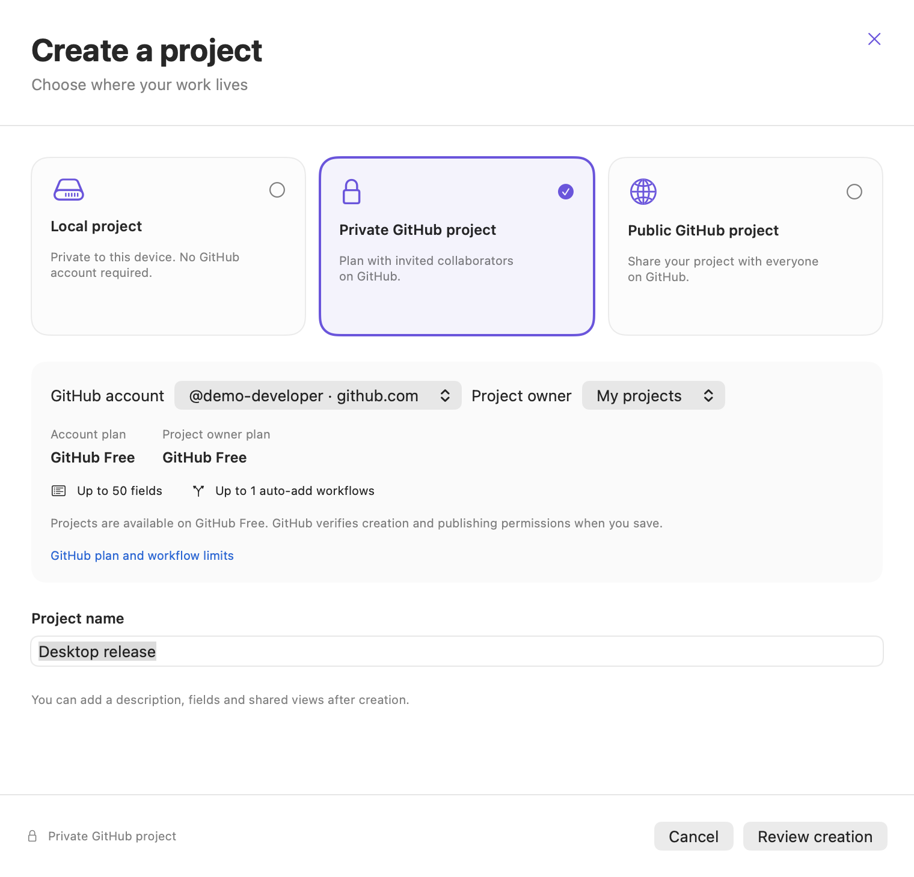
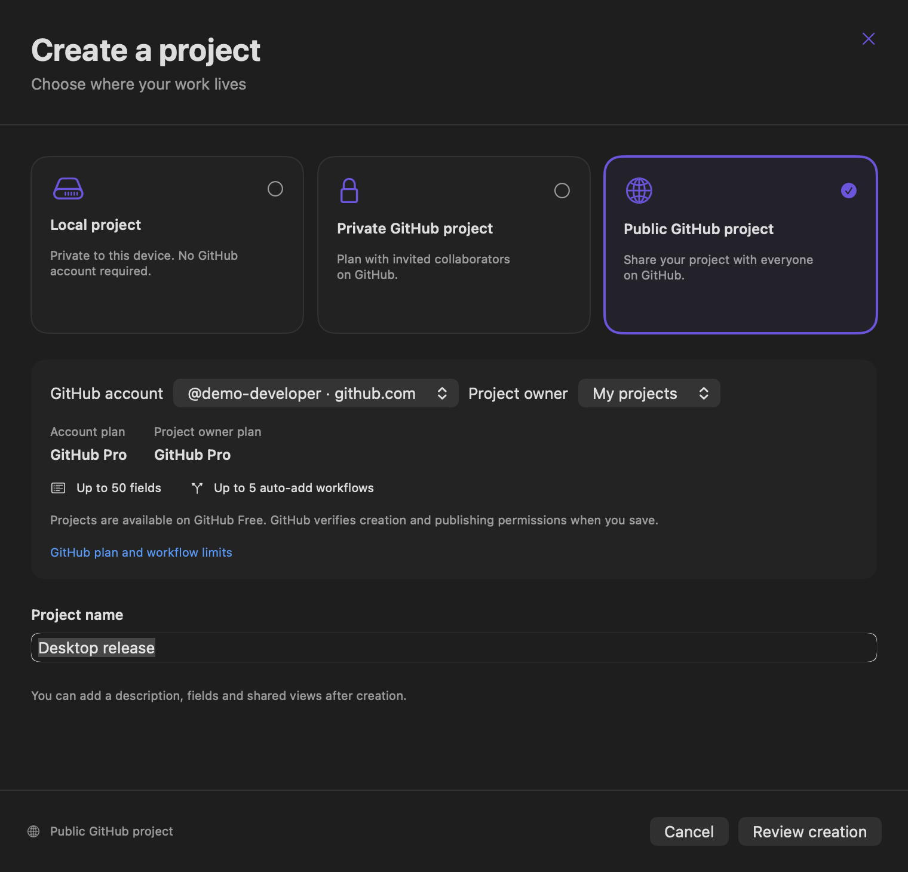
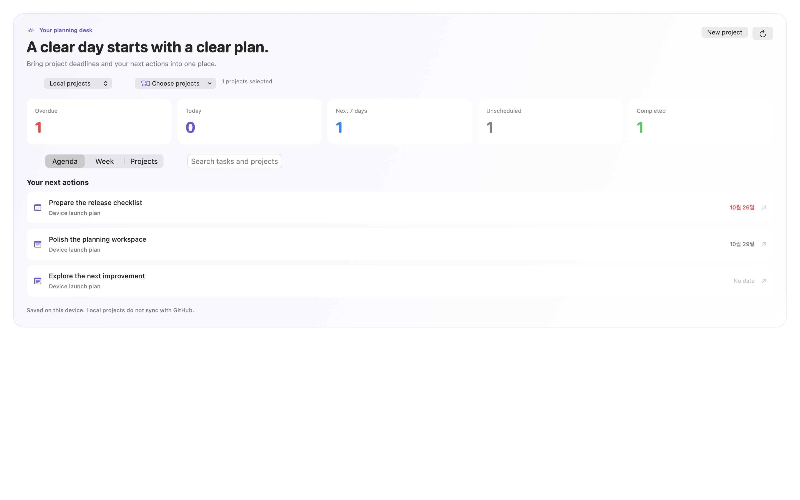
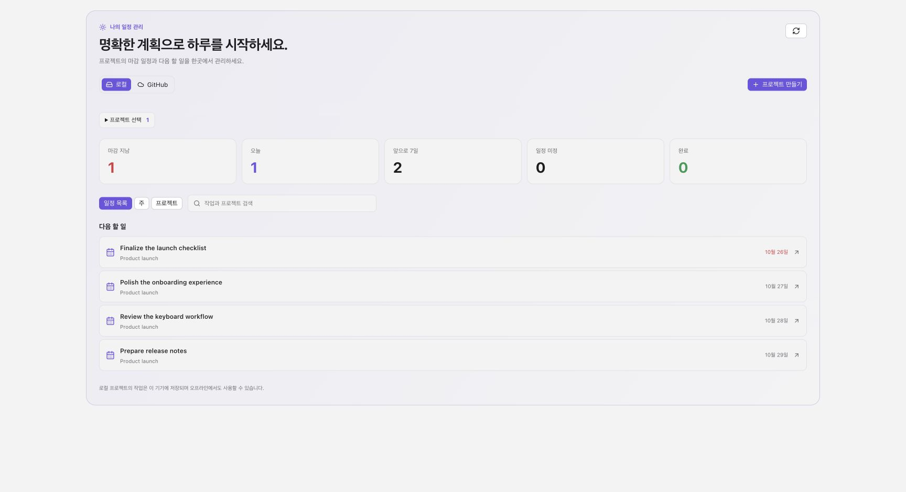

# Project sources and account capabilities

Home and Projects can work with a local planner or connected GitHub projects. The creation dialog offers Local, Private GitHub and Public GitHub projects, with a review of the destination and visibility before saving.

## Local planning

Local projects require no hosting account or token. Their tasks use the same Overview, Calendar, Board, Table and Roadmap as connected projects, including start/due dates, status, priority, assignees, descriptions, ordering, archive and bulk edits. Home can combine selected local projects into its agenda, week and project summaries. Completion and schedule preferences use a stable local namespace across account changes.

Local data stays in the application's private data directory. It is not uploaded to GitHub, converted into a repository, or synchronized between devices. The native macOS app and the Tauri app use separate application data directories. Current safeguards allow up to 1,000 projects, 10,000 tasks per project and a 50,000,000-byte document. These are local application limits, not GitHub subscription limits.

Storage uses a versioned JSON document, an operating-system file lock, compare-and-swap checks and atomic replacement. Stale edits fail with a refresh instruction. Corrupt or unreadable data does not become an empty document and cannot silently overwrite previous work. Multi-task changes and schedule range shifts save together. Local requests never enter the HTTP or account-credential path.

The local planner has built-in fields. GitHub-only functions—existing issue linking, draft-to-issue conversion, shared views, custom field management and browser links—are available for connected projects. This release does not add local collaboration, dependencies, recurring tasks or notifications.

## GitHub plans and permissions

The dialog reads the authenticated account's optional plan metadata and separately reads the selected project owner's plan when GitHub exposes it. Missing or unrecognized metadata is **Unknown**, never inferred as Free. An organization's project uses the organization's limits; a member's personal Pro subscription does not establish its organization's entitlement.

| Capability | Free | Pro | Team | Enterprise |
| --- | --- | --- | --- | --- |
| Public/private Projects | Available subject to owner and token permissions | Available subject to permissions | Available subject to permissions | Available subject to permissions |
| Total fields per project, including built-in fields | Up to 50 | Up to 50 | Up to 50 | Up to 50 |
| Auto-add item workflows per project | Up to 1 | Up to 5 | Up to 5 | Up to 20 |

The displayed numbers are documented ceilings, not remaining quota. The dialog does not claim to measure existing workflow usage. Creation and publishing permissions may remain unknown until GitHub validates the action. A paid plan does not grant a token access to Projects, organization membership, or permission to publish.

GitHub Free can use private projects. The app does not block private creation simply because an account is Free. It also does not use the deprecated classic Projects `viewerCanCreateProjects` field as a ProjectV2 entitlement.

GitHub creates projects privately. For Public creation the app explicitly publishes the returned project and checks the resulting visibility. If publication fails or the write outcome is uncertain, it preserves the created project reference when available and requires reconciliation. Pending creation attempts survive closing the dialog or restarting the app. A successful full project refresh clears the retry lock; a failed or incomplete refresh does not. The app never silently retries creation or upgrades an account.

Plan information checked against GitHub's official documentation on 2026-10-27:

- [Projects and the total-field limit](https://docs.github.com/en/issues/planning-and-tracking-with-projects/learning-about-projects/about-projects)
- [Auto-add workflow limits by plan](https://docs.github.com/en/issues/planning-and-tracking-with-projects/automating-your-project/adding-items-automatically)
- [GitHub account types](https://docs.github.com/en/get-started/learning-about-github/types-of-github-accounts)

## Validation

The backend checks use isolated storage and synthetic transports. They cover local persistence and restart, corrupt-data preservation, stale revisions, atomic bulk/date changes, remote/local source boundaries, unknown plans, owner/account plan separation, Free private creation and uncertain publication recovery. UI fixtures exercise the production views in light and dark themes; remote project writes are blocked in these fixtures. Final validation passed 539 Windows tests, four browser selftests, 56 macOS workspace/navigation scenarios, eight macOS creation scenarios, three native storage tests and both application builds. The macOS build retains its existing Keychain deprecation and Rust deployment-target linker warnings.

## Screenshots

Synthetic data, with no user accounts or projects:

