# Project workspace layout

The project workspace uses a consistent hierarchy: source and account, project title and primary task action, view navigation, then search and filters. The branch remains in the repository chrome. Local projects show task counts without empty issue or pull-request metrics.

Table headers and rows start at the top of the work surface, even with one task. Local tables omit the repository column. Board columns use neutral backgrounds and a compact empty state; cards display actual status, priority, dates and assignees when available. The roadmap keeps date-field configuration in a settings menu and places Schedule beside each undated task.

Normal task, date, field and project metadata edits save once. Editors show progress, prevent duplicate submissions and keep inputs when saving fails. Consequential operations retain a review with the captured project, affected items and an explicit action. Local task removal explains that the task is permanently deleted from the device. Public project creation reviews the destination and visibility inside the creation sheet.

Compact inspector actions wait for the inspector to close before presenting another editor or review, avoiding competing sheets. Existing account, context, stale-edit and uncertain-write guards remain in place.

Board columns include a focused task-title form. Return submits once, Escape cancels, and failed saves retain the title and show an inline error. Creating inside a column assigns the captured grouping option: local creation is atomic; remote creation uses the returned item ID, with uncertain results requiring refresh. Changing projects or grouping resets the form. The overview also offers direct New task and Open calendar actions.

The inspector groups assignees, status, priority, labels and dates. Status and priority can be changed directly in the inspector and table; local required fields cannot be cleared. Cards display available author and creation metadata, and merged pull requests retain their Merged badge.

Linked issues and pull requests show their opening description and a GitHub-style conversation, with actual author names, timestamps, Markdown and pagination. Refresh failures preserve the loaded discussion. The composer submits once with Command+Return on macOS or Control+Enter on Windows, retains failed input, and shows a factual posted notice after success. It never fabricates an appended server comment. A delayed result cannot clear a different task's draft. Local tasks do not expose a remote comment composer.

## Saved account access

On macOS, an offline verification, rate limit, permission error or server failure no longer discards a token that was successfully read from Keychain. Temporary Keychain denials preserve an already restored session. Saved accounts awaiting access are identified as connected accounts with an explicit restore action, rather than being presented as signed out. App activation silently retries eligible temporary failures with a minimum interval; missing, removed and rejected credentials are not automatically restored.

Development builds without a stable signing identity use ad-hoc signing. Replacing one of those builds may still require macOS Keychain approval. The session fix does not weaken Keychain access controls or store credentials outside Keychain. See [Apple's code-signing requirements](https://developer.apple.com/documentation/technotes/tn3127-inside-code-signing-requirements).

## Native previews

These screenshots use isolated synthetic projects; they contain no user data.

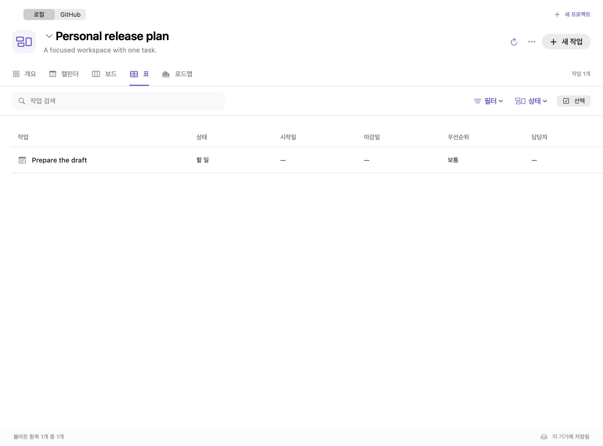

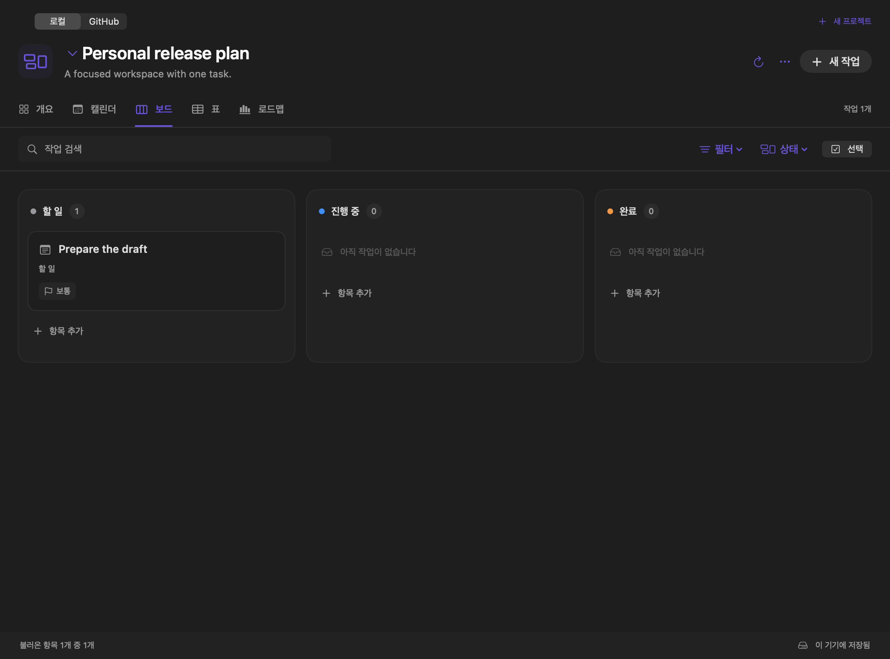

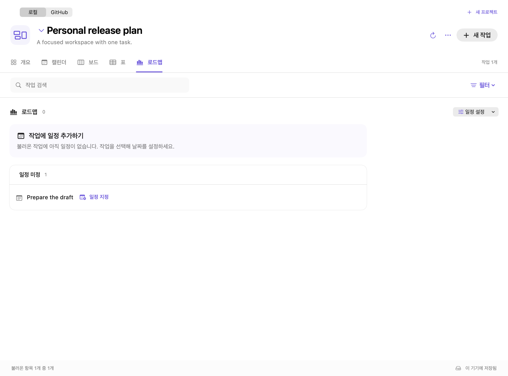

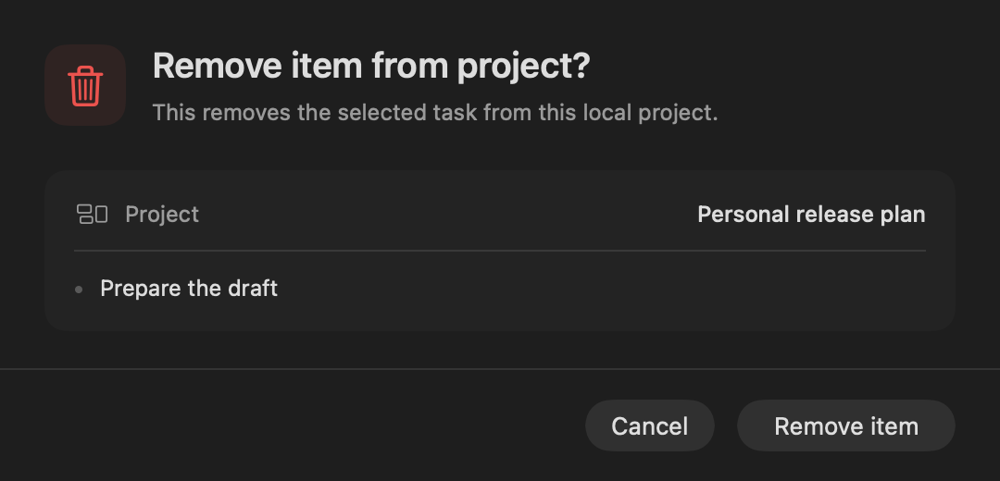

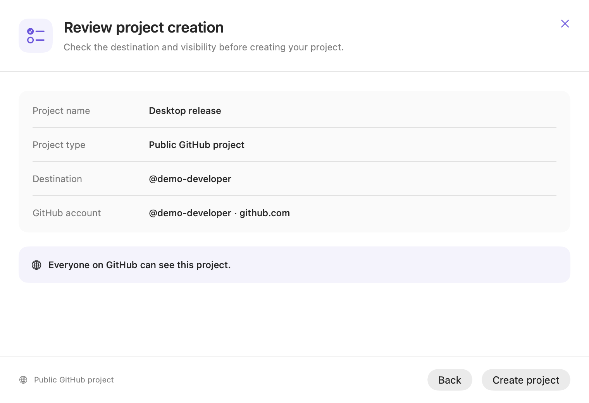

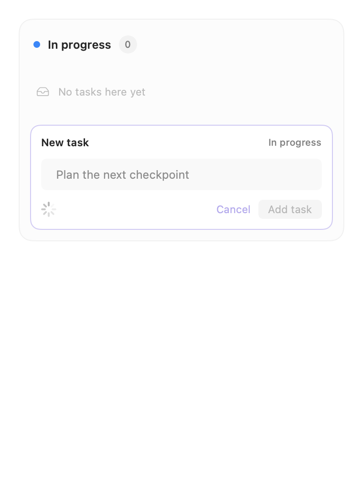

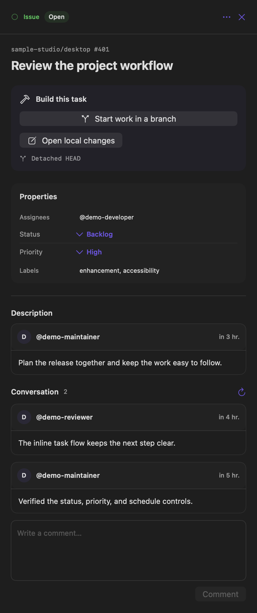

## Windows previews

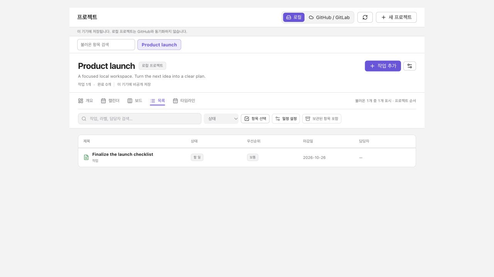

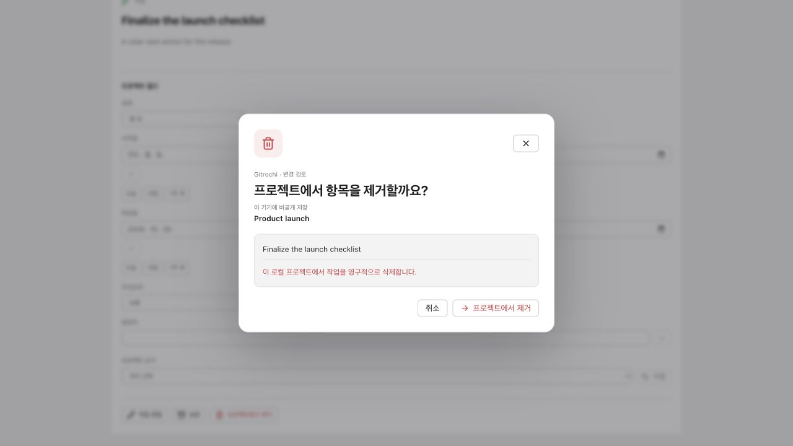

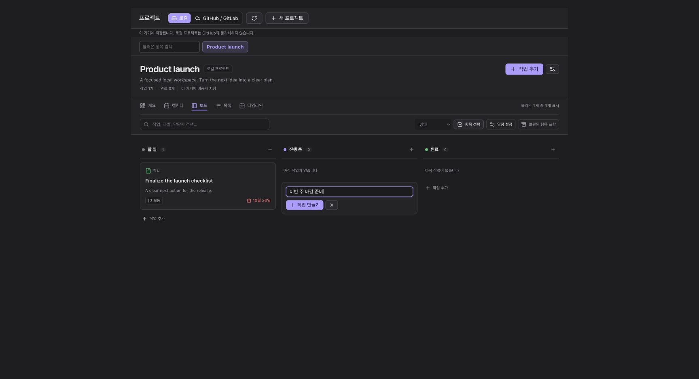

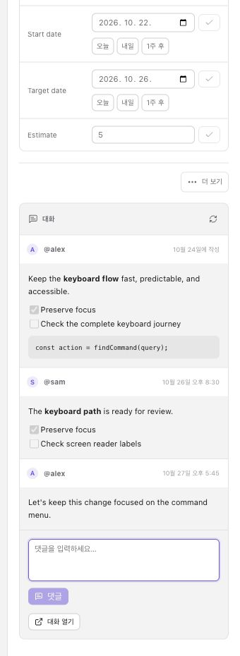

## Verification

- `npm run build` and `npm test` in `windows/`.
- Four real browser selftests: hosting projects, scheduling, Home portfolio and local planning.
- `bash macos/Tools/test-project-workspace-layout.sh`: production workspace, sparse table/board/roadmap, date editor, review and account-free local navigation in both themes and English/Korean.
- `bash macos/Tools/test-project-creation-layout.sh`: local, Free private, Pro public and unknown-plan creation forms/reviews in both themes, with remote writes blocked.
- `bash macos/Tools/test-project-task-creation.sh`: canonical field validation, atomic local creation and remote partial-write handling.
- `bash macos/Tools/test-credential-access.sh` and `bash macos/Tools/test-saved-account-verification.sh`: saved-access recovery, transient verification failures, token rotation and rejection/removal regressions.
- `bash macos/build.sh` and a read-only smoke check of the built application.

Native and browser fixtures use isolated preferences/storage and synthetic credentials. Conversations use synthetic read responses and injected write callbacks. The UI work does not touch Rust. The native build retains two existing Keychain deprecation warnings.

The expanded conversation and quick-add suite passed 104 native workspace/editor scenarios. The creation suite passed 20 scenarios, including temporary Keychain denial and unavailable saved credentials in both themes. Windows passed 552 tests in 65 files and four real browser selftests. Authentication regressions also cover legacy fallback rejection, temporary Keychain failures, newer-token rotation and account removal. The final native build completed and was relaunched for a read-only Korean board/inspector and quick-add cancellation smoke check. No real project or comment writes were used for validation.
